# 架构与依赖边界

Sakura 使用一个本机 Node.js 控制进程管理 QEMU 与原生辅助进程。React 和 CLI 通过 HTTP/WebSocket 使用同一控制面；业务能力按插件选择激活。

```mermaid
flowchart TD
  UI[React 应用与状态 hooks] --> HTTP[HTTP / WebSocket 接入]
  CLI[CLI] --> HTTP
  App[应用装配与资源生命周期] --> HTTP
  HTTP --> Gateway[操作契约与权限复核]
  Gateway --> Plugins[插件协议与作用域能力]
  Gateway --> Execution[项目命令与终端]
  Execution --> Preparation[项目准备与租约]
  Plugins --> Domain[业务服务]
  Preparation --> Machines[VM 生命周期与操作锁]
  Domain --> Machines
  Machines --> Transport[SSH / SFTP 传输]
  Machines --> Storage[VM 存储操作]
  Machines --> Runtime[PosixLoom / QEMU]
  Transport --> Network[必需网络核心与有界 worker 池]
  Runtime --> Network
  Domain --> Network
  Contracts[共享契约与功能目录] -.-> UI
  Contracts -.-> HTTP
  Contracts -.-> Domain
  Domain --> Host[HostRuntime 原子预算与所有权]
  Plugins --> Host
  Network --> Host
  Storage --> Host
  Runtime --> Host
  Domain --> Jobs[Jobs 与普通周期 Scheduler]
  Domain --> Compute[有界计算工作线程]
  Jobs --> Host
  Compute --> Host
  Domain --> Metadata[按文件串行的 MetadataStore]
```



## 入口与生命周期

- `server/index.ts` 只启动应用并报告启动失败。
- `server/application.ts` 是组合入口，负责构造服务、绑定宿主能力和安装接入检查。
- `server/network/` 是始终启用的网络核心；启动时预检 worker，退出先 drain，待插件与 VM 清理后关闭连接和网络子进程。
- `server/http-machines.ts` 处理基础实例 API，只能在宿主鉴权、授权、会话锁与维护检查之后调用。
- `server/resource-scope.ts` 在资源构造后、异步初始化前登记清理。启动失败和正常退出使用同一登记表；清理顺序保留既有服务依赖，单项失败不会跳过其余资源。VM 管理器接管运行时后，撤销运行时的独立登记，避免重复关闭。
- `server/operation-scope.ts` 提供操作计数和请求取消范围。进入操作取得可重复释放的凭证，请求结束在 `finally` 中释放；请求断开会取消工作并移除监听器。鉴权和业务准入仍在各自边界执行。

## 操作入口

`OperationGateway` 是核心、插件 HTTP 和 WebSocket 的共同准入入口。`core-operations.ts` 与插件贡献汇总为 302 个精确操作声明（其中 6 个 WebSocket），同一目录驱动运行路由检查、`/api/operations`、OpenAPI 和 SDK。未声明的路径与方法被拒绝，固定路径优先于参数路径；停用插件的操作无法通过准入。

请求开始时捕获凭证、项目和原 VM 运行身份，在读取正文后以及任务、进程、存储等资源排队结束后重新核对权限、维护状态和身份。长连接沿用撤权关闭协议；启停等生命周期操作允许自身推进状态，不复用旧运行身份。权限复核读取最后原子发布的元数据，避免持有资源时反向等待自身的配置写队列。guest interop 保留专用认证，并在宿主进程获准后重验令牌、程序配置和 EXE 摘要。

核心 JSON 正文通过声明的 schema 校验；二进制、流和 SAML 保留原协议解析。尚未提供完整响应 schema 的旧接口在目录中标记 `partial`，不将路由和权限统一等同于全部旧接口已有完整类型化响应。

## 契约与公共原语

`shared/contracts/` 存放 VM、任务与控制面数据契约。契约不能依赖 Node.js 或服务实现。错误类型和输入路径校验分别位于 `shared/errors.ts` 与 `shared/paths.ts`；宿主的数据路径、环境配置和磁盘目录映射属于 `server/paths.ts`。

`shared/catalogs/` 保存自动化、工程与平台功能的纯目录和展示类型。功能聚合服务仍执行原有业务流程，目录消费者无需加载这些服务。

POSIX 参数转义位于 `server/shell.ts`，项目配置和版本指纹位于 `server/project-config.ts`。调用者直接导入这些模块，不通过文件服务或工作区服务获取公共函数。

`server/model.ts`、原桌面偏好入口及原业务模块中的相关导出继续作为兼容入口，供现有脚本、测试和外部调用使用。

## 插件服务

插件声明、服务实现和界面入口继续同包维护。`plugins/<id>/services.ts` 声明提供者拥有的 `ServiceRef<T>`：

```ts
import { services } from './services.ts';

host.provide(services.commands, new CommandPresets(host.machines, host.workspaces));
const commands = host.use(services.commands);
```

服务引用携带提供者、键和类型。宿主仍校验服务归属及直接依赖；新的服务不需要给 `Features` 增加字段。`Features` 使用一份 Map 保存所有服务，旧内置字段通过兼容访问器读取同一份数据。旧字符串形式保持 API v3 兼容，业务代码优先使用提供者声明的引用。

插件激活顺序、请求取消、错误隔离和退出清理继续由 `Features` 管理。服务引用及依赖检查是可信插件的协议约束，不是第三方代码安全沙箱。

插件网络能力通过 `ctx.networking` 获得，身份与插件作用域由宿主分配，随插件取消和退出回收。可选 `network` 插件的网络档案等业务服务与必需网络核心各有生命周期，停用前者不会移除后者。

同一作用域提供 `execution`、`storage`、`jobs` 和诊断能力。宿主固定 owner 与插件身份，排队和活动任务都响应作用域撤销；卸载会停止新准入、按依赖关闭服务，并等待真实清理。清理失败时保留原作用域和资源，重试只处理未完成部分。兼容的服务引用继续经过宿主依赖检查。

现有 `Machines`、`dataFile` 和 `ServiceRef` 兼容接口仍保留；底层资源适配器与源码边界检查约束这些调用。不能据此宣称所有插件都只接触新能力接口，或者可信进程内插件已经具备操作系统沙箱。

## 网络与传输边界

`NetworkRuntime` 统一登记连接、监听、本地管理通道和 VM generation；`NetworkScope` 为服务提供 HTTP(S)、fetch、WebSocket、TCP、DNS 和 SDK 适配器。宿主原始 TCP/DNS 由有界 Node worker 池承载，HTTP/SSH 协议与 TLS 仍在主进程适配器执行。本地管理和原生适配器有独立的准入与取消登记；GPG relay 继续执行 peer PID、nonce 与回执验证。

VM 网络由另一组 Node worker 管理无客户机 CPU 的 QEMU user/slirp 后端；客户机 QEMU 仅通过 Ethernet stream 接入。每个 VM 固定 worker，worker 故障会停止受影响的 VM，不迁移活动 NAT 状态或重放连接。默认网络子进程上限为 8；此数字不包括客户机 QEMU 和其他辅助进程，也不代表单个 VM 的多核 NAT。

配置、管理通道、诊断接口、发布资产及兼容性详见 [统一网络运行时](network-runtime.md)。这是一套资源归属与代码边界，进程内可信插件并非 OS 沙箱，任意第三方代码仍须独立审查。

## VM 与项目执行

`Machines` 保留外部入口、VM 运行身份、操作锁和生命周期所有权；`MachineTransport` 承担 SSH、命令输入与 SFTP 传输，存储复制和身份文件写入使用独立模块。传输通过原宿主取得连接，保留替换运行身份检查、取消和客户端归属。

`ProjectPreparation` 负责项目配置捕获、准入检查、串行准备和准备租约。普通任务通过 `prepareTask` 使用这层，`ProjectTerminals` 在同一准备层上维护终端运行与共享会话。任务取消不提前释放租约；完整执行清理完成后由调用者释放。配置变更、目录迁移和服务关闭继续等待准确的租约归属。

目录迁移门闩的只读准入检查位于 `project-admission.ts`，运行作用域不再导入整个目录迁移服务。固定 UID/GID、客户机运行记录、cgroup 和原生启动器的协议保持原有行为。

`VmLifetime` 区分进程身份、执行代次、boot 与网络代次；附件和活动绑定原始 Live。`ExecutionScope` 将短任务的全局、VM 和项目额度一起取得，嵌套执行显式借用父作用域。`ProjectSessionLifetime` 为主进程、服务、SSH、终端、LSP/DAP 和单应用窗口持有独立的常驻会话额度。VM 停止先阻止新准入，再取消并等待原作用域清理；失败不能由“VM 已退出”或任意资源 ID 直接核销，恢复必须拿原票据和原清理回调再次确认。

`ProcessSupervisor` 为 VM、工具和常驻 helper 统一登记进程额度。Windows 有限工具通过 Native Host Job Object 执行，确认所属进程树退出后释放；原生 GPG、剪贴板等长连接保留各自握手和退出回执。POSIX 的直接子进程观察仅用于固定工具探针与已有明确协议的 helper，不宣称单个 `close` 事件能证明任意后代退出。显式启动交给用户的桌面程序经过所有权移交。

启动时已知的 Native Host 包装进程与目标进程原子预留两个总进程额度，以及一个 VM 或工具分类额度；直接 helper 占一个总额度。原生进程树未确认退出时保留完整预留。总额度用于已知启动参与者的并发准入，不能当作任意 EXE 后代数量的操作系统硬上限。

## 前端

`src/main.tsx` 负责样式、语言包和应用挂载。`src/app/App.tsx` 组合页面、导航与交互；实例表单和通用界面元素各自维护。

`useControllerState` 统一实例数据、控制面状态、事件刷新、请求去重和响应顺序保护。`useProjectSelection` 管理按 VM 保存的项目选择、加载取消与重试。会话凭证仍由 `controller-session.ts` 管理；插件界面保持懒加载。

插件与管理页面的 `useRemote` 通过 `resource-cache.ts` 按请求能力和完整路径/查询参数共享读取、缓存与轮询。同一资源的订阅者共用正在进行的请求；最后一位订阅者离开才取消该请求。写操作按 VM 或接口前缀失效关联数据，事件和断线重连重新校准活动订阅；旧代响应不能覆盖刷新结果。内容未变的 JSON 子树保留引用，避免刷新意外清空表单草稿或预览。账户切换和会话锁会立即清除缓存，后台页面暂停轮询，缓存数量与空闲保留时间都有上限。任务展示单独区分等待额度、执行、取消中、清理待确认和重启后待核对。

## 系统资源治理

公共资源治理位于 `server/host-runtime/`。同一进程内的 `hostRuntime` 原子预留多种资源预算，提供有界等待、按所有者公平准入、取消与超时、控制通道预留及资源诊断。分区额度仅在有活动或等待引用时保留；等待期间不占用部分预算。取消不会自动归还已经授予的额度，所有者确认实际清理后才调用 `release()`；无法确认清理的资源保持 `cleanup-pending`。

`ResourceScope` 登记服务所有权，支持子作用域、命名关闭阶段与显式重试失败清理；成功释放的资源不会重复清理。执行身份采用不可变异步上下文，现有审计 span 将 trace、调用者和项目身份带入资源登记。`GET /api/host-runtime` 在现有会话与账户权限之后提供管理员诊断，包含预算、等待、活动与近期资源，不收集执行参数或凭据。

全系统迁移范围、调用路径与验收结果记录在 [系统资源架构实施记录](system-runtime-plan.md)。

普通周期工作通过 `Scheduler` 登记 owner、周期、重叠策略和失败退避，再由 `Jobs` 取得宿主预算。日志清理、维护、内存采样、共享目录校准、证书续期、服务与入口健康检查、构建调度、宿主状态刷新、Webhook、社区插件事件和远程审计均使用这条路径。调度器使用独立身份，不继承注册请求的账户、VM 或任务额度；构建队列派生的独立构建各自准入。协议超时和高可用心跳仍保留专用时限。应用先停止新调度并取消已派发工作，再按依赖顺序等待实际收尾；`/api/host-runtime` 同时提供周期任务状态。

`Jobs` 的有界等待与可见任务历史分开：历史不是外部副作用的执行承诺。嵌套任务借用父任务槽位并串行协调子任务，依赖环直接拒绝。`HostRuntime` 与委托任务在出队后再次执行原操作权限检查，检查失败归还尚未交付的预算；控制清理不被调用者撤权阻断。独立调度清除请求权限上下文。

计算密集的文件预览与社区 WASM 通过同一 `ComputeRuntime` 按需创建线程，受总线程数和内存预算限制，实际退出后归还额度。固定工程源码仅压缩一次。测量、输入边界、故障处理和发布校验见 [计算运行时](compute-runtime.md)。

大文件操作经 `StorageRuntime` 取得宿主/设备 I/O、缓冲、文件句柄和暂存空间预算；增量空间在写入前扩充额度。备份、同步、镜像、bundle、对象存储和目录迁移共享这些约束。双向传输给接收端保留预算，避免双方都占满写入槽后互等。备份发布日志与既有迁移、同步和原生恢复票据各自保留权威，详见 [存储运行时](storage-runtime.md)。

## 持久化与验证

本次调整保持 JSON、实例目录、增量磁盘以及插件选择格式不变。内存快照指纹新增 `networkBackend: 'sakura-managed-user-v1'`，旧后端的内存快照不能恢复，磁盘快照不受影响。`MetadataStore` 与旧 `readStore` / `writeStore` 共用按文件串行的有界队列，完整读改写、版本冲突检查和缓存发布各有明确顺序。应用关闭先等待领域资源，再 flush 元数据；真实写入失败未修复时保留目录归属。跨宿主文件和客户机状态的操作继续使用各自的运行记录、锁和恢复流程。

应用在初始化业务存储前，由 `DataDirectoryOwner` 取得规范化数据目录的 OS 独占归属。Windows 使用命名管道，Linux 使用抽象 Unix socket；进程强制退出也会释放，无需根据可能复用的 PID 删除锁文件。其它平台采用固定回环端口，端口冲突会拒绝启动。归属端点经过同一网络层实现管理，但保留独立的最后关闭阶段；领域资源清理未确认时不提前交还目录。目录迁移可以在目标不存在时先取得归属，发布后仍保持同一个锁。此机制针对同一宿主 OS 命名空间，不是网络共享目录的分布式锁。

`npm run architecture:check` 检查源码中的急切运行时导入与再导出，拒绝循环依赖，以及浏览器和共享模块直接或经辅助模块引用服务端实现、Node.js 内置模块。类型引用和动态导入不计入初始化依赖图；网络检查另行追踪插件服务与发布脚本的静态、动态本地依赖，拒绝仓库代码绕过托管传输。该检查已纳入 `npm run verify`，并有循环依赖、间接边界、网络别名、插件辅助模块与发布脚本的回归测试。

资源检查进一步拒绝适配器以外的 `child_process` 和 Worker 构造、普通服务的周期定时器、插件直接导入私有资源入口，以及未经审核的直接 JSON 发布和旧 S3 Upload 管线。HA、会话安全期限与专用恢复票据采用精确文件清单保留原协议；新增例外必须有明确领域理由。原生长连接通过预算已授予的同步 `spawnObserved` 能力构造，缺少准入上下文时不能启动进程。静态规则用于发现常见源码绕行，不能验证任意生成代码。

结构调整应复用项目身份、配置捕获、迁移、传输、插件隔离和浏览器回归。宿主资源范围另有初始化失败、清理失败、所有权转移和操作计数测试。
