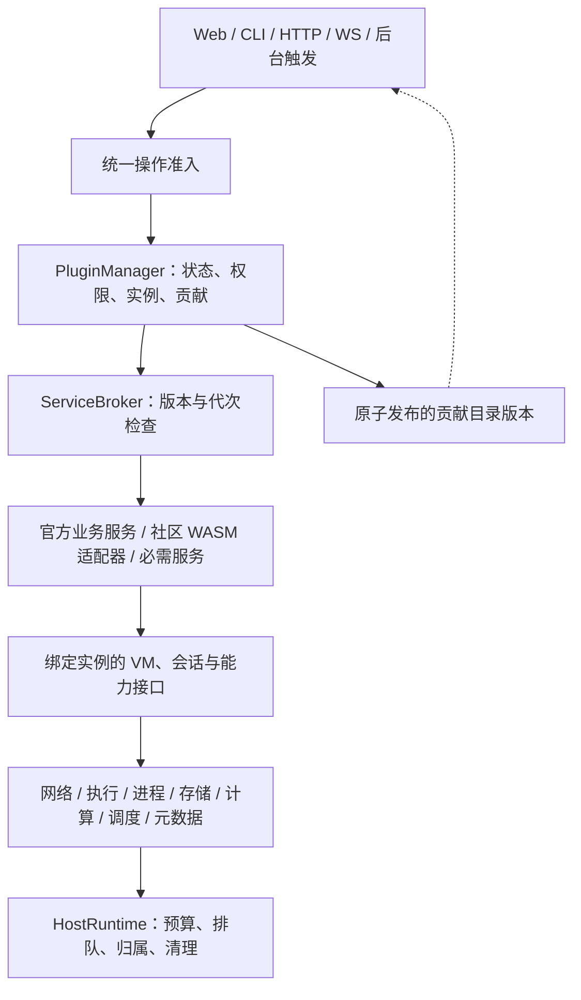

# 架构与依赖边界

Sakura 使用一个本机 Node.js 控制进程管理 QEMU 与原生辅助进程。React 和 CLI 通过 HTTP/WebSocket 使用同一控制面；业务能力按插件选择激活。

基于应用 2.5.0 / 插件 API 5 的逐层接口、权限、资源归属、失败与验收要求见 [插件设计契约与统管层接口](plugin-design-contract.md)。



## 入口与生命周期

- `server/index.ts` 只启动应用并报告启动失败。
- `server/application.ts` 只组合数据目录归属、运行时排空、服务装配与传输入口；`application-services.ts` 声明服务生命周期，`application-http.ts` 和 `application-websocket.ts` 分别负责 HTTP 与 WebSocket 适配。
- `ServiceLifecycle` 检查 `requires` 的缺失与循环，执行 `create → initialize`，初始化成功后 `SystemServices` 才向 Broker 和插件目录发布。`lateRequires` 声明仅在整体就绪后使用的回调依赖，开放入口前统一核验，排空后拒绝新的回调业务；`disposeRequires` 声明已准入工作在排空时仍需保留的依赖。关闭按真实生命周期依赖倒序；独立服务沿用排空阶段，失败消费者保留其依赖供原清理回执重试。协作宿主入口在整体装配就绪前拒绝业务请求。
- `server/network/` 是始终启用的网络核心；启动时预检 worker，退出先 drain，待插件与 VM 清理后关闭连接和网络子进程。
- `server/http-machines.ts` 处理基础实例 API，只能在宿主鉴权、授权、会话锁与维护检查之后调用。
- 系统服务默认 `startup: 'required'`。安全、身份、策略及官方插件必需服务保持启动必需；明确标记的 12 项附属服务可降级，失败先清理原实例，未确认清理保留 `cleanup-pending` 与依赖。插件中心显示真实失败状态，相关 API 返回 `SERVICE_UNAVAILABLE`；缺失必需、延迟或清理依赖的消费者不能伪装就绪。
- `core-http-handlers.ts` 组合公共登录、账户、项目、附属功能、系统诊断、宿主能力和插件管理处理器；领域处理器显式登记操作 ID，只声明所需服务端口。`application-http.ts` 负责传输、准入、审计与结果回执。未选官方插件只登记其禁用路由，不导入实现；启用模块在激活时验证处理器，CI 仍检查全部插件。
- `server/resource-scope.ts` 在资源构造后、异步初始化前登记清理。启动失败和正常退出使用同一登记表；服务装配同时登记物理依赖，清理失败会保留其所需插件、VM、网络等资源，独立资源继续收尾。VM 管理器接管运行时后，撤销运行时的独立登记，避免重复关闭。
- `server/operation-scope.ts` 提供操作计数和请求取消范围。进入操作取得可重复释放的凭证，请求结束在 `finally` 中释放；请求断开会取消工作并移除监听器。鉴权和业务准入仍在各自边界执行。

## 操作入口

`OperationGateway` 是核心、插件 HTTP 和 WebSocket 的共同准入入口。`core-operations.ts` 与插件贡献汇总为 308 个精确操作声明（302 个 HTTP、6 个 WebSocket），同一目录驱动运行路由检查、`/api/operations`、OpenAPI 和 SDK。身份、角色、项目权限、会话锁、VM 锁、维护行为、副作用、审批与传输契约由各操作显式声明，不根据路径、HTTP 方法或 ID 推断。声明绑定处理器后才能封闭发布；缺少策略、处理器或精确路由声明会被拒绝。固定路径优先于参数路径；停用插件的操作无法通过准入。

请求开始时捕获凭证、项目和原 VM 运行身份，在读取正文后以及任务、进程、存储等资源排队结束后重新核对权限、维护状态和身份。长连接沿用撤权关闭协议；启停等生命周期操作允许自身推进状态，不复用旧运行身份。权限复核读取最后原子发布的元数据，避免持有资源时反向等待自身的配置写队列。guest interop 保留专用认证，并在宿主进程获准后重验令牌、程序配置和 EXE 摘要。

当前 302 个 HTTP 操作均声明无正文、JSON、表单或二进制请求传输，以及对应 query/header 和公开响应契约；SAML 等入口保留其原协议解析。响应写出前统一核对结构、状态和媒体，6 个 WebSocket 通道声明方向、编码和尺寸界限。`shared/contracts/api-client.generated.ts` 从同一目录生成请求、响应与路径类型，SDK 与类型客户端共用请求编码；动态扩展数据使用明确的 JSON 值类型。`shared/api-client.ts` 适配已有鉴权与取消传输，生成文件差异检查已纳入插件门禁。内部 unknown 参数与动态业务字段不代表已拥有固定领域结构。

操作结果回执分别记录业务 outcome、是否进入业务、响应校验、审计和交付状态。响应或审计失败不覆盖原业务错误，也不证明业务没有执行；客户端可通过 `GET /api/operation-results/{correlationId}` 查询当前账户/会话的原结果后，再决定是否按领域协议重试。

JSON 写操作在分配回执前有界读取、校验正文，处理器复用同一请求缓存并保留自身限额和取消检查。领域明确证明未发生目标副作用的认证拒绝记为 `failed / executed=false`，不能按所有 4xx 推断失败。普通、恢复管理和认证分别保留 2000、32、64 个在线位置；认证池覆盖密码登录、会话解锁及登录/解锁所需的通行密钥步骤，未知结果不自动淘汰。管理员通过 `GET /api/operation-results` 核对容量和原文摘要，再以 `POST /api/operation-results/archive` 明确归档；归档先持久保留原文、摘要、操作者和原因，再释放在线位置，重试不改变原 outcome。归档本身经过鉴权和审计，但不占用已满回执池。档案及合法命名的中断临时文件合计最多 4096 条、64 MiB；临时文件原样保留且不作为已提交档案，显式重试仍核验在线原文。满额、非法目录项或已提交档案损坏时保留证据并要求管理员处理。

恢复操作可通过管理员凭证调用以上接口：从诊断记录取得 `correlationId` 与 `digest`，在原业务领域核对后提交 `{ correlationId, digest, reason: 'checked-in-domain', acknowledgeUnknown: true }`；仅人工核对时 reason 为 `reviewed-manually`。`archiveAvailable: false` 的记录不能直接归档，活跃操作应等待结束。摘要冲突必须刷新再核对；归档不证明原业务成功，不授权盲目重放原操作。若账户授权相关附属服务不可用，改密或删除账户仍会拒绝执行，避免跳过旧授权的撤销。

## 契约与公共原语

`shared/contracts/` 存放 VM、任务与控制面数据契约。契约不能依赖 Node.js 或服务实现。错误类型和输入路径校验分别位于 `shared/errors.ts` 与 `shared/paths.ts`；宿主的数据路径、环境配置和磁盘目录映射属于 `server/paths.ts`。

`shared/catalogs/` 保存自动化、工程与平台功能的纯目录和展示类型。功能聚合服务仍执行原有业务流程，目录消费者无需加载这些服务。

POSIX 参数转义位于 `server/shell.ts`，项目配置和版本指纹位于 `server/project-config.ts`。调用者直接导入这些模块，不通过文件服务或工作区服务获取公共函数。

`server/model.ts`、原桌面偏好入口及原业务模块中的相关导出继续作为兼容入口，供现有脚本、测试和外部调用使用。

## 插件服务

插件声明、服务实现和界面入口继续同包维护。`plugins/<id>/services.ts` 声明提供者拥有的 `ServiceRef<T>`：

```ts
import { services } from './services.ts';

host.provide(services.commands, new CommandPresets(host.vm, host.workspaces));
const commands = host.use(services.commands);
```

`PluginManager` 是统一管理入口，`PluginDirectory` 是实际状态的唯一来源；`PluginRuntime` 执行可信模块生命周期，`Features` 只保留组合入口名称。官方、社区和必需系统服务分别使用 `official:`、`community:`、`system:` 身份。每次激活固定版本、产物 SHA-256、代次、权限、取消信号与资源作用域。用户期望选择与实际状态分别展示，官方选择变更仍明确提示重启。

`server/service-contracts/v1.ts` 独立定义版本化接口，不导入服务实现；`ServiceRef` 绑定稳定契约 ID，运行时描述符只从这些接口生成。实现类新增公开方法不会扩大跨插件接口，Broker 不按类名发现成员。消费者必须声明直接依赖；可选发现不增加卸载阻挡，实际在途调用由消费者和提供者的作用域共同观察。两端原代实例取得只读、可撤销的句柄，嵌套对象、缓存方法和原清理回执仍受控。每次调用与资源出队都检查权限、代次及原操作身份。提供者重新激活不会恢复旧句柄。

插件网络能力通过 `ctx.networking` 获得，身份与插件作用域由宿主分配，随插件取消和退出回收。可选 `network` 插件的网络档案等业务服务与必需网络核心各有生命周期，停用前者不会移除后者。

独立冻结的上下文提供 `vm`、`execution`、`storage`、`networking`、受管 Jobs、会话和不透明元数据回执，没有 `compat.machines`、原始 `Machines`、可写全局槽位或 `dataFile`。业务实现也使用实例绑定的 `VmAccess`；VM 记录只读，SSH/SFTP 保留句柄在每次新命令时复核权限与 VM 身份，不能取得内部 socket。Jobs、网络范围、周期任务和事件注册捕获创建它们的实例，后台触发清除旧请求身份并恢复正确资源归属。

退出先停止准入、撤销触发与连接，再等待原代在途工作和实际清理。超时或清理失败进入 `cleanup-pending`，保留产物、预算、作用域和恢复回执，禁止新实例覆盖。清理回执只关闭原资源，并可在业务撤权后重试。官方可信模块仍与宿主共享进程；社区代码只运行在现有无宿主导入的签名 WASM 计算边界内。

五批迁移范围与验证说明见 [统一插件管理实施记录](plugin-system.md)。

## 网络与传输边界

`NetworkRuntime` 统一登记连接、监听、本地管理通道和 VM generation；`NetworkScope` 为服务提供 HTTP(S)、fetch、WebSocket、TCP、DNS 和 SDK 适配器。宿主原始 TCP/DNS 由有界 Node worker 池承载，HTTP/SSH 协议与 TLS 仍在主进程适配器执行。本地管理和原生适配器有独立的准入与取消登记；GPG relay 继续执行 peer PID、nonce 与回执验证。

VM 网络由另一组 Node worker 管理无客户机 CPU 的 QEMU user/slirp 后端；客户机 QEMU 仅通过 Ethernet stream 接入。每个 VM 固定 worker，worker 故障会停止受影响的 VM，不迁移活动 NAT 状态或重放连接。默认网络子进程上限为 8；此数字不包括客户机 QEMU 和其他辅助进程，也不代表单个 VM 的多核 NAT。

配置、管理通道、诊断接口、发布资产及兼容性详见 [统一网络运行时](network-runtime.md)。这是一套资源归属与代码边界，进程内可信插件并非 OS 沙箱，任意第三方代码仍须独立审查。

## VM 与项目执行

`Machines` 保留外部入口、VM 运行身份、操作锁和生命周期所有权；`MachineTransport` 承担 SSH、命令输入与 SFTP 传输，存储复制和身份文件写入使用独立模块。传输通过原宿主取得连接，保留替换运行身份检查、取消和客户端归属。

磁盘加密事务与崩溃恢复由 `VmDiskEncryption` 持有，沙箱期限与停止由 `SandboxLifetimes` 持有，HA 见证与退役票据由 `VmHaAuthority` 持有。`HostPeers` 通过 `PeerMigrationSessions` 管理迁移会话、隧道及关闭回执，通过 `PeerReplicaOperations` 执行副本协议。资源所有者只接收所需端口，不反向导入协调入口。`scripts/domain-boundaries.ts` 声明领域依赖矩阵，架构门禁同时检查类型、静态与动态导入；新增领域模块必须明确所有权与允许依赖。

`VmSnapshots` 持有快照身份文件、磁盘捕获及离线恢复/编辑；`VmStoragePlacement` 持有迁池复制、校验、提交、回滚和清理票据。`Machines` 继续持有 Live、操作锁、状态转换及 RAM 恢复。`vm-ports.ts` 独立声明内部 VM 能力端口，`VmAccess` 组合这些端口，不再从 `Machines` 推导签名；快照比较、合并、复制及存储池使用各自需要的窄接口。该拆分保持原资源所有权和 V1 公共服务兼容性。

`ProjectPreparation` 负责项目配置捕获、准入检查、串行准备和准备租约。统一 `TerminalBackend` 持有终端后端，基础终端、插件终端和共享观看取得独立子句柄。退出只回收自身租约；任务取消不提前释放租约。配置变更、目录迁移和服务关闭按同一个宿主身份检查准确归属。文件替换、工作区配置和启动附件采用可注销的受管注册。

目录迁移门闩的只读准入检查位于 `project-admission.ts`，运行作用域不再导入整个目录迁移服务。固定 UID/GID、客户机运行记录、cgroup 和原生启动器的协议保持原有行为。

`VmLifetime` 区分进程身份、执行代次、boot 与网络代次；附件和活动绑定原始 Live。`ExecutionScope` 将短任务的全局、VM 和项目额度一起取得，嵌套执行显式借用父作用域。`ProjectSessionLifetime` 为主进程、服务、SSH、终端、LSP/DAP 和单应用窗口持有独立的常驻会话额度。VM 停止先阻止新准入，再取消并等待原作用域清理；失败不能由“VM 已退出”或任意资源 ID 直接核销，恢复必须拿原票据和原清理回调再次确认。

`ProcessSupervisor` 为 VM、工具和常驻 helper 统一登记进程额度。Windows 有限工具通过 Native Host Job Object 执行，确认所属进程树退出后释放；原生 GPG、剪贴板等长连接保留各自握手和退出回执。POSIX 的直接子进程观察仅用于固定工具探针与已有明确协议的 helper，不宣称单个 `close` 事件能证明任意后代退出。显式启动交给用户的桌面程序经过所有权移交。

启动时已知的 Native Host 包装进程与目标进程原子预留两个总进程额度，以及一个 VM 或工具分类额度；直接 helper 占一个总额度。原生进程树未确认退出时保留完整预留。总额度用于已知启动参与者的并发准入，不能当作任意 EXE 后代数量的操作系统硬上限。

## 前端

`PluginGeneration` 按来源、插件身份、代次、权限与产物维护独立取消范围。资源缓存同时记录请求消费方与路由提供方，插件变化只清理相关分区；会话切换仍清理整个会话。插件页面、标签、开发面板和社区扩展使用独立错误边界，重试只重新创建失败的界面入口；旧代异步结果在提交前再次检查，基础终端与导航不随插件故障重建。

`src/main.tsx` 负责样式、语言包和应用挂载。`src/app/App.tsx` 组合页面、导航与交互；实例表单和通用界面元素各自维护。

`useControllerState` 统一实例数据、控制面状态、事件刷新、请求去重和响应顺序保护。导航、插件中心和面板消费宿主已发布且运行中的贡献；插件目录代次变化时取消请求、失效缓存并忽略旧响应。`useProjectSelection` 管理按 VM 保存的项目选择、加载取消与重试。会话凭证仍由 `controller-session.ts` 管理；插件界面保持懒加载。

插件与管理页面的 `useRemote` 通过 `resource-cache.ts` 按请求能力和完整路径/查询参数共享读取、缓存与轮询。同一资源的订阅者共用正在进行的请求；最后一位订阅者离开才取消该请求。写操作按 VM 或接口前缀失效关联数据，事件和断线重连重新校准活动订阅；旧代响应不能覆盖刷新结果。内容未变的 JSON 子树保留引用，避免刷新意外清空表单草稿或预览。账户切换和会话锁会立即清除缓存，后台页面暂停轮询，缓存数量与空闲保留时间都有上限。任务展示单独区分等待额度、执行、取消中、清理待确认和重启后待核对。

## 系统资源治理

公共资源治理位于 `server/host-runtime/`。同一进程内的 `hostRuntime` 原子预留多种资源预算，提供有界等待、按所有者公平准入、取消与超时、控制通道预留及资源诊断。分区额度仅在有活动或等待引用时保留；等待期间不占用部分预算。取消不会自动归还已经授予的额度，所有者确认实际清理后才调用 `release()`；无法确认清理的资源保持 `cleanup-pending`。

`ResourceScope` 登记服务所有权，支持子作用域、命名关闭阶段与显式重试失败清理；成功释放的资源不会重复清理。执行身份采用不可变异步上下文，现有审计 span 将 trace、调用者和项目身份带入资源登记。`GET /api/host-runtime` 在现有会话与账户权限之后提供管理员诊断，包含预算、等待、活动与近期资源，不收集执行参数或凭据。

全系统迁移范围、调用路径与验收结果记录在 [系统资源架构实施记录](system-runtime-plan.md)。

普通周期工作通过 `Scheduler` 登记 owner、周期、重叠策略和失败退避，再由 `Jobs` 取得宿主预算。日志清理、维护、内存采样、共享目录校准、证书续期、服务与入口健康检查、构建调度、宿主状态刷新、Webhook、社区插件事件和远程审计均使用这条路径。调度器使用独立身份，不继承注册请求的账户、VM 或任务额度；构建队列派生的独立构建各自准入。协议超时和高可用心跳仍保留专用时限。应用先停止新调度并取消已派发工作，再按依赖顺序等待实际收尾；`/api/host-runtime` 同时提供周期任务状态。

`Jobs` 的有界等待与可见任务历史分开：历史不是外部副作用的执行承诺。嵌套任务借用父任务槽位并串行协调子任务，依赖环直接拒绝。`HostRuntime` 与委托任务在出队后再次执行原操作权限检查，检查失败归还尚未交付的预算；控制清理不被调用者撤权阻断。独立调度清除请求权限上下文。

计算密集的文件预览与社区 WASM 通过同一 `ComputeRuntime` 按需创建线程，受总线程数和内存预算限制，实际退出后归还额度。固定工程源码仅压缩一次。测量、输入边界、故障处理和发布校验见 [计算运行时](compute-runtime.md)。

大文件操作经 `StorageRuntime` 取得宿主/设备 I/O、缓冲、文件句柄和暂存空间预算；增量空间在写入前扩充额度。备份、同步、镜像、bundle、对象存储和目录迁移共享这些约束。双向传输给接收端保留预算，避免双方都占满写入槽后互等。备份发布日志与既有迁移、同步和原生恢复票据各自保留权威，详见 [存储运行时](storage-runtime.md)。

## 持久化与验证

`RecoveryCatalog` 维护带摘要校验的恢复索引，将原插件代次、产物、领域票据、资源和可执行动作关联到 `recovery-directory.json`。它不提供按资源 ID 强制释放预算的操作。插件恢复重试使用原官方卸载、系统服务或社区计算清理协议，实际资源核销后才完成；不能重新绑定的旧记录保留并显示无可用动作。资源所有者的已确认释放回执可核销对应索引，原领域票据始终是权威。插件中心、`GET /api/recoveries` 和 `POST /api/recoveries` 统一展示与操作，重试必须提供当前记录摘要。

重启后还主动扫描备份发布日志、冷迁移队列和同步检查点；插件停用时保留发现结果而不提供执行动作。恢复分别调用原备份核对、保留源实例的复制重试和原同步回滚，校验完整票据修订并等待领域完成确认。新票据记录原插件与产物归属，旧票据缺少的身份保持未知，不绑定到新代次。损坏、过大和链接票据显示为不可执行记录；仅文件消失或进程退出不能确认恢复。HA 的未接受接管记录只读展示，原协议的持久接受状态才能确认。在线迁移现已记录原来源退出证明与目标接受状态；恢复目录仅发现尚无 completion 的栅栏，以原 transfer/session/进程身份核验，完成后仍保留来源栅栏。缺少原进程退出证明时保持不可确认，不把目标查询成功或新进程启动当成完成证明。

恢复目录自身共享 8 MiB / 4096 条容量限制，保留 256 条完成记录；损坏或发现失败提供 degraded 诊断。管理员可用当前目录 revision 请求 `POST /api/recoveries/rebuild`，隔离原文件后从领域权威重建索引。重建不修改原票据、VM 栅栏或预算。

目录保留恢复动作的请求撤权检查，只有原领域清理回执可脱离已撤销的业务权限；已完成清理的确认记录仍可持久化。恢复记录摘要与原领域票据修订共同防止旧页面对已变化的票据执行操作。

审计记录增加插件身份、代次、操作与恢复记录关联，耗时使用单调时钟。`/api/host-runtime` 提供排队、执行、清理阶段的固定维度累计统计及单控制器事件循环直方图；VM、项目和代次只进入关联记录，不成为指标标签。采样本身不等于完成性能基准，也不据此自动迁移业务到计算或进程运行时。

本次调整保持 JSON、实例目录、增量磁盘以及插件选择格式不变。内存快照指纹新增 `networkBackend: 'sakura-managed-user-v1'`，旧后端的内存快照不能恢复，磁盘快照不受影响。`MetadataStore` 与旧 `readStore` / `writeStore` 共用按文件串行的有界队列，完整读改写、版本冲突检查和缓存发布各有明确顺序。应用关闭先等待领域资源，再 flush 元数据；真实写入失败未修复时保留目录归属。跨宿主文件和客户机状态的操作继续使用各自的运行记录、锁和恢复流程。

应用在初始化业务存储前，由 `DataDirectoryOwner` 取得规范化数据目录的 OS 独占归属。Windows 使用命名管道，Linux 使用抽象 Unix socket；进程强制退出也会释放，无需根据可能复用的 PID 删除锁文件。其它平台采用固定回环端口，端口冲突会拒绝启动。归属端点经过同一网络层实现管理，但保留独立的最后关闭阶段；领域资源清理未确认时不提前交还目录。目录迁移可以在目标不存在时先取得归属，发布后仍保持同一个锁。此机制针对同一宿主 OS 命名空间，不是网络共享目录的分布式锁。

`npm run architecture:check` 检查源码中的急切运行时导入与再导出，拒绝循环依赖，以及浏览器和共享模块直接或经辅助模块引用服务端实现、Node.js 内置模块。类型引用和动态导入不计入初始化依赖图；网络检查另行追踪插件服务与发布脚本的静态、动态本地依赖，拒绝仓库代码绕过托管传输。该检查已纳入 `npm run verify`，并有循环依赖、间接边界、网络别名、插件辅助模块与发布脚本的回归测试。

资源检查进一步拒绝适配器以外的 `child_process` 和 Worker 构造、普通服务的周期定时器、插件直接导入私有资源入口，以及未经审核的直接 JSON 发布和旧 S3 Upload 管线。HA、会话安全期限与专用恢复票据采用精确文件清单保留原协议；新增例外必须有明确领域理由。原生长连接通过预算已授予的同步 `spawnObserved` 能力构造，缺少准入上下文时不能启动进程。静态规则用于发现常见源码绕行，不能验证任意生成代码。

插件边界检查覆盖 `plugins/` 入口及 `server/` 业务实现，拒绝业务导入原始 `Machines`、模块顶层 Jobs、重复终端后端、单值全局拦截器和插件导入宿主权限/路径适配器。宿主适配器的固定清单是基础设施边界，业务兼容豁免为零。`plugins:check` 同时验证公共成员目录、贡献声明、精确版本、加载器和 Schema 同步。

结构调整应复用项目身份、配置捕获、迁移、传输、插件隔离和浏览器回归。宿主资源范围另有初始化失败、清理失败、所有权转移和操作计数测试。
