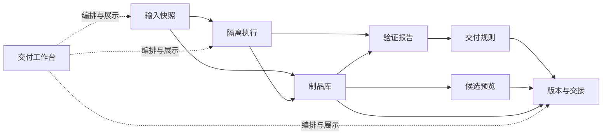
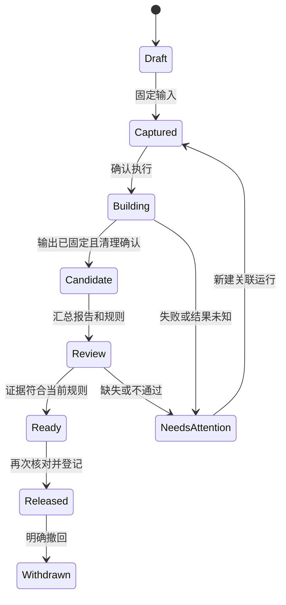

# 项目交付工作台插件包设计

## 1. 目标与版本

设计版本：**1.0.0**；日期：**2026-10-23**。实现基线为 Sakura **2.4.0 / e8168e3**，宿主插件 API 5、公共服务 V1。本文件是待实施方案，应用版本保持 2.4.0。完整实施的拟定目标为 2.5.0，验收前不发布该版本标签。

包标识为 `delivery`，名称为“项目交付工作台”。它面向使用 Sakura 开发、测试和交接应用的个人及小团队。用户应能回答：交出去的文件来自哪份代码，经过什么验证，接收方能否核验并运行。

完整流程为：固定输入、隔离构建、收集证据、保存制品、预览候选、登记版本、导出交付包、在接收端导入并验证。首版须完成整条流程，不能以目录项、空页面或返回“尚未实现”的操作作为交付。

本包拟增加 **8 个插件**。数量依据数据归属和资源生命周期确定。整合包仍只是成员清单，业务由插件提供。默认不启用；选择后沿用重启生效机制，已有用户选择不改变。

## 2. 现有基础与新增价值

| 现有能力与源码 | 当前边界 | 本包补充的能力 |
| --- | --- | --- |
| [环境配方](environment-plan.md)、[RecipesV1](../server/service-contracts/v1.ts) | 预览和保存声明，不冻结镜像、运行时及依赖 | 固定源码、声明输入、实际环境证据和构建定义 |
| [流水线](pipeline-graph.md)、[实现](../server/pipelines.ts) | 在当前项目目录执行；最多保留 30 次运行，淘汰时删除对应产物 | 对固定输入运行；正式制品独立保留，不依赖流水线历史 |
| [工程质量操作](../server/engineering-operations.ts)、[执行器](../server/engineering-runner.py) | 已有发布检查、覆盖率、SBOM、来源清单和双目录构建比较 | 统一报告模型，绑定确切候选，保存可追溯的门禁判定 |
| [沙箱](sandbox.md)、[实现](../server/sandboxes.ts) | 一次性命令结束后关闭整机；输入限于修复文本，产物最多 8 个、总计 8 MiB | 分块输入和产物通道，矩阵运行，独立的常驻预览生命周期 |
| [构建农场](build-farm.md)、[实现](../server/build-farm.ts) | 调度本机登记的普通实例，不分发固定源码和制品；当前不接受沙箱 | 复用任务和资源调度基础，为交付任务提供隔离执行适配 |
| [分支预览操作](../server/capability-definitions.ts) | 当前管理 Git Worktree | 从交付制品启动真实服务，核验监听、健康和归属 |
| [本机入口](http-ingress.md)、[网络服务引用](../plugins/network/services.ts) | 提供转发、HTTP/HTTPS 和本地域名 | 为每个预览绑定原资源身份、期限及独立浏览器来源 |
| [任务证据](task-evidence.md)、[可信更新](self-update.md) | 前者管理请求与恢复；后者面向 Sakura 自身运行包 | 复用证据展示；为用户项目另建交付格式和信任用途 |

本包不把已经存在的发布检查、SBOM 或构建比较重新称为新功能。主要新增对象是不可变输入、独立制品库、持久候选、基于同一摘要的证据判定，以及接收端验证记录。

不直接依赖 `extensions` 或 `platform` 两个实验插件。可复用的解析器和检查算法应提取到明确的公共模块。原能力入口继续保留，不能因启用本包而重复运行原后台任务。

## 3. 插件构成与归属

下表均为提议。依赖表列出允许直接消费的插件；实现时只保留实际调用的直接依赖，不能通过传递依赖越权取服务。

| 插件 | 完整功能与独立用途 | 拟声明的直接依赖 |
| --- | --- | --- |
| `delivery-artifacts` 制品库 | 上传或收集制品；分块校验；按摘要保存；下载、隔离、引用保护、清理预览 | `transfers` |
| `delivery-inputs` 输入快照 | 固定 Git 提交或审阅后的草稿；捕获环境要求、流水线定义和文件清单；比较两个输入版本 | `projects`、`git`、`recipes`、`pipelines`、`delivery-artifacts` |
| `delivery-runners` 交付执行 | 输入准备、隔离实例、矩阵队列、构建与测试、取消、产物采集、执行恢复 | `projects`、`pipelines`、`sandbox`、`delivery-inputs`、`delivery-artifacts` |
| `delivery-reports` 验证报告 | 解析测试、覆盖率、诊断和性能报告；保存原始摘要与结构化结果；同条件比较 | `delivery-artifacts`、`delivery-runners` |
| `delivery-gates` 交付规则 | 版本化门禁策略、证据核验、判定解释、人工确认和明确的例外记录 | `delivery-inputs`、`delivery-runners`、`delivery-artifacts`、`delivery-reports` |
| `delivery-previews` 候选预览 | 从制品创建限时服务环境；启动、健康、访问、日志、停止、到期清理及原域恢复 | `projects`、`sandbox`、`network`、`delivery-inputs`、`delivery-artifacts` |
| `delivery-releases` 版本与交接 | 候选登记、版本晋级、通道、撤回、导出、导入、接收端验证和保留规则 | `delivery-inputs`、`delivery-runners`、`delivery-artifacts`、`delivery-reports`、`delivery-gates`、`delivery-previews`；可选 `secrets` |
| `delivery-workbench` 交付工作台 | 项目入口、交付定义、模板、就绪检查、流程推进、总览及失败处理 | 上述 7 个交付插件；可选 `repair` |

`delivery-workbench` 保存交付定义、流程游标和对象引用，不复制制品、日志或报告。不重建第二套 Jobs、资源额度、鉴权或调度系统。每个业务插件同时提供 API 和自身面板，可在统一工作台之外使用。

`delivery` 包的直接成员为上述 8 个插件及 `command-palette`。解析器补齐现有依赖并去重。AI 修复作为可选配套，不随包自动启用。首版直接依赖清单冻结前，不将预估插件总数写入运行目录。

图表示数据流。实际依赖以上表为准，服务依赖必须无环。

## 4. 用户流程与功能细节

### 4.1 创建交付定义

项目新增“交付”入口，首次使用提供静态网站、Node 服务、Python 命令行程序和自定义流程模板。模板包含输入范围、环境要求、步骤、报告位置、产物选择和启动契约。模板保存为版本化定义；修改后新运行使用新版本，历史运行保持原定义。

支持复制、比较、归档和导入导出定义。仓库内可保存 `.sakura/delivery.json`；导入文件只显示待应用差异。导入的命令、安装步骤、联网权限和私密引用必须审阅后才能执行。源码中的配置不能自行放宽宿主额度或发布规则。

就绪检查列出缺失镜像、项目身份、工具、锁文件、空间、运行名额及密钥引用。每项提供对应的准备入口。只读检查不安装依赖、不停止用户实例，也不启动构建。

### 4.2 固定输入

默认从明确的 Git 提交读取对象。纳入子模块时固定其提交；Git LFS 内容必须已取得并通过对象摘要核验。缺失对象明确阻塞，不把指针文件当成目标内容。排除 `.git`、私钥、缓存和依赖目录，按清单显示实际包含的内容。

首版拒绝符号链接、硬链接和特殊文件，列出具体路径，不静默省略。归档路径统一为相对路径，核对大小写冲突、目录深度和目标平台名称限制。读取不会切换用户分支、写入索引或执行 Git hooks。

草稿模式允许显式选择未提交文件。界面显示新增、修改、删除和被排除项；捕获前后核对索引及文件版本，发生变化时拒绝旧计划。捕获结果的身份由实际保存的字节决定。草稿不宣称是某个 Git 提交，也不保证外部进程写入期间的整个目录具有原子快照语义。正式通道默认要求提交模式。

每份输入固定源码清单、显式数据文件、流水线定义、项目配置版本、镜像摘要、运行时要求及依赖锁文件摘要。私密配置只保存引用和版本标识，不保存明文或低熵秘密的可猜测摘要。新运行重新取得授权，不能凭旧快照读取已撤销的密钥。

普通环境变量也可能含密钥，只有明确标为可公开的值才进入交付清单。默认排除 `.env` 等敏感文件；导出前展示实际文件与脱敏结果，自动扫描不作为不存在秘密的证明。

环境证据区分“已声明”“已解析”“已在本次执行核验”。未安装工具、浮动软件源和不完整锁文件保持未核验。可复现构建必须另做两次独立运行并比较制品；保存摘要本身不构成可复现证明。

### 4.3 构建、测试与重跑

一次交付运行使用新建的受管实例和独立项目目录。先写入并校验固定输入，再以项目 UID 执行捕获的流水线定义。安装、构建、测试和收集阶段在同一次实例生命周期内衔接。默认禁用外部网络；需要依赖下载时先审阅来源和权限，再使用已有受管下载机制。

运行矩阵按发行版和运行时组合生成子运行。默认单路执行，最多请求 4 路，并受全宿主实例名额、内存和进程预算限制。名额不足进入有界队列；不会暂停或停止用户实例腾出资源。每个单元单独保存退出码、环境证据、日志和清理结果。

源目录后续变化不影响已捕获输入。重试创建新运行并记录 `retryOf`。局部重跑沿用显式可重跑声明，重新执行必要依赖；首版不复用步骤产物缓存。新实例必然有新的运行身份，因此交付重跑使用固定输入及所选步骤创建新尝试，不调用绑定原 VM/boot 的旧 `sourceRunId` 重跑接口。原接口继续保留原检查。清理未确认或外部副作用结果未知时，先处理原记录，不能直接重放。

构建结束先收集、校验和固定输出，再停止并清理实例。程序退出成功但产物采集失败，不能算交付成功。至少提供日志、失败步骤、关联回执和可以执行的恢复动作。

### 4.4 报告与规则

首版报告支持 JUnit XML、Istanbul 汇总、LCOV、coverage.py JSON、结构化诊断 JSON 和命令耗时样本。复用已有覆盖率及性能算法；新增有界解析和统一证据关联。原始文件按摘要保存，界面只渲染解析后的数据；HTML 报告默认作为下载附件。

解析结果区分通过、失败、缺失、格式错误、截断、取消和结果未知。声明需要测试的流程，测试数为 0 时默认不通过。命令退出码与报告互相核对，不能只凭日志中出现“通过”判断成功。重复运行不得把首次失败改写为通过，界面保留偶发失败比例和每次结果。

规则包括必需步骤、测试失败数、覆盖率阈值、产物完整性、环境核验、报告时效及人工审阅。规则版本和阈值参与判定摘要。性能比较只接受相同输入类别、工具和可比执行环境，其他情况显示不可比，不给出性能退化结论。

门禁输出为 `passed`、`failed`、`incomplete` 或 `waived`，逐条说明证据。完整性错误、未知执行结果、应结束任务的清理未确认、权限失效和证据身份不匹配不可豁免。可豁免的质量项须由所有者显式选择并记录理由；正式通道默认拒绝 `waived`。

报告只能说明这次受控命令提交了什么结果，不能证明项目编写的测试或报告生成器客观可信。导入的报告标为外部证据。发布者签名证明来源，不自动把外部证据转换成本机执行成功。

### 4.5 制品与保留

制品按 SHA-256 和长度标识，内容不可覆盖。分块上传或采集完成后重算整份摘要，再原子发布索引。元数据保存名称、媒体类型、来源输入、运行和可见范围。相同内容可共享底层存储，但下载及存在性查询仍检查当前项目权限。

候选、正式版本、导出任务和运行中的预览都持有独立保留引用。流水线记录过期、删除定义或停用插件均不解除这些引用。下载开始取得读取租约，垃圾回收等待原租约完成。

删除先预览引用和预计释放量，再提交有期限的一次性计划。引用版本变化则拒绝旧计划。正式版本须先撤回或归档，并按明确的保留策略释放引用；不会递归删除外部目录。异常文件隔离并保留原因，不能静默重建为“已验证”。

### 4.6 候选预览

预览只使用候选引用的制品和启动契约，禁止回退到开发目录。静态网站使用固定服务器；Node 服务和其他服务使用审阅后的启动参数、工作目录、端口及健康检查。命令行制品以验证运行代替网页预览，界面明确显示类型。

预览使用独立实例和期限。真实监听、完整运行归属和健康检查均通过后才显示可访问地址。预览记录保存制品摘要及启动契约摘要，导出时再次确认两者一致。健康结果带采样时间，历史成功不代表当前仍健康。

预览拥有独立浏览器来源。单独更换 `localhost` 端口不能作为管理凭据隔离。入口不得向客户机转发 Sakura 管理 Cookie、Authorization 或管理令牌；页面使用独立命名的主机、限制嵌入策略，并测试管理端的原点检查。管理源内不执行制品 HTML 或报告脚本。

默认仅本机访问，出站关闭。需要外部依赖时单独确认；不能因开放预览入口就授予全部 NAT 出站。当前沙箱的 `isolated` 与 `nat` 两种策略不足以表达此要求，须先补受管入口和出站分离的策略，见第 6 节。

停止、到期、撤权和插件关闭先撤回访问入口，再清理原进程域和实例。入口每次接入核对绝对期限，到期关闭原 WebSocket 和长连接。暂停和重启不重置期限，恢复入口前必须重新核对。预览与构建共享宿主资源预算，不另开配额池。

客户机受管进程按期限停止服务并请求关机，宿主进程监督器负责可确认的 QEMU 回收。客户机任务退出不等于宿主进程、端口和磁盘已经回收。控制服务失联时，拿不到释放证明的资源保留未知状态；恢复后按原身份核销，不承诺离线期间立即释放全部宿主存储。只有宿主定时器、没有客户机到期约束的实现不能通过首版验收。

有限的构建和接收验证必须完成清理后才提供通过证据。预览可以在授权期限内继续运行，不因此阻塞晋级。默认晋级规则接受最近 5 分钟内的成功健康证据，且预览当前未异常、未过期；若预览已经停止，必须确认其清理完成。停止后的清理失败或未知会阻塞晋级，历史健康不保证版本未来持续可用。

### 4.7 登记版本与交接

候选清单固定输入、运行、制品集合、环境要求和启动契约，内容变化产生新候选。报告、规则判定和预览是独立证据，各自绑定候选摘要，不进入候选摘要本身。版本登记时固定所采用的证据引用，并复核当前权限、必要预览证据及规则版本；版本号一经占用不能绑定另一份内容。

首版提供 `candidate` 和 `stable` 两个本地通道。通道更新使用版本比较，冲突时展示当前目标。回退仅把本地通道重新指向仍有效的旧版本，保留操作记录；不修改运行中的服务、客户机数据或外部系统。页面明确标注“已登记本地版本”，不显示“已部署生产”。

版本说明可以从已有 Git 变更生成草稿，用户修改后保存。撤回版本使其不能成为新的默认交付目标，但保留内容、引用及撤回原因。删除、撤回与清理是不同动作。

交付文件使用拟定的 `*.sakura-delivery.zip` 格式，独立于磁盘 `.sakura` 包和 Sakura 自更新包。包内包含版本清单、制品、启动契约、环境要求、报告及证据摘要、版本说明，可选包含源码。包中不包含主机私密配置、会话、客户机身份票据或默认授权。

版本身份采用“项目命名空间 + 版本号 + `releaseCoreDigest`”。核心摘要固定候选、版本说明和登记时选定的证据，不包含 ZIP 字节、压缩参数、源码附件或签名。每次导出另有包摘要；签名同时绑定核心摘要和包清单摘要。同一版本可形成附源码与不附源码的交付包，二者须有相同核心内容。核心不同才构成版本冲突。

签名可选，但受信任通道可要求签名。签名绑定格式版本、清单摘要、制品根摘要、版本、发布者和用途域 `sakura-delivery`。项目交付密钥与 Sakura 自更新信任分开管理，不能互相授权。私钥由受管秘密引用提供，导出包只携带公钥标识和签名。

所有者可登记、核对指纹和撤销交付公钥。界面区分有效可信、未知发布者、未签名、签名无效和已撤销；无效签名拒绝提交，未知发布者保留隔离状态供明确处理。通道晋级再次核对最新信任修订。未启用 `secrets` 时可使用无签名交付，签名入口明确提示缺少提供者，不自动启用插件。

导入先进入隔离区，检查格式、长度、摘要、路径、重名、大小写冲突和签名。拒绝越界路径、链接、重复成员及解压后超限；先审核全部条目再发布。未知格式或不支持的压缩类型明确拒绝。重复导入相同包返回已有记录；相同来源命名空间和版本号的核心摘要不同则冲突。

外部项目、运行和候选 ID 只保存为来源标识，导入时分配新的本地 ID。所有者明确绑定来源命名空间与本地项目，不能由包内字段覆盖本机对象或授权。未签名、未知发布者或已撤销的包可以隔离保存，但不能自动进入可信目录；是否允许后续无签名接收由所有者策略决定。格式损坏和签名无效始终拒绝提交。

导入成功仅表示内容已保存。接收方看到工具、发行版、CPU 架构、密钥映射和网络需求，显式绑定环境后才能运行。缺少依赖时保留包并列出准备步骤；不得自动执行安装脚本或可信包中的任意命令。接收端验证产生自己的记录，保留原发布者证据和本机结果的区别。

执行服务区分 `build` 和 `validate-artifact` 两种输入。后者使用已封存制品、启动契约和环境要求，支持不附源码的交付包。发布者的源码摘要只作为来源记录；接收方没有源码时仍可验证运行，但不能声称已从源码重建。

接收验证使用独立的 `import-acceptance` 规则：本地制品完整性、本次验证运行与清理、当前环境兼容、所需预览，以及明确配置的信任要求。外部 BuildRun 和 GateDecision 不能直接取得本地晋级资格。通过后可登记为“已接收验证”的本地版本，区别于“本机构建”。若项目规则要求本地源码测试，缺少源码时保持不满足，不能自动换用较弱规则。

## 5. 对象与状态

所有对象带 `schemaVersion`、不透明 ID、所有者和项目范围。可变索引带 `revision`，内容对象带摘要。客户端提交 ID、预期修订及确认令牌，服务端从存储重建权威数据，不接受客户端自报的“已通过”。

| 对象 | 不可变内容或可变状态 | 权威插件 |
| --- | --- | --- |
| `DeliveryDefinition` | 可变定义；每次保存产生不可变修订 | workbench |
| `InputSnapshot` | 源码、环境、步骤和显式输入清单 | inputs |
| `BuildRun` | 输入引用、矩阵单元、执行票据；追加阶段与结果 | runners |
| `ArtifactManifest` | 文件摘要、长度、来源；保留引用独立更新 | artifacts |
| `EvidenceRecord` | 原报告摘要、解析器版本、运行身份与结果 | reports |
| `CandidateManifest` | 本机输入或已导入版本引用、运行、制品根摘要、环境要求和启动契约；不包含判定结果 | releases |
| `GatePolicy` / `GateDecision` | 规则修订、候选摘要、证据摘要和判定 | gates |
| `PreviewLease` | 候选、VM 创建时间、运行代次、入口归属和期限 | previews |
| `ReleaseRecord` | 固定候选、版本、选定证据及核心摘要；追加撤回或接收记录 | releases |
| `ChannelPointer` | 通道当前版本及修订 | releases |

执行结果和清理结果分别保存。构建状态为 `queued → preparing → running → collecting → finished`，结束原因另存成功、失败、超时、取消或中断。清理状态为 `not-started / pending / verified / failed / unknown`。只有执行成功、所需输出完整、清理确认的运行才能用于正式门禁。

状态图是工作台展示投影。领域插件保留详细状态；工作台不能替它们宣布任务已停止或资源已释放。

`releases` 保存候选清单，但 `gates` 和 `previews` 不反向调用它。两者接收共享只读 `CandidateDescriptor`，重算摘要，再向各自直接依赖核验输入、制品和证据。门禁回执不证明候选已经登记；晋级服务再核对回执所绑定的内容确实属于本次候选。这样既避免依赖环，也避免候选摘要包含自身判定的循环定义。

重启后扫描原运行、导入、导出和清理记录。没有同代完成证明的执行标为待核对，不自动接管旧进程或重复命令。恢复只能处理保存的原资源身份。用户可在任务证据页检查原回执，完成清理后再创建新运行。

## 6. 实现接口与宿主前置能力

下列接口均是拟新增设计，不是 2.4.0 已有 API。已有 V1 方法保持输入和输出兼容；兼容新增方法可继续使用 V1，不兼容方案须另建版本。

| 前置工作 | 需要提供的能力 | 实现归属与约束 |
| --- | --- | --- |
| 项目源码捕获端口 | 按固定提交读取；按计划捕获草稿；逐块校验和取消；固定项目与运行身份 | Git/项目领域提供细粒度契约，按原项目 UID 运行；不把 `Machines` 或任意宿主路径交给插件 |
| 流水线定义执行端口 | 在明确的临时实例和项目执行已校验定义及步骤选择；创建新尝试，不覆盖用户流水线 | 扩展 Pipelines 公共接口；复用 DAG 与清理，不反向依赖 delivery，不复用旧 VM 的重跑指纹 |
| 执行空间准备端口 | 新建受管实例，写入大文件输入，建立项目身份，固定环境并销毁原实例 | 基于沙箱和项目原语扩展；不能把 16 KB 修复输入直接当通用代码包接口 |
| 制品流式通道 | 输入、收集、下载的分块流与摘要、额度、取消和读取租约；执行实例销毁后仍可下载 | 扩展传输/存储端口，按项目和发行对象授权。现有 Downloads 会检查 VM 存在，不能原样复用；不得返回任意宿主路径 |
| 基础镜像解析端口 | 按摘要和架构只读定位镜像，校验可用性并取得保留引用 | 使用镜像/沙箱领域的细粒度端口，不依赖整个 `platform`；引用期间拒绝错误回收 |
| 预览会话端口 | 常驻项目服务、客户机到期清理、按原运行停止；同一实例的入口与出站分离 | 扩展受管会话/网络能力；不改写 `SandboxesV1.run` 的结束即停机语义 |
| 有归属的入口租约 | 创建、查询、撤回准确预览入口，带所有者和修订 | 扩展网络公共契约；不能删除同名但属于新运行的入口 |
| 报告解析 | 有界 XML/JSON/LCOV 解析，拒绝 XML 外部实体和外部抓取 | 固定解析器或受管计算适配器；解析不执行项目插件 |
| 项目签名 | 对明确用途和摘要签名，取得短期秘密引用，记录原授权 | 复用秘密存储并新增固定签名适配器，不开放任意进程启动或私钥导出 |

元数据使用插件自己的 `PluginMetadata` 命名空间；二进制走受管存储。跨对象写入采用准备记录、内容校验、原子索引提交和可恢复清理。不能用工作台缓存覆盖领域最新修订。

每个插件提供 `manifest.ts`、`server.ts`、`services.ts` 和 `client.tsx`。新增服务接口进入独立服务契约；公共 DTO 与 Schema 进入 `shared/contracts/`。通过现有生成器更新目录、加载器、请求与响应契约，不手改生成文件。

### 6.1 API 与操作策略

项目入口拟使用 `/api/vms/{vmId}/delivery-*`；归档与跨实例导入目录拟使用 `/api/delivery-releases`。项目由显式绑定解析，归档对象以原项目 ID 与所有者授权，不能因实例删除而失去数据，也不能转为全局公开。

每个插件拥有独立 HTTP 命名空间，避免工作台替其他插件声明路由。只读列表、详情、报告与恢复查询使用 GET。捕获、运行、取消、预览、晋级和导入使用明确的 POST 动作；保存配置须带预期修订。大型文件使用传输票据和流式请求，不放入控制 JSON。

操作声明写明角色、项目范围、锁要求、维护模式、正文类型、请求上限和响应 Schema。计划、晋级、清理及导入提交绑定内容摘要和期限。相同 `requestId` 只用于查询或返回原已提交结果；遇到原业务结果未知时不自动重新执行。

公共服务按插件划分为 `DeliveryArtifactsV1`、`DeliveryInputsV1`、`DeliveryRunnersV1`、`DeliveryReportsV1`、`DeliveryGatesV1`、`DeliveryPreviewsV1`、`DeliveryReleasesV1` 和 `DeliveryWorkbenchV1`。方法最小集合包括读取、预览/提交、取消、按原身份恢复；精确签名在 M0 冻结，不允许只用无约束 `action(unknown)` 避开契约。

### 6.2 权限、额度与升级

首版沿用 `owner`、`member` 和 `viewer`，不新增角色。所有变更入口先限所有者，包括构建、预览、签名、晋级、清理和导入。成员及只读角色仅能读取原项目授权范围内的摘要、脱敏日志和制品；某类对象若无法接入现有成员检查，其读取也限所有者。权限由服务端落实，不能仅靠隐藏按钮实现。

队列等待、每个异步阶段和最终提交前都检查当前授权与原插件代次。撤权停止新增工作，并用原领域清理权限完成在途资源回收。下载票据绑定主体、项目、摘要、范围和有效期。

拟定默认额度：源码包 100 MiB、10,000 个文件；单制品 1 GiB；单交付包解压后 5 GiB；单报告 10 MiB；每项目 1 个并行预览，默认期限 30 分钟。它们是设计默认值，M0 须按现有存储和运行预算验证。额度提高仍受宿主硬上限约束；超限先给出具体原因，不留下可见半成品。

跨重启保存队列上限、磁盘预算、引用和清理记录。关闭包只撤销执行入口、停止自有运行并等待清理，不删除数据。缺失插件时显示不可用原因；清理失败保留记录。重新启用后只恢复目录和待处理状态，不能默认重启历史服务。

数据升级先校验格式和摘要，备份旧索引，再执行可重复验证的迁移；失败保留旧记录。未知新格式只读拒绝，不覆盖为默认值。应用代码回退不自动回退交付数据；需要的格式兼容说明随发行记录保存。

## 7. 界面与使用体验

工作台采用“项目交付”总览，下设“定义、运行、候选、制品、版本、接收记录”。运行详情按阶段展示图、日志和证据，候选详情固定展示输入身份、实际文件、报告、规则及预览。全局页面提供跨项目队列、空间占用和待处理清理。

每个页面具备首次使用、加载、空结果、无权限、插件不可用、部分失败和结果未知状态。网络重连只查询原操作，不重新提交写请求。切换项目、关闭页面及取消后丢弃迟到响应；取消请求已发出不能直接显示资源已释放。

预览执行、版本晋级、导出范围和清理使用可审阅的实际内容。高风险操作显示目标及影响，不使用只有“确定/取消”的空确认。失败提示给出原回执、失败阶段和恢复入口。

桌面支持键盘导航和命令面板，窄屏下图与表有可读的列表替代。图标和颜色不独立承载状态。长日志按需加载；隐藏页面暂停无必要轮询。

已启用 `repair` 时，失败报告可打开修复会话并预选明确文件。用户仍需确认发送、审阅补丁和执行隔离验证。应用修复后生成新输入及新候选，原版本和原证据不改变。

## 8. 实施顺序与验收

所有里程碑完成后，才将完整包标记为已实现。M0 是后续工作的前置条件；不在依赖缺失时用模拟数据替代用户可操作功能。负责人按职责划分，具体人员可在实施时安排。

| 优先级 / 里程碑 | 交付物 | 依赖 | 负责人 | 完成条件 |
| --- | --- | --- | --- | --- |
| P0 / M0 契约与执行验证 | 细粒度端口、DTO、资源归属、网络方案、额度及数据迁移设计 | 本方案 | 宿主与契约维护 | 在临时实例验证源码输入、执行、流式制品和预览到期；确认无依赖环 |
| P0 / M1 输入与制品 | artifacts、inputs、原子保存、引用及清理 | M0 | 存储与项目模块 | 输入不可变；中断可恢复；下载与清理竞态通过 |
| P0 / M2 执行与报告 | runners、reports、矩阵、结构化证据 | M1 | 执行与质量模块 | 真实运行、取消、退出码、报告解析和整机清理均有证据 |
| P0 / M3 规则与预览 | gates、previews、证据失效和独立预览入口 | M2 | 质量与网络模块 | 同一制品预览；管理来源隔离；旧证据拒绝；到期和重启恢复通过 |
| P0 / M4 版本与交接 | releases、签名、导出、导入和接收验证 | M3 | 交付模块 | 全新数据目录导入并显式运行；损坏或无效签名拒绝，未知信任保持隔离 |
| P0 / M5 完整包 | workbench、模板、整合包、CLI/API、文档与升级 | M1～M4 | 界面与交付整合 | 全流程可操作；权限、故障、兼容、生产构建和端到端验收通过 |

首版验收至少覆盖以下场景。测试脚本、数据、报告、截图和缓存放在忽略目录；Git 只保留正式实现、配置、文档和简短结论。沿用既有 CI 必需入口，不删除有效断言。

| 场景 | 必须观察到的结果 |
| --- | --- |
| 静态网站完整交接 | 捕获、构建、报告、规则、预览、版本、导出、另一个干净数据目录导入验证全部完成 |
| 无源码交付 | 导入制品及启动契约后可做接收端验证；来源摘要保留，不声称完成源码重建 |
| 导出与版本身份 | 带源码、不带源码和签名轮换的包核心摘要一致；不同核心不能占用同一来源版本 |
| Node 服务与 Python CLI | 实际服务健康与停止；CLI 真实退出码；运行需求和目标架构不匹配时明确阻塞 |
| 输入和身份变化 | 工作区变化不改变旧快照；VM 重建、项目切换、撤权和旧确认令牌都不能作用于新身份 |
| 矩阵失败与取消 | 某单元失败不伪造其他单元成功；停止新派发，等待所有已启动资源准确清理 |
| 报告异常 | 缺失、空测试、超限、恶意 XML、错误格式和矛盾退出码不能得到通过 |
| 证据失效 | 输入、制品、启动契约或规则改变后，旧判定和旧预览证据失效 |
| 引用与垃圾回收 | 原流水线记录淘汰后正式制品仍能下载；并发下载、预览、晋级均阻止错误删除 |
| 导入边界 | 越界、链接、重复路径、大小写冲突、解压炸弹和签名不匹配在执行前被拒绝 |
| 重复和中断 | 同请求重复提交返回原结果；进程崩溃后的未知状态不重放；恢复保留原身份 |
| 预览浏览器隔离 | 应用脚本拿不到管理凭据；请求管理接口被拒绝；代理不泄露管理头与 Cookie；WebSocket、重定向、弹窗和 Service Worker 不越过来源边界 |
| 预览到期 | 宿主正常、异常退出及重启三种情况下，客户机期限和入口撤回结果可核对 |
| 版本与通道 | 同版本不同内容冲突；并发晋级只接受当前修订；撤回和回退不改变客户机数据 |
| 迁移与插件组合 | 空选择行为不变；单插件/整包依赖正确；停用保留数据；损坏索引和升级失败可解释 |
| 真实运行限制 | 本机双数据目录验证与跨物理主机验证分别记录，不把前者称为后者 |
| 最终交付 | 类型、架构、全部历史契约、构建和必要浏览器检查通过；无占位入口；实现提交、冻结基线与版本标签对应 |

## 9. 首版范围与后续扩展

首版交付本地工作流、固定输入、隔离运行、报告、规则、制品、预览、版本与离线交接。HTTP 项目需要预览，命令行项目需要验证运行，两类都有明确完成条件。

云平台部署、互联网公开预览、生产数据库迁移、多租户审批、远程执行集群和第三方插件市场不属于本包首版。外部部署可以后续作为独立提供者接入，必须另有目标绑定、授权和恢复协议。

不承诺任意语言项目自动打包、任意依赖离线复现或字节级构建一致。运行时和依赖的实际检查结果随候选展示；未核验项保持未核验。AI 不自动批准规则、修改原文件或晋级版本。

## 10. 本轮设计验收

本轮仅交付设计文档、索引和项目状态，不修改插件目录、运行代码、应用版本或用户数据。设计评审检查功能闭合、独立归属、当前接口缺口、状态恢复、权限、浏览器隔离和可执行验收标准。代码链接以 2.4.0 基线核对；实施时须再次确认实际接口。

设计复核已完成：8 个插件的依赖无环；本文件、文档索引和项目状态中的 167 个本地链接有效。候选摘要、接收验证、预览生命周期和版本身份的评审问题已修正并复核。本轮没有运行功能测试，不把设计检查计为实现验收。
