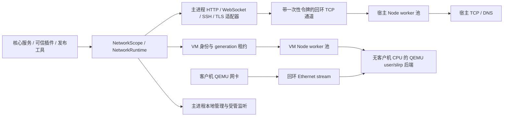

# 统一网络运行时

网络运行时是 Sakura 的必需基础设施，先于业务服务启动，最后关闭。停用可选的 `network` 插件只会停用该插件的业务入口，不会移除网络核心。核心负责连接归属、资源上限、取消、VM 网络后端和退出清理；已有鉴权、证书验证、项目网络策略及原生身份校验继续在各自的边界执行。

## 数据路径

宿主出站 TCP 和 DNS 使用 `server/network/host-pool.ts` 与独立的 `worker.mjs`。目的地址经父子 IPC 发给 worker；主进程凭一次性随机令牌连接回环数据通道。数据以支持背压的流传输，IPC 只承载控制消息。每条连接固定在承接它的 worker，不迁移活动连接。

HTTP、HTTPS、WebSocket、SSH 和 S3 的协议处理仍在托管的主进程适配器中。TLS 在主进程封装 worker 返回的 TCP 流，因此原来的 CA、服务器身份、mTLS 和固定证书检查仍由协议适配器执行。HTTP/TLS 解析与加解密没有迁到 worker，不能将这次拆分理解为全部网络计算都已并行化。

VM 使用另一组 Node worker。每个 VM worker 按需启动至多一个 QEMU，参数包含 `-machine none -m 0 -nodefaults -display none -qmp stdio`。它只承载 user/slirp 网络及 QMP，不运行客户机 CPU、内存或磁盘；每个 VM 拥有独立的 user 网络与 hub。真正运行客户机的 QEMU 只通过 `stream` 接入该后端。默认网段和地址保持 `10.0.2.0/24`、客户机 `10.0.2.15`、网关 `10.0.2.2`、DNS `10.0.2.3`。

同一个 VM 的连接始终固定到一个 worker。多个 VM 可以分散到不同网络进程，一个 worker 也可以承载多个相互分开的 VM 网络；增加 worker 数量不意味着单个 VM 的 NAT 可以使用多个 CPU 核。隔离模式继续设置 user 后端的 `restrict` 并禁用 IPv6；非隔离 VM 按原配置选择 IPv6。SSH 和显式端口转发绑定宿主回环地址。

这两种路径使用用户态能力，不需要管理员权限、TAP/TUN、系统交换机或额外网络驱动。`SAKURA_QEMU_DIR` 仍用于选择 QEMU；所选版本必须支持使用的 user、stream、hubport 与 QMP 能力，缺失时启动报错，不回退到客户机 QEMU 内的非托管 user 网络。

## 能力、归属与例外适配器

服务通过 `networkFor(owner, purpose, signal?)` 获得 `NetworkScope`；可信插件使用宿主分配的 `ctx.networking`，其 owner 为 `plugin:<id>`，取消与插件作用域相连。scope 提供 `dial`、`lookup`、`fetch`、HTTP(S) 请求、WebSocket、托管监听及 SDK 请求适配器。scope 身份被冻结，插件退出时关闭自身 scope。

VM 租约带有 VM ID 和 generation。恢复内存快照时先断开该 VM 的 Ethernet hub 接入，撤销旧 generation 的连接，重建 user 后端以清除旧 NAT、DNS 和转发流状态，再给新 generation 发放能力。QEMU 的快照命令自行暂停和恢复客户机；任务成功后，当前租约才重新接通 hub，失败则停止实例。过期租约不能重新接通或关闭后续 generation。客户机原有网络连接不保证延续，应用需自行重连；这不撤回对端已经收到的数据，也不清除快照本身保存的客户机网卡缓冲。

本地 QMP、串口、guest-agent、退出过程中的 SSH，以及本地 Agent/IPC 使用保留的管理通道。它仍有归属、数量限制和清理登记，但在主进程直接连接回环地址或本地 IPC，不占普通数据 worker；drain 阶段保留这条路径供 VM 停止使用。普通 TCP/HTTP(S) 监听也在主进程建立并由核心登记、限制接入数量和关闭。

Windows GPG 原生 relay 由 `nativeLease` 登记取消与生命周期，同时保留原 helper 的文件/ACL、peer PID、nonce 和回执验证。核心登记不替代 OS 对端身份验证。SSH Agent、本地监听和其他可信原生适配器同样保留各自协议检查。

S3 必须同时显式提供托管 `requestHandler()` 和凭据。对象备份继续使用其已配置凭据；远程审计只读取 `AWS_ACCESS_KEY_ID`、`AWS_SECRET_ACCESS_KEY` 和可选 `AWS_SESSION_TOKEN`。不会隐式运行元数据请求、STS/SSO 认证或 `credential_process`。临时凭据的外部更新与续期仍由部署环境负责，详情见源码文档 `docs/remote-audit.md`。

发布工具中的 Git/npm 下载使用作用域内的带认证回环代理及显式代理环境，直接下载使用托管 fetch。这只约束这些已接入的工具路径；任意子进程或忽略代理配置的第三方程序不能由环境变量自动约束。

## 配置和容量

以下环境变量在进程启动时读取，须为范围内的整数。无效配置会阻止启动；更改后需重启。每个 Sakura 服务、独立见证程序或 CLI 进程各有自己的运行时，以下上限按单个运行时计算。

| 环境变量                     | 默认值 | 允许范围 | 含义                                           |
| ---------------------------- | -----: | -------: | ---------------------------------------------- |
| `SAKURA_NETWORK_WORKERS`     |      4 |     1–16 | 宿主 TCP/DNS Node worker 上限                  |
| `SAKURA_NETWORK_VM_WORKERS`  |      2 |      1–8 | VM Node worker 上限，每个最多派生一个网络 QEMU |
| `SAKURA_NETWORK_CONNECTIONS` |    128 |   1–1024 | 每个宿主 worker 的活动连接/租约容量            |
| `SAKURA_NETWORK_SCALE_AT`    |     32 |   1–1024 | 当前最空闲 worker 达到此值后，按需增加 worker  |
| `SAKURA_NETWORK_IDLE_MS`     |  30000 | 1–600000 | 完全空闲 worker 的回收等待时间，毫秒           |

`SAKURA_NETWORK_SCALE_AT` 不得大于 `SAKURA_NETWORK_CONNECTIONS`。池按活动租约数量扩缩，不根据 CPU 使用率调度；只有完全空闲的 worker 才会被回收，定期检查可能使实际回收稍晚于配置时间。服务启动先检查一个宿主 worker 能否启动，VM 网络进程在 VM 接入时才创建。

VM 池每个 worker 固定最多 4 个 VM 租约，优先把新增 VM 分散到尚可创建的 worker，再在已有 worker 间分配。因此默认最多 8 个同时接入的 VM。宿主与 VM 两组池分开，数据负载不会消耗本地管理通道的 worker 配额。

网络子进程上限为 `SAKURA_NETWORK_WORKERS + 2 × SAKURA_NETWORK_VM_WORKERS`，默认最多 8 个，其中最多 6 个 Node worker 和 2 个无客户机 CPU 的 QEMU。这不包含真正运行客户机的 QEMU、服务主进程、独立 CLI 或其他原生辅助进程。

核心另有按 owner、操作种类和通道计算的租约限制：默认数据操作每类每 owner 256，管理操作每类每 owner 128；全局监听上限 128、接入连接上限 1024，单个受管 server 最多接入 256 条连接。超限返回 `NETWORK_BUSY`，不通过创建无界队列绕过限制。

## 故障、退出与诊断

worker 或其网络 QEMU 退出后，现有连接失败，受影响 VM 的租约被撤销并停止这些 VM。不会无声切换 NAT 后端，也不会自动重放请求或已建立连接。其他 worker 上的连接继续按自身状态运行；后续新的宿主连接可按容量创建新的 worker。需要重新运行的 VM 由用户重新启动。

关闭顺序是：停止接受新的普通数据操作，保留管理通道完成插件与 VM 清理，随后关闭 scope、监听、租约和两个 worker 池。启动中途失败使用同一资源清理登记表。worker 关闭有有界等待和终止处理，父进程 IPC 断开也会触发子进程清理。

通过已鉴权的 `GET /api/network-runtime` 查看 `running`、`draining` 或 `closed` 状态、限制、子进程上限、worker PID、网络 QEMU PID、活动租约数、VM generation/策略和管理端口归属。启用账户模式时仅 owner 可查看；该接口不提供流量内容、凭据或任意网络执行能力。错误排查先核对容量、worker 状态、QEMU 路径和 VM 日志；不要假定写请求因连接失败而未在对端执行。

## 源码门禁和运行包

`npm run architecture:check` 在急切依赖与浏览器边界检查之外，扫描服务端、插件服务的静态/动态本地依赖，以及运行包脚本和其辅助模块。门禁拒绝网络原语的直接导入、常见动态加载方式、全局 fetch/套接字及常见别名，要求 S3 显式传输和凭据；类型导入、IP 判断与证书上下文等无出站操作继续允许。浏览器和生成的客户端 SDK 使用浏览器网络 API；构建产物和第三方依赖由各自的适配器与发布校验覆盖。

这是仓库代码的架构约束，不是 OS 安全沙箱。进程内可信插件仍能执行任意 JS、导入其他代码或启动进程；静态检查不能证明任意计算出的代码或全部第三方依赖永远不出网。项目客户机隔离策略、第三方纯计算 WebAssembly 插件的隔离，以及 OS 权限仍是各自独立的边界。核心也不自动为全部宿主目的地址建立出站 ACL。

源码脚本通过 `scripts/network-client.mjs` 用 `tsx` 加载当前 `server/network-entry.ts`；运行包则加载 `.sakura-server/network-entry.js`，不依赖 TypeScript loader。worker 以独立 `.mjs` 资产发布在 `.sakura-server/assets/network-worker.mjs`，`undici` 是生产依赖。

构建的最后一步复制 worker 与本文，并生成 `assets/network-runtime.json`，记录网络入口、worker 和构建时网络源码的大小与 SHA-256。`npm run dist:check` 检查这些资产、语法和源码一致性，源码变动后须重新构建。`npm run release:prepare` 在创建运行包前执行分发检查；入口、worker、元数据和本文随后一同纳入完整运行包摘要。源码门禁、构建和发布摘要提供不同阶段的检查，资产摘要不是第三方代码沙箱。

网络后端名称 `sakura-managed-user-v1` 已加入内存快照的运行时指纹。旧后端生成的内存快照会因指纹不匹配而拒绝恢复；磁盘快照、实例数据目录、插件选择和端口配置保持原有格式。升级前如需保留运行状态，应先正常关闭实例并保留可用磁盘快照。
