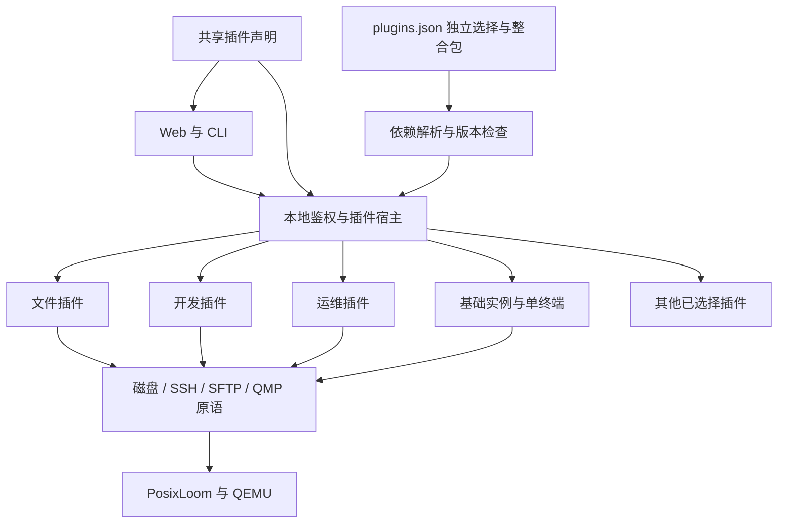

# 最小核心、插件与整合包

Sakura 的初始版本只负责让用户创建、启动、使用和停止一个可靠的本地 Linux 空间。新增业务能力必须作为插件接入；常用组合通过整合包交付。默认插件选择为空，不因升级、已有实例或历史配置自动启用可选功能。

## 首版边界

| 层             | 职责                                                                                    | 默认行为                       |
| -------------- | --------------------------------------------------------------------------------------- | ------------------------------ |
| 最小宿主       | 配置与数据路径、鉴权、同源检查、HTTP/WebSocket、错误处理、插件目录与依赖解析            | 始终运行                       |
| 基础运行能力   | PosixLoom/QEMU 进程管理、Alpine 实例创建/删除/启停、磁盘持久化、SSH、启动日志、资源配置 | 开箱即用                       |
| 基础界面与 CLI | 实例列表、单终端、配置、插件中心、系统信息                                              | 不要求业务插件                 |
| 可选插件       | 文件、项目、桌面、开发、监控、备份等业务服务与入口                                      | 显式选择后，下一次启动加载     |
| 插件整合包     | 版本化的插件成员清单                                                                    | 只解析组合，不运行独立业务代码 |

基本网络初始化、SSH 通道、磁盘锁、关机保护、输入校验和请求鉴权属于宿主可靠运行所需的基础设施，不能通过停用插件关闭。`Machines` 保留磁盘、SSH/SFTP、进程和 QMP 操作原语，插件复用这些原语；快照、文件管理、端口管理等业务入口由对应插件拥有。

“一切皆插件”约束的是能力的归属与组合，不要求把每个按钮、工具函数或安全检查都变成一个独立安装单元。首版保留唯一的 QEMU 运行实现，避免为尚不存在的第二个运行后端引入抽象。

默认导航仅有「工作空间 / 插件中心 / 系统设置」；默认实例标签仅有「终端 / 配置」。没有后台备份、同步、资源采样、计划启停、开发模板安装或 IDE 配置刷新。



## 插件划分

当前有 **32 个插件、9 个整合包**。每个插件在 `plugins/<id>/` 内维护 `manifest.ts`、`server.ts` 和可选的 `client.tsx`。运行 `npm run plugins:sync` 从目录生成共享声明与可信加载器；路由和项目作用域直接从声明生成。插件标识不会与磁盘导入导出的 `.sakura` 包混用。协议和 JSON Schema 见 [插件协议](plugin-protocol.md)。

| 插件标识               | 业务范围                                        | 直接依赖                      |
| ---------------------- | ----------------------------------------------- | ----------------------------- |
| `transfers`            | 文件、磁盘包及本地文件的传输基础；任务记录      | 无                            |
| `files`                | SFTP 浏览、上传下载、编辑器、历史与回收站       | transfers                     |
| `images`               | 发行版镜像目录、下载与校验                      | 无                            |
| `terminal-workspace`   | 多终端、分屏与 tmux 会话恢复                    | 无                            |
| `snapshots`            | 快照、恢复、克隆、普通磁盘包导入导出            | transfers                     |
| `backups`              | 定时、保留策略、加密与外部目录备份              | snapshots、secrets、transfers |
| `projects`             | 多项目、开发模板、初始化与项目服务              | 无                            |
| `recipes`              | 环境配方的导入、导出和应用                      | projects                      |
| `ide`                  | VS Code Remote-SSH 配置和项目连接               | projects                      |
| `toolchains`           | 工具检查和安装                                  | projects                      |
| `project-search`       | 项目文件名与内容搜索                            | projects、files               |
| `code-checks`          | 按文件进行代码诊断                              | projects、files               |
| `commands`             | 参数化收藏命令、执行和日志                      | projects                      |
| `pipelines`            | 构建步骤、运行记录和产物下载                    | projects、files、transfers    |
| `runtimes`             | 项目运行时版本选择和安装                        | projects                      |
| `git`                  | Git 操作与远程仓库                              | projects                      |
| `containers`           | Docker / Compose                                | projects                      |
| `sandbox`              | 隔离虚拟机、限时命令、执行历史和到期清理        | 无                            |
| `sync`                 | 双向目录同步与冲突决策                          | projects                      |
| `network`              | 端口转发、代理、软件源与诊断                    | 无                            |
| `secrets`              | 私密配置及环境变量引用                          | 无                            |
| `metrics`              | 按请求采样客户机资源                            | 无                            |
| `service-health`       | 项目服务持续健康检查                            | projects                      |
| `desktop`              | KDE Plasma、noVNC 与输入法，实验性              | 无                            |
| `library`              | 分组、标签、收藏与批量启停                      | 无                            |
| `maintenance`          | 故障诊断、磁盘扩容与整理                        | 无                            |
| `migration`            | 数据目录迁移                                    | 无                            |
| `automation`           | 暂停/恢复、资源策略、包管理与开发任务及计划配置 | projects                      |
| `automation-scheduler` | 计划启停、定期采样与阈值告警后台调度            | automation                    |
| `extensions`           | 工程扩展能力与操作适配器，实验性                | projects                      |
| `platform`             | 远程、灾备、安全与协作适配器，实验性            | projects                      |
| `command-palette`      | 全局导航与已启用能力的搜索                      | 无                            |

`transfers` 只拥有下载票据、流式传输与任务服务。`Files` 和文件历史属于 `files`，`Bundles` 属于 `snapshots`；传输服务通过延迟读取的可选提供者复用它们，单独启用传输不会创建文件或磁盘包服务。下载票据签发再次检查具体业务所属插件；已有导出任务的重试也必须启用 `snapshots`。

项目、文件、快照等界面只挂载已启用的配套插件：例如文件插件不要求 Git 或开发工具，快照插件不启动备份定时器，项目插件不自动启动健康检查。配置了私密引用的项目在 `secrets` 未启用时明确报错，不静默丢弃引用。

`metrics` 复用独立的采样实现，不加载项目服务或健康检查定时器。`recipes` 不创建 IDE 服务或更新 SSH 配置。单独启用 `automation` 不会启动后台轮询；`automation-scheduler` 专门拥有定时器。`extensions`、`platform` 直接依赖项目，不连带启动调度器。扩展与平台能力保留适配器的实际就绪状态；登记在目录中不代表客户机、远程主机或外部服务已安装就绪。自动化与两组实验适配器仍复用原有服务，后续按实际可独立运行的服务继续拆分，不将目录中的每个能力占位项直接当作插件。

## 整合包

| 整合包                     | 面向场景              | 直接成员                                                                                                   |
| -------------------------- | --------------------- | ---------------------------------------------------------------------------------------------------------- |
| `essentials` 日常使用      | 基础 Linux 的常用补充 | files、snapshots、images、terminal-workspace                                                               |
| `developer` 开发工作台     | 项目与代码开发        | files、projects、git、network、secrets、terminal-workspace、command-palette；子包 environment、development |
| `operations` 运维与备份    | 日常维护与数据保护    | backups、sync、maintenance、library、migration；子包 monitoring                                            |
| `desktop` 图形桌面         | 图形 Linux            | desktop、files、snapshots、images                                                                          |
| `lab` 实验室               | 主动试用进阶能力      | automation、automation-scheduler、extensions、platform、containers、sandbox                                |
| `complete` 完整兼容        | 恢复此前所有扩展入口  | 当前所有插件，包括实验插件                                                                                 |
| `development` 开发工具组合 | 可独立选择的开发能力  | toolchains、project-search、code-checks、commands、pipelines、runtimes                                     |
| `environment` 环境互通组合 | 项目环境与 IDE        | recipes、ide                                                                                               |
| `monitoring` 监控组合      | 资源与服务监控        | metrics、service-health                                                                                    |

没有默认整合包。`complete` 是迁移便利选项，不是首次启动配置。整合包通过带 `kind` 的成员引用，精确锁定插件或子整合包的版本。当前插件和整合包版本均为 `0.3.0`，声明格式版本为 `1`，宿主插件 API 为 `3`。解析前校验完整目录，包括未选包的声明、服务/路由/操作冲突、版本和循环；必需依赖先于消费者初始化，可选配套不会自动启用。

整合包不复制插件代码，不覆盖插件配置，也不代表新的运行实例。两个整合包引用同一插件时只激活一次。停用整合包后，独立选择及其他整合包所需的插件继续保留；只有不再被引用的依赖才从下次启动清单移除。

## 选择、激活与关闭

状态保存于当前数据目录的 `plugins.json`：

```json
{
  "schemaVersion": 3,
  "plugins": ["desktop"],
  "packs": ["developer"]
}
```

文件只保存用户的独立选择与整合包选择，依赖闭包在读取时计算。缺少文件意味着基础版；损坏或不兼容的文件会明确报错，不覆盖原文件，也不自动回退为全部启用。写入经过串行队列与临时文件替换，写入失败时内存中的选择保持原样。

宿主分别记录 `active`（本进程成功激活）、`planned`（下次启动的依赖闭包）和 `errors`。修改选择不热卸载正在处理请求的服务。启停插件后需要退出并重新启动 Sakura；仅刷新浏览器无效。

1. 读取并校验选择，计算依赖顺序。
2. 仅动态导入选中插件模块，执行 `activate`，登记资源与服务。
3. 某插件启动失败时释放其已创建资源，记录错误；跳过依赖它的插件，继续启动其他插件与基础能力。
4. 请求经过宿主鉴权和插件归属检查，再进入插件处理器。桌面及终端会话 WebSocket 同样检查启用状态。
5. 退出时拒绝新请求，取消并等待插件在途请求，再按依赖顺序的逆序清理服务、任务和监听器，最后关闭虚拟机与运行时。

禁用插件不会删除客户机软件、磁盘、备份、历史或插件配置，也不会撤销此前已写入客户机的配置。再次启用可继续使用这些数据。已有实例在基础版中仍可启停，并可以修改基础资源；原有的发行版、模板及端口配置可以原样保留，创建或修改相应扩展配置需要启用对应插件。磁盘等原有破坏性操作继续沿用各自的确认和停机要求。

没有保存选择的旧版本仍进入基础版。已有 `schemaVersion: 1` 选择保留用户意图：`development`、`environment`、`monitoring` 的独立插件选择转换为对应整合包。版本 1 或 2 中单独选中的 `automation` 会补入 `automation-scheduler`，保留原有计划任务。启动时只在内存转换并显示迁移说明，第一次修改选择时原子保存为版本 `3`。旧 CLI 的 `plugin enable/disable` 加上述标识仍映射到对应整合包。不改动实例和各插件数据文件。

## Web、API 与 CLI

`GET /api/plugins` 返回声明目录、独立选择、整合包、当前激活集合、计划集合、错误和 `restartRequired`；`reasons` 列出各插件由哪些独立选择或整合包引入，`migrations` 说明旧选择的兼容转换。

`PATCH /api/plugins` 接受单次选择变更：

```json
{ "kind": "pack", "id": "developer", "enabled": true }
```

`kind` 为 `plugin` 或 `pack`。试图关闭仍被引用的插件返回 `409`，并列出需要先停用的根插件/整合包。用户可以将整合包中的插件设为独立选择，使其在移除整合包后仍然保留。

`GET /api/system` 的 `plugins` 返回成功激活的插件标识。Web 根据它生成可用导航、标签和快捷命令，并按需加载可选组件；上次保存的页面若不可用，回到工作空间/终端。后端不依赖前端隐藏：访问未激活插件的 API 返回 `403` 并提示启用方式。

插件中心分为「插件目录 / 整合包 / 我的配置」，支持名称、标识、用途及运行状态筛选。卡片区分运行中、待启用、待停用与启动异常，并展示独立选择和整合包/依赖来源。整合包会预览实际增减的插件数量，移除时保留其他选择仍需要的插件。页面分别统计当前运行与下次启动配置，并在变更后提供重启说明。主导航将基础功能与已启用的扩展分组，实例的终端和配置入口始终保留；导航、命令面板及开发区块共用插件入口名称。

```powershell
npm run sakura -- plugins
npm run sakura -- plugin enable files
npm run sakura -- pack enable developer
npm run sakura -- pack disable developer
npm run sakura -- plugin disable files
```

CLI 默认帮助只列基础与插件管理命令；`help all` 列出可选命令。可选命令使用原有 API，保持已启用插件的调用兼容性。

## 扩展开发约束

添加插件需要在包内声明身份、版本、分类、必需/可选依赖、服务归属与 `contributes`（HTTP 命名空间、操作、项目作用域、WebSocket 和界面入口），并提供 `activate`、`route` 和必要时的异步 `deactivate`。运行目录生成器后，动态导入仅在选择生效时发生。入口导出的声明必须与目录一致；宿主按声明检查服务访问、注册完整性和资源清理。新界面入口由同包的 `client.tsx` 按需加载；插件初始化不能在模块顶层启动定时器或修改用户配置。

服务自身必须释放监听器、定时器、SSH/WS 连接与任务；由宿主等待 `deactivate` 后按声明逆序调用清理方法。插件只能注册自有服务，只能读取自有或直接依赖提供的服务。必需依赖在 `requires` 声明；可选配套在 `optional` 声明，使用时检查存在性并提供明确错误。可选配套可能在本插件之后激活，应延迟获取。整合包不可引入隐式依赖或静默开启其他功能。

首版只加载随源码审核和交付的内置插件。它们与宿主处于同一 Node.js 进程，服务接口用于模块化，**不构成第三方代码的安全沙箱**。此版本没有远程插件市场、任意路径代码加载、热卸载或自动版本升级。可选插件的代码与 npm 依赖仍随源代码版本交付；按需激活、后台运行和浏览器入口加载已经拆分，不宣称已经实现独立插件下载与安装包裁剪。

前述市场与分发能力若加入，应以独立提案定义来源校验、包完整性、隔离执行、权限与版本迁移后再实现，不能直接把当前受信任模块加载器用于第三方代码。

## 验收

前端的文件、项目、Git、同步、快照、镜像、运维和开发子面板由各自插件目录维护。宿主通过 `src/plugin-client.tsx` 按声明加载页面、标签和开发区块；共享开发标签由 `src/DevelopmentPanel.tsx` 装配。备份、私密引用、IDE 与健康检查等可选配套采用独立懒加载入口。插件检查要求所有声明独立界面贡献的包提供 `client.tsx`，加载过程在对应内容区显示进度。

CI 分为 Windows/Linux 的常规验证和独立的真实虚拟机验收。常规任务运行 `npm run verify`；真实任务运行 `npm run verify:vm`，包含 VM、沙箱和连接真实编译版服务的浏览器流程。后者验证实例创建、SSH、文件面板、快照、服务重启恢复、沙箱命令、销毁和产物下载。测试使用独立临时数据目录；CI 使用 TCG，本机默认按实际硬件选择加速。

- 空选择下，基础实例与单终端可用，不构建可选服务，不注册其监听器或任务存储。
- 单独启用文件/快照等插件能完成自身操作，不请求未选择的配套插件。
- 独立选择与整合包共享依赖只加载一次；依赖循环、版本冲突与未知标识先行拒绝。
- 关闭选择不会删除历史数据，也不能从下载、任务重试、VM 配置或 WebSocket 绕过状态检查。
- 单插件启动失败与清理失败可报告，正常插件与基础能力保持可用。
- 运行 `npm run verify` 检查声明、入口、JSON Schema、单测、生产构建和浏览器入口。真实 VM 回归使用隔离数据目录，并覆盖基础创建/启动/SSH/关机及插件快照路径。
