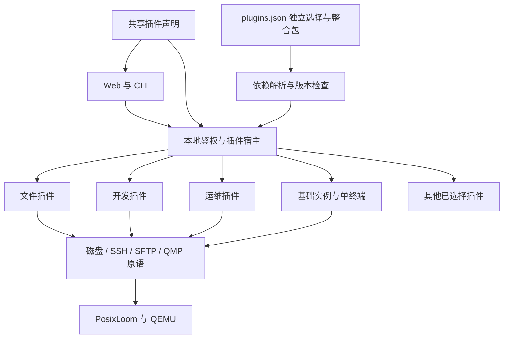

# 最小核心、插件与整合包

Sakura 的初始版本只负责让用户创建、启动、使用和停止一个可靠的本地 Linux 空间。新增业务能力必须作为插件接入；常用组合通过整合包交付。默认插件选择为空，不因升级、已有实例或历史配置自动启用可选功能。

## 首版边界

| 层             | 职责                                                                                    | 默认行为                       |
| -------------- | --------------------------------------------------------------------------------------- | ------------------------------ |
| 最小宿主       | 配置与数据路径、鉴权、同源检查、HTTP/WebSocket、错误处理、插件目录与依赖解析            | 始终运行                       |
| 基础运行能力   | PosixLoom/QEMU 进程管理、Alpine 实例创建/删除/启停、磁盘持久化、SSH、启动日志、资源配置 | 开箱即用                       |
| 基础界面与 CLI | 实例列表、单终端、配置、插件中心、系统信息                                              | 不要求业务插件                 |
| 可选插件       | 文件、项目、桌面、开发、监控、备份等业务服务与入口                                      | 显式选择后，下一次启动加载     |
| 插件整合包     | 版本化的插件成员清单                                                                    | 只解析组合，不运行独立业务代码 |

基本网络初始化、SSH 通道、磁盘锁、关机保护、输入校验和请求鉴权属于宿主可靠运行所需的基础设施，不能通过停用插件关闭。`Machines` 保留磁盘、SSH/SFTP、进程和 QMP 操作原语，插件复用这些原语；快照、文件管理、端口管理等业务入口由对应插件拥有。

“一切皆插件”约束的是能力的归属与组合，不要求把每个按钮、工具函数或安全检查都变成一个独立安装单元。首版保留唯一的 QEMU 运行实现，避免为尚不存在的第二个运行后端引入抽象。

默认导航仅有「工作空间 / 插件中心 / 系统设置」；默认实例标签仅有「终端 / 配置」。没有后台备份、同步、资源采样、计划启停、开发模板安装或 IDE 配置刷新。



## 插件划分

共享目录 `shared/plugins.ts` 是插件标识、版本、依赖与界面入口的唯一声明来源。`server/plugins/<id>.ts` 负责注册服务和处理路由。插件标识不会与磁盘导入导出的 `.sakura` 包混用。

| 插件标识             | 业务范围                                              | 直接依赖           |
| -------------------- | ----------------------------------------------------- | ------------------ |
| `transfers`          | 文件、磁盘包及本地文件的传输基础；任务记录            | 无                 |
| `files`              | SFTP 浏览、上传下载、编辑器、历史与回收站             | transfers          |
| `images`             | 发行版镜像目录、下载与校验                            | 无                 |
| `terminal-workspace` | 多终端、分屏与 tmux 会话恢复                          | 无                 |
| `snapshots`          | 快照、恢复、克隆、普通磁盘包导入导出                  | transfers          |
| `backups`            | 定时、保留策略、加密与外部目录备份                    | snapshots、secrets |
| `projects`           | 多项目、开发模板、初始化与项目服务                    | 无                 |
| `environment`        | 环境配方与 Remote-SSH                                 | projects           |
| `development`        | 工具、代码搜索/检查、命令、流水线、运行时版本         | projects、files    |
| `git`                | Git 操作与远程仓库                                    | projects           |
| `containers`         | Docker / Compose                                      | projects           |
| `sync`               | 双向目录同步与冲突决策                                | projects           |
| `network`            | 端口转发、代理、软件源与诊断                          | 无                 |
| `secrets`            | 私密配置及环境变量引用                                | 无                 |
| `monitoring`         | 客户机资源与项目服务健康检查                          | projects           |
| `desktop`            | KDE Plasma、noVNC 与输入法，实验性                    | 无                 |
| `library`            | 分组、标签、收藏与批量启停                            | 无                 |
| `maintenance`        | 故障诊断、磁盘扩容与整理                              | 无                 |
| `migration`          | 数据目录迁移                                          | 无                 |
| `automation`         | 计划启停、暂停/恢复、阈值、资源策略、包管理与开发任务 | projects           |
| `extensions`         | 第二批扩展能力与工程操作适配器，实验性                | automation         |
| `platform`           | 第三批远程、灾备、安全与协作适配器，实验性            | automation         |
| `command-palette`    | 全局导航与已启用能力的搜索                            | 无                 |

`transfers` 是可复用的底层插件，不会因为加载它而开放文件或快照业务。下载票据签发会再次检查具体功能所属插件；已有导出任务的重试也必须启用 `snapshots`。

项目、文件、快照等界面只挂载已启用的配套插件：例如文件插件不要求 Git 或开发工具，快照插件不启动备份定时器，项目插件不自动启动健康检查。配置了私密引用的项目在 `secrets` 未启用时明确报错，不静默丢弃引用。

资源采样当前复用项目工作区实现，因此 `monitoring` 明确依赖 `projects`。扩展与平台能力保留现有适配器的实际就绪状态；登记在目录中不代表客户机、远程主机或外部服务已安装就绪。后续需要独立发布某一适配器时，将它拆为新插件并更新整合包，不向核心新增入口。

## 整合包

| 整合包                  | 面向场景              | 直接成员                                                                                              |
| ----------------------- | --------------------- | ----------------------------------------------------------------------------------------------------- |
| `essentials` 日常使用   | 基础 Linux 的常用补充 | files、snapshots、images、terminal-workspace                                                          |
| `developer` 开发工作台  | 项目与代码开发        | files、projects、environment、development、git、network、secrets、terminal-workspace、command-palette |
| `operations` 运维与备份 | 日常维护与数据保护    | backups、sync、monitoring、maintenance、library、migration                                            |
| `desktop` 图形桌面      | 图形 Linux            | desktop、files、snapshots、images                                                                     |
| `lab` 实验室            | 主动试用进阶能力      | automation、extensions、platform、containers                                                          |
| `complete` 完整兼容     | 恢复此前所有扩展入口  | 当前所有插件，包括实验插件                                                                            |

没有默认整合包。`complete` 是迁移便利选项，不是首次启动配置。整合包锁定每个直接成员的版本；当前插件版本均为 `0.1.0`，宿主插件 API 为 `1`。解析时校验成员版本、API、未知标识和依赖循环，依赖先于消费者初始化。

整合包不复制插件代码，不覆盖插件配置，也不代表新的运行实例。两个整合包引用同一插件时只激活一次。停用整合包后，独立选择及其他整合包所需的插件继续保留；只有不再被引用的依赖才从下次启动清单移除。

## 选择、激活与关闭

状态保存于当前数据目录的 `plugins.json`：

```json
{
  "schemaVersion": 1,
  "plugins": ["desktop"],
  "packs": ["developer"]
}
```

文件只保存用户的独立选择与整合包选择，依赖闭包在读取时计算。缺少文件意味着基础版；损坏或不兼容的文件会明确报错，不覆盖原文件，也不自动回退为全部启用。写入经过串行队列与临时文件替换，写入失败时内存中的选择保持原样。

宿主分别记录 `active`（本进程成功激活）、`planned`（下次启动的依赖闭包）和 `errors`。修改选择不热卸载正在处理请求的服务。启停插件后需要退出并重新启动 Sakura；仅刷新浏览器无效。

1. 读取并校验选择，计算依赖顺序。
2. 仅动态导入选中插件模块，执行 `activate`，登记资源与服务。
3. 某插件启动失败时释放其已创建资源，记录错误；跳过依赖它的插件，继续启动其他插件与基础能力。
4. 请求经过宿主鉴权和插件归属检查，再进入插件处理器。桌面及终端会话 WebSocket 同样检查启用状态。
5. 退出时拒绝新请求，取消并等待插件在途请求，再按依赖顺序的逆序清理服务、任务和监听器，最后关闭虚拟机与运行时。

禁用插件不会删除客户机软件、磁盘、备份、历史或插件配置，也不会撤销此前已写入客户机的配置。再次启用可继续使用这些数据。已有实例在基础版中仍可启停，并可以修改基础资源；原有的发行版、模板及端口配置可以原样保留，创建或修改相应扩展配置需要启用对应插件。磁盘等原有破坏性操作继续沿用各自的确认和停机要求。

首次运行与已有版本升级统一采用相同规则。升级后的用户如需要原先后台的自动备份或同步，应先选择对应整合包并重启，插件中心会显示实际运行状态。

## Web、API 与 CLI

`GET /api/plugins` 返回声明目录、独立选择、整合包、当前激活集合、计划集合、错误和 `restartRequired`。

`PATCH /api/plugins` 接受单次选择变更：

```json
{ "kind": "pack", "id": "developer", "enabled": true }
```

`kind` 为 `plugin` 或 `pack`。试图关闭仍被引用的插件返回 `409`，并列出需要先停用的根插件/整合包。用户可以将整合包中的插件设为独立选择，使其在移除整合包后仍然保留。

`GET /api/system` 的 `plugins` 返回成功激活的插件标识。Web 根据它生成可用导航、标签和快捷命令，并按需加载可选组件；上次保存的页面若不可用，回到工作空间/终端。后端不依赖前端隐藏：访问未激活插件的 API 返回 `403` 并提示启用方式。

```powershell
npm run sakura -- plugins
npm run sakura -- plugin enable files
npm run sakura -- pack enable developer
npm run sakura -- pack disable developer
npm run sakura -- plugin disable files
```

CLI 默认帮助只列基础与插件管理命令；`help all` 列出可选命令。可选命令使用原有 API，保持已启用插件的调用兼容性。

## 扩展开发约束

添加插件需要声明 `id/name/description/version/apiVersion/requires/pages/tabs`，提供 `activate`、HTTP `route`、服务资源清单，以及必要时的 `deactivate`。登记在 `server/plugins/registry.ts` 后，动态导入仅在选择生效时发生。前端扩展使用 `lazy` 入口和 `PluginGate`；插件初始化不能在模块顶层启动定时器或修改用户配置。

服务自身必须释放监听器、定时器、SSH/WS 连接与任务；由宿主负责调用清理方法。可选服务之间有两种关系：硬依赖必须在 `requires` 声明；可选配套使用显式存在性检查，缺少前置能力时提供可理解的错误。整合包不可引入隐式依赖或静默开启其他功能。

首版只加载随源码审核和交付的内置插件。它们与宿主处于同一 Node.js 进程，服务接口用于模块化，**不构成第三方代码的安全沙箱**。此版本没有远程插件市场、任意路径代码加载、热卸载或自动版本升级。可选插件的代码与 npm 依赖仍随源代码版本交付；按需激活、后台运行和浏览器入口加载已经拆分，不宣称已经实现独立插件下载与安装包裁剪。

前述市场与分发能力若加入，应以独立提案定义来源校验、包完整性、隔离执行、权限与版本迁移后再实现，不能直接把当前受信任模块加载器用于第三方代码。

## 验收

- 空选择下，基础实例与单终端可用，不构建可选服务，不注册其监听器或任务存储。
- 单独启用文件/快照等插件能完成自身操作，不请求未选择的配套插件。
- 独立选择与整合包共享依赖只加载一次；依赖循环、版本冲突与未知标识先行拒绝。
- 关闭选择不会删除历史数据，也不能从下载、任务重试、VM 配置或 WebSocket 绕过状态检查。
- 单插件启动失败与清理失败可报告，正常插件与基础能力保持可用。
- 运行 `npm test`、`npm run build`；真实 VM 回归使用隔离数据目录，并覆盖基础创建/启动/SSH/关机及插件快照路径。
