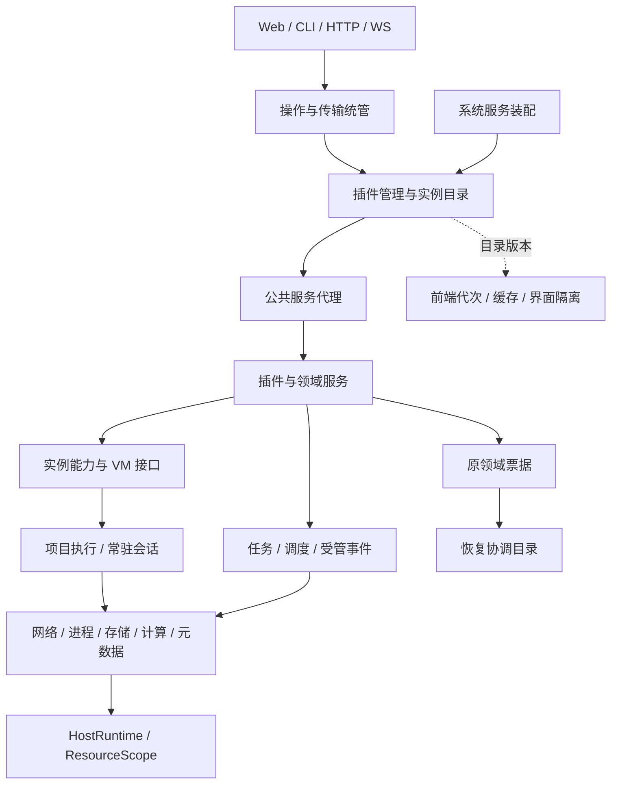
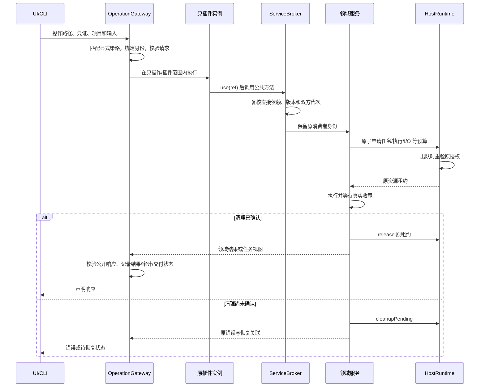

# 插件设计契约与统管层接口

文档版本：**1.1.7**。核对日期：**2026-10-07**。当前实现：应用和内置包 **2.3.7**，宿主插件 API **5**，公共服务契约 **V1**。原 1.0.0 文档基线为应用 `2.2.0 / a8d3e8a`。

本契约将当前架构整理为插件开发、宿主扩展和评审可以共同使用的接口规范。2.3.0 增加回执容量恢复与明确的附属服务降级，收敛 HTTP 处理器和 VM 领域端口；2.3.1 修复锁定时的认证容量、中断归档重试和剪贴板故障隔离。2.3.2 复核历史 86 项请求声明，补齐上传条件正文及默认值、JSON 扩展和媒体解析的一致性，详见 [HTTP 请求契约清单](http-request-contracts.md)。既有公开接口、HTTP 路径和数据格式保持兼容，具体实现与验收见 [项目状态](../PROJECT_STATUS.md)。文中的接口块是现有接口的摘录或明确标注的类型投影，省略导入与非相关成员；完整签名以链接的源码为准，不能把宿主内部接口当作插件 SDK。

阅读顺序：先核对第 1–3 节的边界与包协议，再按第 4–22 节查阅所需统管层，最后按第 23–25 节实施与验收。[插件与整合包协议](plugin-protocol.md)保留包结构、选择迁移和生成流程；[架构说明](architecture.md)说明整体调用关系；[交付记录](plugin-system.md)记录历次验收，不作为当前接口清单。

## 1. 设计边界与权威来源

### 1.1 三种调用面

| 调用面 | 使用者 | 允许的入口 | 权限和资源责任 |
| --- | --- | --- | --- |
| 插件公开面 | 仓库内受审核的官方源码插件 | `PluginContext`、`ServiceRef<T>`、`HostServiceResolver`、绑定实例的 capabilities | 宿主分配身份；插件声明直接依赖并负责自身资源的真实收尾 |
| 宿主装配面 | application、管理入口、基础设施适配器 | `PluginManager`、`PluginDirectory`、`SystemServices`、`OperationGateway`、`ServiceBroker` | 创建实例、绑定权限、发布贡献、协调生命周期；业务插件不能自行构造或绕过 |
| 领域资源面 | 已受管的领域实现和固定适配器 | VM/项目执行、网络、进程、存储、计算、元数据、Jobs、Scheduler | 持有真实资源和原始回执，调用 HostRuntime 准入，完成后确认释放 |

跨插件只能取得公共服务句柄，不得导入另一插件的实现类取得实例。插件 `server.ts` 可以导入**本插件拥有的**领域实现来构造服务，依赖方使用其 `services.ts`。可信插件与宿主共用 Node.js 进程，这些约束由类型、代理、生命周期和源码门禁落实，不等同于 OS 沙箱。

社区插件使用 `community:<id>` 身份和签名 WASM 计算协议。它们不获得 `PluginContext`，也不获得网络、文件或 VM capabilities，见第 22 节。

### 1.2 权威不可互相替代

| 事项 | 唯一权威 | 其它层只能做什么 |
| --- | --- | --- |
| 用户选择 | `plugins.json` / `PluginManager` | 推导下一次启动计划，不伪造正在运行的实例 |
| 实际插件状态 | `PluginDirectory` 中的原 `PluginInstance` | 消费目录版本和只读视图，不以 UI 可见性判断权限 |
| 操作准入 | 显式 `OperationPolicy` + 当前身份绑定 | 根据声明匹配，禁止从 URL、HTTP 方法推断授权 |
| 服务公共成员 | `server/service-contracts/v1.ts` 及其生成描述符 | 实现类可以增加私有方法，消费者接口不随之扩大 |
| 资源额度 | `HostRuntime` 的原租约 | 提交清理结果，不凭任务状态或资源 ID 强制释放 |
| VM / 项目运行身份 | 原 VM lifetime、配置捕获和领域票据 | 精确复核原代，不以相同 `vmId` 代表相同运行 |
| 领域恢复是否完成 | 原领域的完成证明 | RecoveryCatalog 关联与展示，不能代替原领域确认 |
| 元数据提交 | MetadataStore 的串行队列、内容修订及原子发布 | 不能以缓存值代替最新已提交修订 |

规范要求使用“必须 / 不得”；实现缺口在第 25 节单列。正文不将未来接口写成已实现能力。

## 2. 统管层总表与共同身份



| 章节 | 统管层 | 主要接口 | 公开方式 |
| --- | --- | --- | --- |
| 3 | 声明与组合 | `PluginManifest`、`PluginPack`、`PluginSelection` | shared 纯声明 |
| 4 | 插件管理与生命周期 | `PluginManager`、`PluginDirectory`、`PluginRuntime` | 宿主内部；HTTP 输出状态 |
| 5 | 系统服务装配与就绪 | `SystemServices`、`ServiceLifecycle` | 宿主工厂；插件只取受限 resolver |
| 6 | 服务代理 | `ServiceRef`、`ServiceContract`、`ServiceBroker` | 插件 `provide/use/optional` |
| 7–8 | 操作准入与传输 | `OperationGateway`、请求/响应/WS 契约 | 宿主适配；插件声明操作 |
| 9 | 插件能力与 VM | `PluginContext`、`PluginCapabilities`、`VmAccess` | 插件直接使用 |
| 10 | 项目准备与短任务 | `ProjectPreparation`、`ExecutionScope` | 领域实现；插件使用 execution capability |
| 11 | 常驻会话与终端 | `ProjectSessionLifetime`、`TerminalBackend` | 原领域会话；插件取得独立终端子句柄 |
| 12 | 任务 | `JobsV1` | capability 创建自有存储；受管重试 |
| 13 | 调度、事件与拦截器 | `Scheduler`、`ManagedHooks` | 受管领域注册，捕获原实例 |
| 14 | 网络 | `NetworkScope`、`NetworkRuntime` | 插件使用 `host.networking` |
| 15 | 进程 | `ProcessSupervisor` | 固定宿主适配器，非任意 spawn API |
| 16 | 存储 | `StorageRuntime`、`StorageLease` | 插件使用 `host.storage.run` |
| 17 | 计算 | `ComputeRuntime` | 固定计算适配器，非插件任意代码入口 |
| 18 | 元数据与数据目录 | `PluginMetadata`、`MetadataStore`、`DataDirectoryOwner` | 插件只取得不透明元数据回执 |
| 19 | 资源准入与清理 | `HostRuntime`、`ResourceScope`、`PluginScope` | 宿主/领域内部 |
| 20 | 恢复 | `RecoverySource`、`RecoveryCatalogV1` | 原域注册；管理 HTTP 重试/重建 |
| 21 | 前端与诊断 | `ClientModule`、`PluginGeneration`、`OperationResult` | 懒加载 UI、类型客户端、管理 API |
| 22 | 社区计算插件 | 签名目录、WASM `alloc/run` | 独立适配协议 |

共同关联字段来自 [ResourceIdentity](../shared/contracts/host-runtime.ts)：

```ts
type ResourceIdentity = {
  operationId: string; owner: string;
  actorId?: string; pluginId?: string;
  pluginInstanceId?: string; pluginGeneration?: string;
  callerPluginInstanceId?: string; callerPluginGeneration?: string;
  vmId?: string; projectId?: string; jobId?: string;
  vmProcessId?: string; executionGeneration?: string;
  bootId?: string; networkGeneration?: string;
  traceId?: string; spanId?: string; recoveryId?: string;
};
```

`identity` 是 `official:<id>`、`community:<id>` 或 `system:<id>`；**它本身不唯一标识一次激活**，必须与 `generation` 一起使用。`artifactDigest` 固定该代产物。资源的 `owner` 与来源身份不同，例如官方插件的资源 owner 是 `plugin:<id>`。跨服务调用同时保留提供者归属和原消费者代次；账户、项目与 VM 身份沿调用链传播，后台独立调度清除旧请求权限上下文。

## 3. 包声明与版本契约

来源：[plugin-protocol.ts](../shared/plugin-protocol.ts)、[plugin-schema.ts](../shared/plugin-schema.ts)、[plugin-resolver.ts](../shared/plugin-resolver.ts)。

| 版本对象 | 当前值 | 修改规则 |
| --- | --- | --- |
| 应用及内置插件/整合包 | `2.3.7` | 沿用应用发行版；兼容维护 |
| manifest / pack `schemaVersion` | `1` | 声明数据结构版本 |
| 可信插件 `apiVersion` | `5` | 生命周期、显式操作与服务引用协议 |
| 用户选择 `schemaVersion` | `3` | 兼容读取选择 V1/V2，修改时写 V3 |
| 公共服务接口 | `V1` / descriptor `version: 1` | 不兼容接口变更必须另建契约版本 |
| 本文档 | `1.0.1` | 文档版本，不能用于依赖 `pin()` 或替代 API 版本 |

`definePlugin()` 补齐固定字段、空数组和默认时限：激活 30 秒、关闭 10 秒；合法配置范围均为 100–180000 ms。`pin()`、`member()` 使用完整精确版本，不支持范围解析、同插件多版本并存或动态下载官方源码包。缺少选择文件表示基础版，不自动启用已有历史业务。

| 声明字段 | 插件必须提供/遵守的语义 |
| --- | --- |
| `requires` | 每个实际直接使用的必需插件；拓扑启动，失败则跳过消费者 |
| `optional` | 允许延迟发现的直接提供者；不自动启用，不保证卸载顺序 |
| `services` | 自有服务槽位；唯一归属、不可重复，激活返回前全部注册 |
| `systemDependencies` | 允许访问的宿主公共服务键；整体就绪前检查存在性 |
| `contributes.http` | 命名空间、方法、项目范围；不能覆盖核心或另一插件 |
| `contributes.routes` | 每条操作的精确路径、完整 policy、`route/operation` 处理器种类和成功状态 |
| `contributes.operations` | 声明式操作 ID，与模块 `operations` 的键完全对应 |
| `contributes.sockets` | 当前仅 `desktop`、`terminal-session` 固定扩展通道 |
| `pages/tabs/developmentSections` | 共享声明中的界面入口；按需提供同包 `client.tsx` 导出 |
| `contributes.managed` | `job-retry/jobs/schedule/event/interceptor` 受管注册种类 |

整合包只含显式 `plugin/pack` 成员、精确版本和可选旧插件替换映射，不执行代码、不拥有另一份资源、不覆盖配置。完整目录在选择解析前校验，包括未选择的插件；插件依赖环和整合包包含环分别拒绝。两个根选择引用相同插件只激活一次。

**权限说明：**现有可信 manifest 没有可任意填写的 `permissions`、`sandbox`、`entry` 或预算字段，不得在设计示例中添加它们冒充已支持。实例权限由宿主分配；第三方权限也不能通过可信 manifest 获得。

## 4. 插件管理、目录与生命周期统管

来源：[PluginManager](../server/plugin-manager.ts)、[PluginDirectory](../server/plugin-directory.ts)、[PluginRuntime](../server/plugin-runtime.ts)、[PluginInstance](../server/plugin-instance.ts)。以下 `Port` 名称仅是文档投影。

```ts
interface PluginManagerPort {
  init(): Promise<string[]>;
  start(machines: Machines, rolloutAllowed?: (id: string) => boolean): Promise<PluginRuntime>;
  view(): PluginStatus;
  change(input: unknown): Promise<PluginStatus>;
  unload(id: string): Promise<void>;
  assertReady(): void;
  canRetryCleanup(identity: string, generation: string): boolean;
  retryCleanup(identity: string, generation: string): Promise<void>;
  close(): Promise<void>;
}

interface PluginDirectoryPort {
  setDesired(source: PluginSource, ids: Iterable<string>): void;
  begin(source: PluginSource, id: string, version: string, digest: string,
    permissions?: readonly string[], generation?: string): PluginInstance;
  get(source: PluginSource, id: string): PluginInstance | undefined;
  all(): PluginInstance[];
  publish(instance: PluginInstance): void;
  changed(): void;
  subscribe(listener: () => void): () => boolean;
  view(): { version: number; instances: PluginInstanceView[] };
}
```

| 调用 | 前置条件与结果 | 失败/并发规则 |
| --- | --- | --- |
| `init()` | 读取并迁移选择，返回启动清单 | 不写回旧选择，不激活服务 |
| `start()` | 使用已解析清单构造可信运行时 | 已启动再次调用为冲突 |
| `change({kind,id,enabled})` | 严格解析、串行持久化选择，返回完整状态 | 仍被其它根选择引用的插件不能单独取消；不会即时切换官方运行实例 |
| `view()` | 返回 `selection/active/planned/reasons/restartRequired/errors/lifecycle/runtime` | `planned`、期望 desired、实际 phase 必须分别显示 |
| `unload(id)` | 宿主内部停止原插件准入并清理 | 活跃或清理未完的必需消费者仍存在时，`PLUGIN_DEPENDENTS_ACTIVE`；不改用户选择 |
| `begin()` | 建立原身份、产物、代次、作用域 | 前代仍 running/draining/cleanup-pending 时拒绝覆盖 |
| `publish()` | 激活、承诺服务及贡献登记完成后转 running | 插件不可直接调用它提前宣告成功 |
| `retryCleanup()` | 精确原 identity + generation；走对应官方/系统/社区恢复 | 原代变化为 `RECOVERY_STALE`；领域未确认保持 pending |

实际状态取 [PluginPhase](../shared/contracts/plugin-runtime.ts)：

| phase | 含义 | 是否可接收新业务 |
| --- | --- | --- |
| `activating` | 构造并登记资源；尚未向其它消费者就绪发布 | 仅受控激活调用 |
| `running` | 成功发布的实例 | 仍须逐次核对权限与请求身份 |
| `draining` | 停准入、撤销回调/连接、等待在途与关闭 | 否 |
| `cleanup-pending` | 关闭失败或超时；原资源、作用域、额度和产物仍需保留 | 否；仅原清理协议 |
| `inactive` | 原实例真实收尾完成 | 否 |
| `failed` | 启动失败，未留下待确认清理 | 否 |
| `skipped` | 必需依赖失败或灰度策略未允许 | 否 |

运行时顺序为：目录校验 → 必需依赖排序 → 校验可信入口与 manifest 一致 → 预登记服务和 deactivate 清理 → activate → 检查所有承诺服务 → 发布贡献及 running。失败只影响该插件及其必需消费者，基础能力与其它独立插件继续运行。

关闭顺序为：撤销准入和触发 → 取消旧请求/连接 → 等待实际在途 → 消费者先于必需提供者关闭 → 确认清理后删除 Broker 注册。`closeMs` 超时只是停止等待并保留恢复责任，不能据此释放仍存在的资源。

## 5. 系统服务装配与就绪统管

来源：[service-lifecycle.ts](../server/service-lifecycle.ts)、[system-services.ts](../server/system-services.ts)、[application-services.ts](../server/application-services.ts)。这些接口由宿主装配使用。

```ts
type ServiceDefinition<T> = {
  id: string;
  startup?: 'required' | 'degradable';
  requires: readonly string[];
  lateRequires?: readonly string[];
  disposeRequires?: readonly string[];
  create(dependencies: ServiceDependencyResolver): T | Promise<T>;
  initialize(value: T, dependencies: ServiceDependencyResolver): void | Promise<void>;
  dispose(value: T | undefined, dependencies: ServiceDependencyResolver): void | Promise<void>;
  disposePhase?: number;
};
type ServiceDependencyResolver = Readonly<{
  get<T = unknown>(id: string): T;
  late<T = unknown>(id: string): T;
  self<T = unknown>(): T;
}>;
```

`SystemServices.register()` 是对上述声明的强类型封装：`id` 限于 `SystemServiceContracts`，`get/late/self` 的返回类型由服务键推导，不能由调用者自由声称。`vm()` 只有声明 `@machines` 的工厂可用，返回绑定本系统实例的 `VmAccess`。外部依赖 `@machines/@plugins/@audit/@pluginDirectory` 必须登记实际提供者。

| 装配接口 | 结果与契约 |
| --- | --- |
| `register(definition): void` | 冻结声明、登记 create/initialize/dispose；构造前先登记失败清理 |
| `start(definition): Promise<SystemServiceContracts[K]>` | 登记并启动该服务，返回 Broker 句柄 |
| `startDegradable(definition): Promise<SystemServiceContracts[K] \| undefined>` | 显式附属服务失败后清理原实例并保留诊断；不会伪造可用句柄 |
| `ready(id, value): void` | 仅登记已存在的外部阶段和真实对象，不能只标记字符串“ready” |
| `startAll(): Promise<void>` | 按必需依赖启动，初始化成功后才发布公共句柄 |
| `lifecycle.validateReady(): void` | 开放应用入口前核对延迟依赖、清理依赖和就绪状态 |
| `resolver(consumer, dependencies): HostServiceResolver` | 给原消费者绑定允许访问的宿主服务列表 |
| `retire(id): Promise<void>` / `close(): Promise<void>` | 撤销原实例并执行依赖约束下的收尾，失败保留依赖 |

三类依赖不得混用：`requires` 用于构造/初始化与关闭；`lateRequires` 用于整体就绪后的入站回调，排空后不能继续调用；`disposeRequires` 用于已准入任务及其清理仍会访问的提供者。`get()` 仅接受 requires，`late()` 接受声明的三类依赖但检查消费者阶段与提供者就绪，`self()` 仅在自身就绪后可用。`disposePhase` 仅排序无依赖的服务，不能越过真实依赖。

`startup` 默认 required。应用显式区分 31 项必需服务与 12 项可降级附属服务；安全、身份与策略仍须成功初始化。就绪核验允许明确的附属失败，但所有消费者的必需、延迟与清理依赖仍需就绪；插件声明的 `systemDependencies` 不因降级而消失。附属失败在插件中心显示，相关入口通过 `requireService()` 返回 `SERVICE_UNAVAILABLE`。清理期只能访问声明的原代依赖数据和原资源清理回执，不能借保留依赖重新开展业务。

插件通过下面的**实际公开接口**取得宿主服务，不获得 `SystemServices`：

```ts
type HostServiceResolver = {
  optional<K extends keyof HostServiceContracts>(id: K): HostServiceContracts[K] | undefined;
};
```

必须在 manifest `systemDependencies` 声明键；`optional` 表示查询结果可能未就绪，不豁免依赖声明或整体启动核验。当前 [HostServiceContracts](../server/host-service-contracts.ts) 完整映射如下，各 V1 的逐方法参数和返回值见 [v1.ts](../server/service-contracts/v1.ts)：

| 服务键 | 契约 | 职责 |
| --- | --- | --- |
| `communityPlugins` | `CommunityPluginsV1` | 签名社区包目录、安装、执行与恢复 |
| `mediaDevices` | `MediaDevicesV1` | 受管媒体设备入口 |
| `hostMounts` | `HostMountsV1` | 宿主目录挂载 |
| `virtioFsShares` | `VirtioFsSharesV1` | Virtio-FS 共享及 helper 生命周期 |
| `processInterop` | `ProcessInteropV1` | 已配置的跨系统进程互操作 |
| `hostPeers` | `HostPeersV1` | 协作宿主、迁移/复制协调 |
| `notebookEnvironments` | `NotebookEnvironmentsV1` | Notebook 项目运行环境 |
| `browserIde` | `BrowserIdeV1` | 浏览器 IDE 与项目身份 |
| `coldMigrations` | `ColdMigrationsV1` | 冷迁移队列与原传输恢复 |
| `snapshotReplications` | `SnapshotReplicationsV1` | 快照复制 |
| `haHostFailover` | `HaHostFailoverV1` | 宿主故障转移 |
| `haLocalFailovers` | `HaLocalFailoversV1` | 本地接管 |
| `disasterRecovery` | `DisasterRecoveryDrillV1` | 灾备演练 |
| `trustedBoot` | `TrustedBootServiceV1` | 可信启动检查与附件 |
| `projectTerminals` | `ProjectTerminalsV1` | 项目终端公共服务 |
| `capabilityChecks` | `CapabilityChecksV1` | 功能适配器的实际就绪检查 |

宿主内部 `SystemServiceContracts` 范围更大，包含账户、会话、SSO、审批、原生集成等服务；完整键表在 [service-contracts.ts](../server/service-contracts.ts)。不能把内部注册键自动加入插件可访问范围。

## 6. 服务代理与版本化接口统管

来源：[service-ref.ts](../server/service-ref.ts)、[service-broker.ts](../server/service-broker.ts)、[独立 V1 接口](../server/service-contracts/v1.ts)、[生成的成员描述符](../server/public-service-members.ts)。

```ts
// 省略仅用于 TypeScript 类型约束的 unique-symbol 字段。
type ServiceRef<T> = Readonly<{
  pluginId: string; key: string; version: number; contractId: string;
  contract?: ServiceContract<T>;
}>;
// 服务提供者绑定已经版本化的独立契约。
function serviceRef<T>(pluginId: string, key: string, contract: ServiceContract<T>): ServiceRef<T>;

// PluginContext 上的实际接口。
interface PluginServicePort {
  provide<T, Value extends T>(service: ServiceRef<T>, value: Value): Value;
  use<T>(service: ServiceRef<T>): T;
  optional<T>(service: ServiceRef<T>): T | undefined;
}
```

descriptor 字段为 `id/version/members/optional/methods/properties/returns`；其中 `properties/returns` 显式指定嵌套对象或返回句柄的独立契约。成员来自声明生成，不能反射实现类或根据类名推导。

| Broker 内部接口 | 用途 |
| --- | --- |
| `register<T>(instance, reference, value): T` | 核对提供者、自有 service key、契约 ID/版本、成员与重复注册 |
| `lookup<T>(consumer, manifest, reference, optional?): T \| undefined` | 核对直接依赖、精确包版本和两端原代，返回公共代理 |
| `registerSystem<T>(instance, value, declared?): void` | 系统提供者初始化后发布独立契约 |
| `system<T>(consumer, id, allowed): T \| undefined` | 核对允许的宿主服务键 |
| `activeBorrows(instance): number` | 观察原提供者的在途借用 |
| `remove(instance): void` | 原实例真实清理后移除注册 |
| `unwrap(value)` | 仅宿主用于归属和清理；插件不得调用 |

调用必须满足：消费者与提供者原代有效、提供者已运行、消费者声明实际直接依赖、双方契约版本一致。可选查询不会自动构建服务；提供者缺失可返回 `undefined`，但未声明依赖和版本不兼容仍是错误。

普通数据可以复制返回；可执行对象、嵌套服务和缓存方法继续受代理约束。旧句柄不因提供者重启而复活。跨提供者的 `init/close/file/dataFile` 等生命周期或内部成员被隐藏；即便 V1 类型中存在 `close`，也不能据此关闭另一个提供者。宿主操作方、自有服务和明确的原资源清理回执按原有规则处理。公共代理不可写，错误为 `PLUGIN_SERVICE_PRIVATE`、`PLUGIN_SERVICE_READONLY`、`PLUGIN_SERVICE_VERSION`、`PLUGIN_REVOKED` 等。

清理回执绑定原资源，可以在业务撤权后重试；只能清理，不能借此建立新业务。异步调用和返回的清理回执同时受原消费者与提供者的作用域观察，可选依赖也不能丢失在途清理责任。

## 7. 操作准入统管

来源：[operations.ts](../shared/contracts/operations.ts)、[operation-catalog.ts](../server/operation-catalog.ts)、[operation-gateway.ts](../server/operation-gateway.ts)、[operation-authority.ts](../server/operation-authority.ts)。

```ts
type OperationBinding = {
  check(): Promise<OperationRole | undefined>;
  input?(input: unknown): Promise<void>;
  identity?: Partial<ResourceIdentity>;
};
type HttpOperationHandler = (
  req: IncomingMessage, res: ServerResponse, url: URL, entry: OperationEntry
) => unknown | Promise<unknown>;

interface OperationGatewayPort {
  register(entry: OperationEntry, handler: HttpOperationHandler): void;
  seal(): void;
  dispatch(req: IncomingMessage, res: ServerResponse, url: URL): Promise<unknown>;
  resolve(method: string, path: string): {
    entry: OperationEntry; parameters: Record<string, string>;
  };
  prepare(req: IncomingMessage, url: URL, method?: string): Promise<{
    declaration: OperationDeclaration;
    instance: PluginInstance | undefined;
    check(): Promise<void>;
    run<T>(work: () => T): T;
  }>;
  run<T>(req: IncomingMessage, url: URL, work: () => T | Promise<T>): Promise<T>;
  readonly version: number;
}
```

`register()` 绑定**目录中同一 entry 对象**，禁止重复或绑定 WebSocket entry 为 HTTP handler；`seal()` 要求每个 HTTP 操作都有处理器，之后不能再登记。`dispatch()` 处理 HTTP；WebSocket 适配器使用 `prepare(..., 'UPGRADE')` 和原长连接准入。`directory()` 提供由当前启用集合生成的操作目录。

策略字段必须逐项写明：

| 字段 | 合法值 / 含义 |
| --- | --- |
| `access` | `controller/public/download-ticket/extension/guest/socket` |
| `roles` | `owner/member/viewer` 的显式数组 |
| `projectPermission` | 可选 `read/write/execute/approve`，由操作语义决定 |
| `projectScoped` | 是否包裹项目上下文；true 时须符合 VM 路径和项目依赖约束 |
| `identity` | `host`、固定原 VM 的 `fixed-vm`、允许自身推进状态的 `lifecycle` |
| `maintenance` | `allow/block` |
| `transport` | `json/binary/form/websocket` |
| `mutating` | 是否产生副作用，不按 GET/POST 猜测 |
| `session` / `vmLock` | `required/allow-locked`；`require-unlocked/allow-locked` |
| `projectBinding` | `none/query/input-scope/legacy-terminal-grant` |
| `approval` | `none/project-change` |
| `extensionAuth` | `none/account/paired/preflight` |
| `socketChannel` | 可选固定六通道之一；不是自由声明 WS 路径 |
| `executionOwner/sessionOwner` | 可选执行/常驻会话归属说明 |

路径匹配时固定路径优先，即便方法不匹配也不能退回参数路径。`prepare()` 捕获凭证和目标身份，读取正文后与资源排队出队后重新检查；不能通过缓慢上传、排队或缓存句柄延续已撤销的权限。没有已准入操作上下文的插件 route 调用以 `OPERATION_NOT_ADMITTED` 拒绝。

## 8. 请求、响应、WebSocket 与错误契约

来源：[HttpRequestContract](../server/http-request-contracts.ts)、[HttpResponseContract](../shared/contracts/http-response.ts)、[WebSocket](../shared/contracts/websocket.ts)、[api-errors.ts](../server/api-errors.ts)。

```ts
type HttpRequestContract = {
  kind: 'none' | 'json' | 'form' | 'binary';
  required: boolean; media?: string; schema?: z.ZodType;
  query: z.ZodObject; headers: z.ZodObject;
};
type HttpResponseContract = {
  kind: 'json' | 'text' | 'binary' | 'event-stream' | 'empty';
  statuses: readonly number[]; media?: string; schema?: z.ZodType;
};
type PluginOperation = {
  request?: z.ZodType;
  response: z.ZodType;
  execute(this: PluginContext, url: URL, input: unknown,
    signal: AbortSignal): Promise<unknown> | unknown;
};
```

`OperationEntry` 组合 declaration、handler 种类、上述请求/响应合同及成功状态。manifest 是路由/策略来源；`server.ts` 的 `operations` 是实现；legacy route 还必须有逐 ID 的 `httpHandlers` 绑定。请求表与公开响应表见 [http-route-requests.ts](../server/http-route-requests.ts)、[plugin-route-responses.ts](../shared/contracts/plugin-route-responses.ts)，不能只在处理器内部增加私有 validator。

当前基线有 **302 个 HTTP 操作和 6 个 WebSocket 操作**。HTTP 均有请求传输及响应契约；这里的完整指目录声明与对应运行边界，不表示动态业务 JSON 已经全部拥有固定领域字段。`PluginOperation.execute` 内部仍接受 unknown；扩展 JSON 仍使用明确的 JSON 值类型。

| 边界 | 必须遵守的行为 |
| --- | --- |
| query | 逐操作 schema；同名重复 query 参数拒绝，不能依赖最后一个值覆盖 |
| headers/body | 无 body 操作拒绝正文；检查实际媒体类型；JSON、form、binary 使用各自解析器和限额 |
| JSON 成功响应 | 写出前核对 schema、状态、媒体；不得删除字段或换状态绕过契约 |
| 流式/二进制/空响应 | 使用对应合同；已发送的字节不能回滚，不能承诺整流原子交付 |
| OpenAPI 与 SDK | 来自同一目录和公共 DTO，客户端与 SDK 共用请求编码；表单不能伪装为 JSON |
| WS | 六通道生成双向消息与连接参数类型、身份及关闭清单；检查声明完整性与漂移；长连接撤权后关闭 |

WS 通道为 `events/terminal/terminal-view/logs/desktop/desktop-view`。前四者采用 `sakura-json-v1` 消息；terminal 输入为 `input/resize`，输出为 `ready/data/error/exit`；events 只下发 change，logs 只下发 data。桌面是 `rfb-3.7-or-3.8` 有序二进制字节流，不能把一个 WebSocket 帧等同于一个 RFB 包。通用上限为客户端 65536 字节、服务端 1048576 字节，字段还有各自限额；只读桌面仍允许协议握手，不允许由“只读”推导完全无客户端字节。

2.3.3 的逐通道收发路径、账户与本机令牌差异、JSON 字段、RFB 过滤、错误/关闭以及兼容行为见 [WebSocket 契约清单](websocket-contracts.md)。`plugins:schema` / `plugins:check` 同时生成/检查 HTTP 和 WebSocket；浏览器使用独立生成的路径、查询与消息类型。账户 terminal-view 仅允许有精确授权的 viewer，本机控制令牌兼容入口仍使用 owner。1005/1006 是客户端观察值，不能作为服务端主动发送的关闭码。

HTTP 错误使用 `ApiErrorDto` 的 `error/code/correlationId`，审计副诊断可以附带 `auditFailure`，不覆盖原业务错误。输入不符通常为 400 `INVALID_INPUT`，媒体不符为 415 `UNSUPPORTED_MEDIA_TYPE`。插件声明式响应校验可产生 502 `INVALID_PLUGIN_RESPONSE`，公共响应边界使用 `INVALID_OPERATION_RESPONSE`。客户端必须查看实际 code，不把所有 5xx 当作“业务未执行”。操作结果查询见第 21 节。

## 9. 插件上下文与 VM 能力统管

来源：[plugin-api.ts](../server/plugin-api.ts)、[plugin-capabilities.ts](../server/plugin-capabilities.ts)、[vm-access.ts](../server/vm-access.ts)。

```ts
// PluginContext 的能力部分；还有只读 PluginServices 兼容 getter。
interface PluginContextPort extends PluginServicePort {
  readonly signal: AbortSignal;
  readonly instance: Readonly<Pick<PluginInstance,
    'identity' | 'generation' | 'version' | 'artifactDigest'>>;
  readonly capabilities: PluginCapabilities;
  readonly execution: PluginCapabilities['execution'];
  readonly storage: PluginCapabilities['storage'];
  readonly networking: PluginCapabilities['networking'];
  readonly vm: PluginCapabilities['vm'];
  readonly system: HostServiceResolver;
  readonly activity: {
    readonly mutations: number; readonly importing: boolean;
    exclusive<T>(name: string, work: () => Promise<T>): Promise<T>;
  };
  require(id: string): void;
  onDispose(disposer: () => void | Promise<void>): void;
  registerJobs(store: JobsV1, retry: (job: JobView) => Promise<unknown> | unknown): void;
  jobViews(): readonly JobView[];
  jobSources(): ReadonlyArray<Pick<JobsV1, 'list' | 'flush'>>;
}
```

上下文及能力对象冻结；`instance` 只提供身份信息，不暴露可修改 permissions/phase 的对象。`host.workspaces` 等兼容 getter 仍经同一 Broker，并不绕过直接依赖检查。`require(id)` 只检查声明的自身或依赖已启用，不会启用或下载插件。

仓库内官方插件统一使用 `use(ref)` / `optional(ref)`，服务引用来自本包或直接依赖的 `services.ts`；兼容 getter 保留于 API 5，官方源码门禁拒绝新增使用。宿主在调用 activate 前按 manifest 的服务槽位登记真实清理；插件必须先 provide 再 init。构造函数中可能失败的事件、调度或依赖登记应延后到已受管的初始化阶段，不能让未返回的对象遗留资源。

`activity.exclusive(name, work)` 用于既有宿主互斥流程；它不能替代操作授权、VM 锁、执行作用域或 I/O 预算。`onDispose` 必须在资源存在后及时登记；清理要返回真实完成的 Promise。`capabilities.diagnostics()` 返回本插件作用域的诊断，而非其它插件的私有对象。

`VmAccess` 由 [vm-ports.ts](../server/vm-ports.ts) 的独立内部领域端口组合，运行白名单与受控视图见 [vm-access.ts](../server/vm-access.ts)。签名不再从 `Machines` 推导；它仍是宿主内部能力边界，**不是单独版本化的 V1 VM SDK**：

| 分组 | 主要接口 | 调用责任 |
| --- | --- | --- |
| 查询 | `get/state/list/view/isBusy/requireStopped/requireUnlocked/incidentLocked/commandline` | 返回快照或只读视图，保留服务端检查 |
| 生命周期 | `create/start/stop/suspend/resume/update/delete/importDisk/adopt` | 生命周期操作自身可以推进状态；迁移/HA 栅栏仍由原域控制 |
| 执行和传输 | `exec/execInput/connect/sftp/files/readGuestFile/writeGuestFile` | 每次新操作复核原插件、原 VM 与请求；不能取得内部 socket |
| 磁盘和快照 | `resize/completeResize/snapshot/onlineSnapshot/memorySnapshot/restore/restoreMemory/editSnapshot` | 交给拥有锁、密钥和恢复票据的原域 |
| 加密与救援 | `diskEncryptionStatus/encryptDisk/withDiskSecret/withRescue` | 不向普通数据 DTO 暴露密钥 |
| 网络与资源配置 | `setForwards/reserveHostPorts/setMemoryTarget/configureHardware/hotplug` | 仍受网络、存储、进程预算约束 |
| 迁移与 HA | `createIncomingTarget/startIncoming/completeIncoming/fenceForLiveMigration/fenceForHa` 等 | 使用完整迁移/见证/退役票据，禁止仅凭 VM ID 解除栅栏 |
| 受管贡献 | `on/off/beforeFileReplace/beforeHaStart/bootGuard` 等 | 绑定创建它们的原代并取得注销责任 |

只读目录为 `records/live/logs`；`engine` 仅有 `run/runStatus/version/aarch64Available/whpxAvailable`；`storagePools` 仅有 `view/directory/conflictsWithDataTarget/run/hasPendingCleanup/ensure`。不得通过这些入口恢复原始管理器、内部连接或可写全局槽位。

## 10. 项目准备与短任务执行统管

来源：[ProjectPreparation](../server/project-preparation.ts)、[ExecutionScope](../server/execution-scope.ts)、[VmLifetime](../server/vm-lifetime.ts)。插件使用以下已存在的 capability，不自行提供 governor、owner 或 Machines：

```ts
type PluginExecution = {
  vmId: string; projectId: string; configVersion?: string; signal?: AbortSignal;
};
type PluginExecutionScope = Pick<ExecutionScope,
  'identity' | 'signal' | 'owner' | 'assert' | 'deferCleanup' | 'recovery' | 'hasPendingCleanup'>;
interface PluginExecutionPort {
  run<T>(options: PluginExecution,
    work: (execution: PluginExecutionScope) => Promise<T>): Promise<T>;
}
type VmIdentity = Readonly<{
  vmId: string; vmProcessId: string; executionGeneration: string;
  bootId?: string; networkGeneration?: string;
}>;
type ExecutionIdentity = Readonly<
  VmIdentity & { projectId: string; configVersion?: string; operationId: string }
>;
```

`execution.run` 合并请求 signal 与原插件 signal，进入原 VM/项目执行范围，原子取得宿主、VM、项目额度。符合原宿主、VM、项目、配置和 owner 的嵌套执行可以显式借用父范围并串行协调；不能借用别的项目槽位，也不能在取消后提前归还父额度。资源出队和委托子工作开始前重新核对权限。

| 执行接口 | 语义 |
| --- | --- |
| `assert(): void` | 检查取消、VM 原运行与执行代次，拒绝复用旧上下文 |
| `deferCleanup(work): () => Promise<void>` | 登记实际清理并返回原回执；成功不会重复执行，失败可重试 |
| `recovery(): () => Promise<void>` | 返回该执行范围保留的清理恢复入口，不是新的业务执行授权 |
| `hasPendingCleanup(): boolean` | 判断是否有未确认收尾；true 时不能声称资源已归还 |

项目准备与执行额度是不同责任。`ProjectPreparationV1` 捕获项目配置、串行准备、身份及网络命名空间，并保留准备租约：

```ts
// ProjectPreparation / V1 的核心签名；V1 使用同名 V1 DTO。
interface ProjectPreparationPort {
  serial<T>(id: string, signal: AbortSignal,
    action: (signal: AbortSignal) => Promise<T>): Promise<T>;
  prepare<T>(id: string, projectId: string | null | undefined,
    signal: AbortSignal | undefined,
    options: { task: boolean; readOnly?: boolean; verifyOnly?: boolean },
    action: (context: PreparationContext) => Promise<T>): Promise<T>;
  retain(context: PreparationContext, task: boolean, terminalId?: string,
    stop?: () => Promise<void>): () => void | Promise<void>;
  prepareTask(id: string, projectId: string | null | undefined,
    signal?: AbortSignal, options?: { verifyOnly?: boolean }): Promise<PreparedProject>;
  close(): Promise<void>;
}
```

`PreparationContext` 含 `id/scope/project/version/live/abort/identity?`；`PreparedProject` 含 `command/projectId/networkIsolation/terminalId?/signal?/release()`，以及可选捕获的 `project/configVersion/live/identity`。调用者必须使用捕获配置执行，结束并完成实际收尾后 `await release()`，不能重新读取最新配置替换原任务身份。

目录迁移、项目配置变更、UID/GID 和客户机运行记录沿用原领域协议，见 [项目执行](project-execution.md)、[项目身份](project-identities.md)。短任务执行额度不能代替持续终端、IDE 或服务进程的常驻会话额度。

## 11. 常驻会话与终端统管

来源：[ProjectSessionLifetime](../server/project-session-lifetime.ts)、[TerminalBackend](../server/terminal-backend.ts)、[ProjectTerminalsV1](../server/service-contracts/v1.ts)。

```ts
type SessionReceipt = {
  runId: string; bootId: string; projectId: string; [key: string]: unknown;
};
// 领域实现使用；机器对象实际为受限 VmAccess。
type SessionOptions<R extends SessionReceipt> = {
  machines: VmAccess; vmId: string; kind: string; receipt: R;
  signal?: AbortSignal;
  live?: NonNullable<ReturnType<VmAccess['live']['get']>>;
  cleanup(receipt: R): Promise<void>;
  governor?: Pick<HostRuntime, 'tryAcquire'>;
};
// acquire 是 ProjectSessionLifetime 的静态方法。
interface ProjectSessionPort<R extends SessionReceipt> {
  readonly identity: VmIdentity; readonly signal: AbortSignal;
  assertReceipt(receipt: R, initialIntent?: boolean): void;
  pin(receipt: R): void;
  perform<T>(work: (signal: AbortSignal) => Promise<T>, signal?: AbortSignal): Promise<T>;
  close(): Promise<void>;
}
```

`ProjectSessionLifetime.acquire(options)` 返回 `Promise<ProjectSessionLifetime<R>>`，按 VM、projectId、runId 查找原会话，复用时必须同时匹配领域 kind、完整票据及原 Live。使用同步原子 `tryAcquire`；没有额度直接失败，不在持有其它会话资源时无限排队。`pin` 只能按原协议补全已知票据，不能用新进程覆盖已观察身份。

默认常驻额度为宿主 64、每 VM 32、每项目 16，受控制通道预留限制。取消和 VM 退出都不证明客户机全部后代已清理；只有 `cleanup(originalReceipt)` 确认后才释放。

插件通过 `host.capabilities.sessions.terminals(): ProjectTerminalsV1` 取得独立子句柄：

```ts
interface TerminalPort {
  prepareTask(id: string, projectId: string | null | undefined,
    signal?: AbortSignal, options?: { verifyOnly?: boolean }): Promise<PreparedProjectV1>;
  prepare(id: string, projectId: string | null | undefined, session?: string | null,
    readOnly?: boolean, signal?: AbortSignal, expectedTerminalId?: string,
    options?: { mode?: 'task'; verifyOnly?: boolean }): Promise<PreparedProjectV1>;
  validate(id: string, projectId: string | undefined, session: string):
    Promise<{ projectId: string; terminalId: string }>;
  stop(id: string, projectId: string, session?: string, signal?: AbortSignal): Promise<void>;
  close(): Promise<void>;
}
```

该终端子句柄的 `close()` 只关闭自己持有的准备租约，不关闭共享根后端；这是与跨服务 Broker 禁止关闭提供者不同的显式子资源协议。基础终端、多终端插件和共享观看复用同一后端；禁止再创建独立全局终端管理器。

## 12. 任务统管

来源：[Jobs](../server/jobs.ts)、[JobView/JobMeta](../shared/contracts/jobs.ts)、[JobsV1](../server/service-contracts/v1.ts)。

```ts
// 通过 host.capabilities.jobs 创建，归属和退出自动绑定原插件。
interface PluginJobsFactory {
  create(name: string, options?: { persistent?: boolean; historyName?: string }): JobsV1;
}
type WorkV1 = (
  log: (text: string) => void, signal: AbortSignal,
  update: JobUpdate, result: (value: unknown) => Promise<void>
) => Promise<void>;
interface JobsPort {
  start(key: string, work: WorkV1, meta?: JobMeta): JobView;
  track<T>(key: string, work: (log: (text: string) => void,
    signal: AbortSignal, update: JobUpdate) => Promise<T>,
    meta?: JobMeta, external?: AbortSignal): Promise<T>;
  list(): JobView[];
  view(key: string): JobView | null;
  get(id: string): JobView | undefined;
  cancel(key: string, reason?: unknown): void;
  wait(key: string): Promise<void>;
  resolveCleanup(id: string): Promise<void>;
  flush(): Promise<void>;
  close(): Promise<void>;
}
```

| 方法/数据 | 必须明确的含义 |
| --- | --- |
| `create()` | 每插件最多 16 个任务存储；name/historyName 使用受限标识，不能提供文件路径；默认持久化 |
| `start()` | 立即返回任务视图，实际工作经过 Jobs/HostRuntime 排队；返回不等于执行成功 |
| `track()` | 返回工作结果并受外部 signal 约束；必须等待真实清理后结束 |
| `key` 与 `id` | key 用于运行域的查看/取消/等待，id 定位一条历史记录；不能互换 |
| `cancel()` | 发出取消，界面仍需展示 cancelling/cleanup-pending 等准入状态 |
| `wait()` | 等待生命周期结束；获取结果使用原结果接口，不把 wait 当成业务结果 |
| `resolveCleanup()` | 由原领域完成清理后核对关联资源，不是管理员按任意 ID 强制释放 |
| `result(id)` | V1 当前返回 `Promise<any>`；调用者必须按本业务 schema 验证，不能声称已有通用强类型结果 |
| `clearCompletedLogs(entries, at)` | entries 为 `{id, signature}[]`，核对原记录后清理已完成日志；返回删除条数和字节数 |
| `persistenceError` / `flush()` | 报告持久化失败，不将失败历史伪装成已保存 |

`host.registerJobs(store, retry)` 登记同属本插件的存储和重试入口；必须声明 `job-retry` 等受管种类。原任务 `cleanup-pending` 未确认时重试被拒绝。任务历史是可见记录，不构成外部副作用的恰好一次承诺；插件必须依靠领域幂等键、原票据或恢复协议处理重复请求。

## 13. 调度、事件与拦截器统管

来源：[scheduler.ts](../server/scheduler.ts)、[managed-hooks.ts](../server/managed-hooks.ts)、[plugin-authority.ts](../server/plugin-authority.ts)。

```ts
type ScheduleDefinition = {
  id?: string; owner: string; label: string; intervalMs: number;
  immediate?: boolean; overlap?: 'skip' | 'coalesce'; catchUp?: 'skip' | 'once';
  timeoutMs?: number; backoff?: { initialMs: number; maxMs: number; factor?: number };
  run(context: { signal: AbortSignal; scheduledAt: string }): Promise<void>;
};
type ScheduleHandle = {
  id: string;
  trigger(): boolean;
  snapshot(): ScheduleView;
  close(): Promise<void>;
  resolveCleanup(jobId: string): Promise<void>;
};
interface SchedulerPort {
  register(definition: ScheduleDefinition): ScheduleHandle;
  snapshot(): ScheduleView[];
  beginDrain(): void;
  close(): Promise<void>;
}
interface ManagedHooksPort<A extends unknown[]> {
  register(run: (...args: A) => Promise<void> | void): () => void;
  dispatch(...args: A): Promise<void>;
  readonly size: number;
}
```

Scheduler 是现有领域受管入口，`PluginContext` 没有 `scheduler` 字段。领域构造在原实例权限范围内注册，实例必须允许 `schedule` 并声明 `contributes.managed: ['schedule', ...]`。调度自身使用独立后台身份，每次派发再取得 Jobs 额度；不继承注册请求的账户、VM 或任务槽位。

重叠策略显式跳过或合并，迟到补偿最多一次；失败按 backoff 退避。`trigger()` 返回是否接受触发，不承诺完成。`beginDrain()` 停止新增调度，`close()` 等待派发工作真实结束。执行超时不会解除仍未确认的清理。

拦截器 `register()` 返回只能注销原 callback 的回执，撤权时自动移除；不是可覆盖其它插件的全局 `set*` 槽位。VM 的 `on/off` 也绑定原实例，独立后台事件不能继承已结束请求。必须声明 `event/interceptor` 等实际贡献，失败、撤权和关闭均有注销路径。

普通周期工作不得在业务模块自行 `setInterval`；协议超时、会话安全期限和 HA 心跳沿用精确列入门禁的原协议例外，不能用“需要定时”作为通用豁免。

## 14. 网络统管

来源：[NetworkScope](../server/network/index.ts)、[NetworkRuntime](../server/network/core.ts)、[网络运行时说明](network-runtime.md)。

```ts
type NetworkIdentity = Readonly<{
  owner: string; purpose: string; vmId?: string; generation?: string;
  projectId?: string; scopeId?: string;
}>;
type Destination = { host: string; port: number; family?: number };
// NetworkScope 的实际受管 Agent 返回形状，名称仅用于本文展示。
type ManagedHttpAgent = http.Agent & {
  addRequest(request: http.ClientRequest, options: http.RequestOptions): void;
};
// host.networking 的主要接口；Node 类型的重载沿用各原生类型。
interface NetworkPort {
  readonly identity: NetworkIdentity;
  dial(destination: Destination, signal?: AbortSignal, timeoutMs?: number): Promise<net.Socket>;
  lookup(hostname: string, options?: { family?: number }): Promise<{ address: string; family: number }>;
  fetch: typeof globalThis.fetch;
  httpRequest: typeof http.request;
  httpsRequest: typeof https.request;
  httpsGet: typeof https.get;
  webSocket(url: string, options?: WebSocket.ClientOptions): WebSocket;
  connectLocal: typeof net.createConnection;
  createServer: typeof net.createServer;
  createHttpServer: typeof http.createServer;
  createHttpsServer: typeof https.createServer;
  manageServer<T extends net.Server>(server: T): T;
  requestHandler(): { httpAgent: ManagedHttpAgent; httpsAgent: ManagedHttpAgent };
  close(reason?: unknown): Promise<void>;
}
```

`proxyEnvironment()` 另返回受管本地代理环境变量与 `close()` 回执，供固定子进程适配器使用；代理凭据不能进入公共日志或 DTO。`requestHandler()` 提供 SDK 所需 agents，不能传入自定义 agent、socket 或 createConnection 绕过归属。

| Runtime 内部接口 | 责任 |
| --- | --- |
| `start()` | 启动并预检网络 worker |
| `check(identity, operation, ...)` | 核对 owner、scope、运行状态及连接/监听限额 |
| `dial/lookup/connectLocal/manageServer` | 登记出站连接、DNS、本地管理及入站生命周期 |
| `nativeLease(identity, cancel)` | 为固定原生网络适配器登记取消与原资源归属 |
| `attachVm(options)` | 创建 VM generation 对应的网络 lease 与 QEMU 后端 |
| `whenReleased(identity)` / `closeServer(server)` | 等待该范围连接或原监听真实释放 |
| `beginDrain/snapshot/close` | 停准入、诊断与最终排空 |

插件 owner 和 scope 由 `networkFor()` 绑定，不由插件传入另一个 identity；保留的 callback 会恢复原插件身份，撤权后不再进入业务。`close()` 必须等待该 scope 的 lease 消失，不能只销毁 agent 就宣告关闭。

宿主 TCP/DNS 使用有界 worker，HTTP/SSH/TLS 仍在协议适配器处理。每个 VM 绑定独立网络代次，worker 故障停止受影响 VM，不迁移活动 NAT 状态或重放连接。必需网络核心与可选 `network` 业务插件分开，停用后者不关闭宿主基础网络。

## 15. 进程统管

来源：[process-supervisor.ts](../server/process-supervisor.ts)、[runtime.ts](../server/runtime.ts)。宿主固定适配器使用：

```ts
type ProcessAdmission = {
  owner: string; kind: 'vm' | 'tool' | 'helper'; label: string;
  lane?: 'interactive' | 'background' | 'control'; signal?: AbortSignal;
  queueTimeoutMs?: number; mode?: 'direct' | 'native-owner';
};
interface ProcessSupervisorPort {
  run<T>(options: ProcessAdmission,
    operation: (control: { cleanupPending(error: unknown): void }) => Promise<T>): Promise<T>;
  observe(adapter: HostProcessAdapter, create: () => ChildProcess,
    options?: Partial<Omit<ProcessAdmission, 'kind' | 'mode'>>): Promise<ObservedHostProcess>;
  helper(options: HelperOptions): Promise<ManagedHelper>;
}
```

`run()` 只授予预算并观察适配器回执，不会自行启动或杀死进程。`observe()` 仅接受 `hostProcessAdapters` 中审核过的适配器；`spawnObserved` 仅在已授予预算、同步且尚未消费的构造范围中可用。插件没有 `host.process.spawn`，也不得直接导入 `child_process` 绕过统管。

`HelperOptions` 在 owner/label/signal 等字段上增加 `helper: 'virtiofsd' | 'swtpm'`、`file`、`args`、`onExit?`、`graceMs?`、`closeTimeoutMs?`。`ManagedHelper.ready(probe, timeoutMs?)` 检查服务就绪；`close()` 等待退出。原生 GPG/剪贴板等通道保留其 PID、nonce、握手及退出回执，不用普通 helper 模型替换。

`direct` 预留一个总进程槽位；`native-owner` 预留 Native Host 与目标两个总槽位，并保留一个 vm/tool 分类槽位。额度只统计已知启动参与者，不是操作系统任意后代数量硬上限。

调用者必须等待实际进程树退出；EOF、abort、exit 回调或 VM 已停都不自动等价于所有后代清理。不能确认时调用 `cleanupPending` 保留整份预算。`ObservedHostProcess.handoffToUser()` 只用于明确交给用户的桌面程序，不能作为常规插件逃避清理的路径。

## 16. 存储统管

来源：[storage-runtime.ts](../server/storage-runtime.ts)、[StorageRuntimeV1](../server/service-contracts/v1.ts)、[存储运行时说明](storage-runtime.md)。

```ts
type StorageRequest = {
  owner: string; taskId: string; label: string; paths: readonly string[];
  mode: 'read' | 'write'; transfer?: 'outbound';
  buffers: number; files: number;
  temporary?: readonly { path: string; bytes: number }[];
  temporaryPhases?: readonly (readonly { path: string; bytes: number }[])[];
  dynamicTemporary?: readonly string[];
  lane?: 'interactive' | 'background' | 'control'; signal?: AbortSignal; timeoutMs?: number;
};
type PluginStorage = Omit<StorageRequest, 'owner' | 'taskId' | 'transfer'>;
type PluginStorageLease = Omit<StorageLease, 'transfer'>;
interface PluginStoragePort {
  run<T>(request: PluginStorage,
    work: (lease: PluginStorageLease, signal: AbortSignal) => Promise<T>): Promise<T>;
}
interface StorageLeasePort {
  id: string;
  assertActive(checkSignal?: boolean): void;
  reserveTemporary(path: string, bytes: number): Promise<void>;
  releaseTemporary(path: string): Promise<void>;
  cleanupPending(error: unknown): void;
  readonly pendingCleanup: boolean;
  release(): void;
}
```

插件使用 `host.storage.run()`，宿主固定 owner、产生 taskId、合并取消信号，并从 lease 中移除 `transfer`。回调必须覆盖流关闭和临时文件清理全过程；不要在流仍写入时提前调用 `release()`。

| 输入/接口 | 单位与行为 |
| --- | --- |
| `paths` | 用于实际设备归属和容量核对，不是授予任意路径的安全许可 |
| `buffers/files` | 缓冲字节数、同时持有的文件句柄数，与 I/O 及设备槽一起准入 |
| `temporary` | 各路径预留字节，写入前预算 |
| `temporaryPhases` | 互斥阶段取各设备峰值，不把不会同时存在的阶段相加 |
| `dynamicTemporary` | 预先登记允许未知长度增长的设备路径 |
| `reserveTemporary(path, bytes)` | 写入增长前扩充，重新检查设备/容量；不能先写完再补报 |
| `releaseTemporary(path)` | 仅在文件已删除或所有权已完成转移后调用；它本身不删除文件 |
| `cleanupPending(error)` | 保留资源和临时空间预算，等待领域恢复 |

宿主内部 `StorageRuntime.acquire/run` 还能使用 transfer 约束；网络导出有专门出站限制，为接收端保留 I/O/缓冲，避免两端互等。典型错误包括 `STORAGE_SPACE_REQUIRED`、`STORAGE_DEVICE_CHANGED`、`STORAGE_LEASE_REVOKED`。这些预算管已声明操作，不能声称限制全系统磁盘 I/O 或任意文件系统调用。

## 17. 计算统管

来源：[ComputeRuntime](../server/compute-runtime.ts)、[file-preview-runtime.ts](../server/file-preview-runtime.ts)、[计算运行时说明](compute-runtime.md)。

```ts
type ComputeWork = { source: string | URL; options?: WorkerOptions };
// 当前模块内部的选项形状；不是 PluginContext 的公开能力。
type ComputeOptions = {
  owner: string; label: string; memoryBytes: number; signal?: AbortSignal;
  timeoutMs?: number; partition?: { key: string; limit: number };
};
interface ComputeRuntimePort {
  run<T>(options: ComputeOptions,
    prepare: (signal: AbortSignal) => ComputeWork | Promise<ComputeWork>): Promise<T>;
  beginDrain(): void;
  recover(instance: PluginInstance): Promise<void>;
  close(): Promise<void>;
}
```

固定适配器选择受审核的 worker source，业务请求只提供数据。先取得 worker 和内存预算，再调用 prepare 加载或复制输入，不能在排队期间先堆积大输入。通用执行超时默认 15 秒，合法范围 1–60000 ms；社区 WASM 使用更严格的 1 秒限制。

worker 返回结果后仍要确认退出才释放。`terminate()` 失败进入 `COMPUTE_CLEANUP_PENDING` 并保留原 worker/lease；`recover(instance)` 只核对原 identity/generation 对应的退出。worker 内存预算是声明的资源准入，不是整个宿主 RSS 的硬上限。CPU 密集工作应通过已有固定适配器扩展，不能向插件增加任意代码执行入口。

## 18. 元数据、迁移与数据目录统管

来源：[plugin-metadata.ts](../server/plugin-metadata.ts)、[metadata-store.ts](../server/metadata-store.ts)、[plugin-data.ts](../server/plugin-data.ts)、[data-directory-owner.ts](../server/data-directory-owner.ts)。

```ts
type MetadataRevision = string;
type MetadataSnapshot<T> = { value: T; revision: MetadataRevision };
type MetadataWriteOptions = {
  expectedRevision?: MetadataRevision; signal?: AbortSignal;
  beforeCommit?: () => void | Promise<void>;
};
type PluginMetadata<T = unknown> = Readonly<{
  name: string;
  read(signal?: AbortSignal): Promise<MetadataSnapshot<T>>;
  replace(value: T, options?: MetadataWriteOptions): Promise<MetadataSnapshot<T>>;
}>;
interface PluginMetadataPort {
  reference<T = unknown>(name: string, fallback?: () => T): PluginMetadata<T>;
  run<T>(name: string, work: (signal: AbortSignal) => Promise<T>): Promise<T>;
}
```

插件只通过 `host.capabilities.metadata` 取得回执，不获得真实路径；宿主领域构造器通过 `metadataPath` 解析受登记回执以沿用已有持久化实现。`run(name, work)` 提供该元数据范围的受管 I/O/取消，不自动将任意回调变成跨文件事务。

宿主内部 `MetadataStore<T>` 另有：

```ts
interface MetadataStorePort<T> {
  read(signal?: AbortSignal): Promise<MetadataSnapshot<T>>;
  replace(value: T, options?: MetadataWriteOptions): Promise<MetadataSnapshot<T>>;
  update<R>(edit: (value: T) => R | Promise<R>, options?: MetadataWriteOptions):
    Promise<MetadataSnapshot<T> & { result: R }>;
  remove(options?: MetadataWriteOptions): Promise<void>;
  flush(): Promise<void>;
}
```

同文件 read/update/replace 与旧 `readStore/writeStore` 共用有界串行队列；replace 立即捕获入参，update 在队列内执行完整读改写。revision 是精确内容摘要，缺文件使用 `missing`，不是递增序号。需要防止覆盖他人修改时必须传 `expectedRevision`；冲突为 409 `METADATA_REVISION_CONFLICT`，重新读取并明确合并后再写。插件的 beforeCommit 之后还会复核原代权限。

`flush()` 等待已准入写入，并报告尚未修复的写入失败。备份、迁移和客户机副作用仍需要原领域事务与恢复票据；单文件原子替换不提供分布式事务。插件停用不删除业务数据。逐版数据迁移保留已有版本、未来版本拒绝和 `.v<旧数据版本>.bak` 规则（无版本旧数据为 `.v0.bak`），不能根据插件包版本直接覆盖数据。

`DataDirectoryOwner.acquire(directory, {create?})` 在初始化业务存储前取得规范化目录的 OS 独占归属，返回带 `directory/resourceId/close()` 的对象。Windows 用命名管道、Linux 用抽象 Unix socket；其它平台固定回环端口冲突即拒绝。领域收尾和元数据 flush 未确认前不关闭原目录归属。这是同宿主命名空间的排他约束，不是共享盘分布式锁。

## 19. 宿主资源准入与清理统管

来源：[HostRuntime](../server/host-runtime/governor.ts)、[ResourceScope](../server/resource-scope.ts)、[PluginScope](../server/plugin-scope.ts)、[资源诊断 DTO](../shared/contracts/host-runtime.ts)。

```ts
type ResourceRequest = {
  owner: string; kind: string; label: string;
  lane?: 'interactive' | 'background' | 'control';
  cost: Record<string, number>;
  partitions?: { key: string; limit: number; amount?: number }[];
  identity?: Partial<ResourceIdentity>; signal?: AbortSignal; timeoutMs?: number;
  onQueued?: (id: string) => void;
};
type ResourceRegistration = Pick<ResourceRequest,
  'owner' | 'kind' | 'label' | 'lane' | 'identity'>;
type ResourceLease = {
  readonly id: string;
  release(): void;
  beginCleanup?(): void;
  cleanupPending(error: unknown): void;
  transfer(owner: string): void;
  resize(cost: Record<string, number>): void;
};
interface HostRuntimePort {
  register(request: ResourceRegistration): ResourceLease;
  tryAcquire(request: ResourceRequest): ResourceLease | undefined;
  acquire(request: ResourceRequest): Promise<ResourceLease>;
  subscribeCleanup(listener: () => void): () => void;
  beginDrain(): void;
  close(): void;
  snapshot(): HostRuntimeView;
}
```

| 接口 | 准确含义 |
| --- | --- |
| `register()` | 只登记生命周期归属，不申请 cost；不能用于替代预算准入 |
| `acquire()` | 多维全局与分区预算原子授予；等待时不持有部分额度；队列有界且按 owner 公平 |
| `tryAcquire()` | 立即成功或返回 undefined；不排队。适配器负责同步入口前的权限检查 |
| `resize()` | 已持有维度原子调整，不排队、不隐式新增另一个资源 |
| `transfer()` | 宿主明确移交责任；不能用于让插件冒充其它 owner |
| `cleanupPending()` | 标记仍持有预算的原资源，携带有限错误诊断 |
| `release()` | 原所有者确认实际清理后归还；重复释放不重复扣账 |
| `beginDrain()` | 阻止普通新业务，保留控制收尾路径 |
| `close()` | 完成资源治理关闭；不能替代各 owner 的 close |

HostRuntime 的异步准入在资源交付前复核原操作；被拒绝时归还尚未交付的预算。`control` 用于已授权的控制/清理路径，不是业务资源不足时的提权通道。abort 只取消等待或触发工作取消，**已经授予的额度不随 abort 自动释放**。

当前默认额度（实现常量，不是性能承诺）：

| 维度 | 总量 | 控制预留 |
| --- | ---: | ---: |
| `process` | 32 | 4 |
| `process.vm` | 4 | 0 |
| `process.tool` | 4 | 1 |
| `process.helper` | 16 | 2 |
| `jobs` / `execution` | 各 16 | 各 2 |
| `execution.session` | 64 | 4 |
| `io` | 8 | 2 |
| `io.buffers` | 64 MiB | 4 MiB |
| `io.files` | 128 | 8 |
| `network.worker` | 8 | 0 |
| `compute.worker` | 4 | 0 |
| `compute.memory` | 512 MiB | 32 MiB |

`ResourceScope` 用于宿主和领域的统一关闭：

```ts
interface ResourceScopePort {
  readonly signal: AbortSignal;
  defer(name: string, dispose: () => unknown, order?: number,
    requires?: readonly string[]): () => void;
  own<T extends { close(): unknown }>(name: string, value: T, order?: number): T;
  child(name: string, order?: number, owner?: string): ResourceScope;
  retryCleanup(): Promise<void>;
  close(): Promise<void>;
}
```

资源一经构造、异步 init 之前就登记。`defer()` 返回的是**关闭开始前的所有权注销函数**，调用它不会执行 dispose；仅可在接收方已接管资源时注销，不能与“已清理”回执混淆。关闭先尊重 requires，再按 phase 和同阶段逆序收尾；失败消费者保留提供者，独立资源继续关闭。retryCleanup 只重试保留项，不重复成功清理。

`PluginScope` 把插件在途 Promise、disposer 和失败回执关联到原代，完整管理接口为：

```ts
interface PluginScopePort {
  readonly signal: AbortSignal;
  add(disposer: () => void | Promise<void>): void;
  retainCleanup(disposer: () => void | Promise<void>): (confirmedError: unknown) => void;
  abort(reason?: unknown): void;
  run<T>(work: () => Promise<T> | T): Promise<T>;
  observe(pending: Promise<unknown>): void;
  diagnostics(): {
    resourceId: string | undefined; active: number; revoked: boolean;
    cleanup: { id: string; error: string }[];
  };
  cleanupPending(error: unknown): void;
  recoverCleanup(id: string, recover: () => Promise<void>): Promise<void>;
  settled(): Promise<void>;
  dispose(run?: (dispose: () => void | Promise<void>) => Promise<void>): Promise<void>;
}
```

`run()` 限制该 scope 的在途数量为 128；`observe()` 观察已有 Promise，不能据此声称对任意外部工作都施加相同的准入上限。`retainCleanup()` 可在取消先发生、原回执后到达时保留收尾，返回的确认函数仅移除对应原错误。`dispose()` 先等待在途工作结束再逆序清理，不能把 settled 当作所有 disposer 已完成。这些接口属于宿主内部；插件通过 `onDispose` 和 capabilities 使用，不自行替换作用域。

## 20. 恢复协调统管

来源：[RecoveryCatalog](../server/recovery-catalog.ts)、[恢复 DTO](../shared/contracts/recovery.ts)、[领域发现](../server/domain-recovery-sources.ts)、[迁移/HA 栅栏发现](../server/fence-recovery-sources.ts)。

```ts
type RecoveryCandidate = {
  binding: RecoveryBinding;
  ticketRevision?: string;
  error?: string;
  resourceIds: string[];
  actions: readonly { id: string; title: string }[];
};
type RecoverySource = {
  id: string;
  discover(): Promise<RecoveryCandidate[]> | RecoveryCandidate[];
  recover?(candidate: RecoveryCandidate, action: string): Promise<void>;
  confirmed?(record: RecoveryRecord): boolean | Promise<boolean>;
};
interface RecoveryCatalogPort {
  register(source: RecoverySource): void;
  init(): Promise<void>;
  refresh(): Promise<RecoveryView[]>;
  view(): RecoveryView[];
  diagnostics(): RecoveryDiagnostics;
  retry(input: unknown): Promise<RecoveryView>;
  rebuild(input: unknown): Promise<RecoveryCatalogView>;
  close(): Promise<void>;
}
```

`register/init` 属于宿主内部；公共 `RecoveryCatalogV1` 只包含 refresh/view/diagnostics/retry/rebuild/close 的声明，生命周期仍受 Broker 限制。注册了 recover 就必须同时提供 confirmed，不能把“回调返回成功”当作恢复完成。

| 数据 | 必需信息和使用方式 |
| --- | --- |
| `RecoveryBinding` | `domain/ticketId/owner`，可关联 pluginId、原 instance/generation、artifactDigest、operationId、vmId、projectId、jobId |
| `RecoveryRecord` | 稳定 id、binding、ticketRevision、resourceIds、`pending/attempting/resolved`、发现/更新时间、attempts、错误 |
| `RecoveryView` | Record + 可执行 actions、available、当前 digest |
| retry 入参 | `{id, digest, action}`，全部严格校验 |
| rebuild 入参 | `{revision}`，来自当前 diagnostics 的目录修订；不能使用某条记录 digest 替代 |
| `RecoveryDiagnostics` | healthy/degraded、code/message、revision、容量、记录数、来源失败和隔离文件名 |

恢复顺序为：核对管理操作授权 → 排队后重验 → 重新发现原票据 → 比较记录 digest 和 ticketRevision → 核对 action → 持久化 attempting → 执行原领域恢复 → 检查原资源已核销且 confirmed 为真 → 持久化 resolved。任一环节失败保留原记录和责任；`RECOVERY_STALE` 要求刷新，不能自动以新摘要重放原点击。

领域范围包括插件清理、备份发布、冷迁移传输、同步回滚、HA 未接受记录，以及未完成的在线迁移来源栅栏。旧票据缺失的原身份保持未知，不能绑定当前同名插件。HA accepted 与迁移 completion 必须由原协议确认；迁移“核验完成”可能安全终止原来源进程并查询原会话，**始终保留来源栅栏**。突然退出且缺少原进程退出证明时不可猜测完成。

目录上限为 8 MiB、4096 条，已完成记录保留 256 条。损坏、链接、超限或发现失败进入降级诊断；重建先核对当前 revision，从原领域做只发现扫描，构造候选索引，再隔离原文件、核对副本内容并原子发布。路径是链接或非普通文件时须先修复路径，不能直接覆盖。重建不改变 VM 栅栏、不释放预算、不删除领域票据。记录消失、进程 ID 不存在或用户刷新页面均不足以确认完成。

管理 HTTP 合同：

| 方法与路径 | 输入 | 输出/权限 |
| --- | --- | --- |
| `GET /api/recoveries` | 无 body | `{version: 1, records, diagnostics?}`；owner |
| `POST /api/recoveries` | `{id,digest,action}` | 更新后的 RecoveryView；owner，保留请求撤权检查 |
| `POST /api/recoveries/rebuild` | `{revision}` | RecoveryCatalogView；owner，目录级比较后重建 |

## 21. 前端贡献、状态与诊断统管

### 21.1 浏览器入口

来源：[plugin-client.tsx](../src/plugin-client.tsx)、[plugin-boundary.tsx](../src/plugin-boundary.tsx)、[plugin-generation.ts](../src/plugin-generation.ts)、[resource-cache.ts](../src/resource-cache.ts)。

```ts
// 当前 client.tsx 模块形状；ClientModule 是宿主内部类型。
type ClientModule = {
  tabs?: Record<string, ComponentType<PluginTabProps>>;
  pages?: Record<string, ComponentType<PluginPageProps>>;
  developmentSections?: Record<string, ComponentType<FeatureProps>>;
};
type PluginPageProps = {
  request: Request; vms: VMView[]; selected: string;
  refresh: () => Promise<unknown>; token: string;
  onSelected: (id: string) => void; onCreate: () => void; projectId?: string;
};
type PluginTabProps = FeatureProps & {
  start: () => unknown; busy: boolean; configure: () => unknown;
  openFile?: { path: string; revision: number; directory?: boolean };
};
interface PluginGenerationPort {
  update(view?: { version: number; instances: PluginInstanceView[] }): boolean;
  snapshot(identity: string): string;
  available(identity: string): boolean;
  captureIdentity(identity: string): AbortSignal;
  identityFor(path: string, method?: string): string | undefined;
  capture(path: string, method?: string): AbortSignal | undefined;
  subscribe(listener: (identities: readonly string[]) => void): () => void;
}
```

`FeatureProps` 包含 `vm/request/token/refresh/projectId?/onProjectChange?`。request 的现有签名是 `<T = unknown>(path, method?, body?, signal?) => Promise<T>`；泛型是调用方类型声明，不能代替运行时响应验证。需要操作级推导时使用 [shared/api-client.ts](../shared/api-client.ts) 和 [生成客户端](../shared/contracts/api-client.generated.ts)，保留已有鉴权与取消流程。

| 前端责任 | 行为 |
| --- | --- |
| 贡献可见性 | 消费已发布且 running 的目录贡献；隐藏按钮不代替服务端授权 |
| 懒加载 | 按 owner、入口种类、入口 ID 和 lifetime 缓存组件，导出键必须对应 manifest |
| 故障边界 | 页面/标签/开发区块独立隔离；重试仅重建失败入口，基础终端和导航保持 |
| 代次变化 | fingerprint 包含 generation、phase、permissions、artifactDigest；变化时取消旧 signal |
| 缓存隔离 | 同时登记请求消费者与路由提供者；只失效相关插件分区 |
| 异步提交 | 返回前再检查当前代次，旧响应不能覆盖新状态 |
| 共享读取 | 同资源订阅共享在途请求；最后订阅者离开才取消 |
| 会话切换 | 账户变化和锁定清除整个会话缓存；页面隐藏暂停轮询 |

浏览器模块与 shared 契约不能直接或间接引入服务端实现和 Node.js 能力。社区扩展只渲染受限表单，不参与可信 client.tsx 加载。

官方插件浏览器文件的类型也使用 `OperationResponse` / `OperationRequest` 或 shared DTO，不从服务端实现推导。跨插件嵌入的有状态面板使用提供者的 `PluginBoundary` 和绑定 request；请求同时保留父消费者的取消责任。上传等直接传输必须合并相关插件原代信号，并在响应提交前再次检查。纯编辑组件可以复用，但贡献表仅声明本包实际导出的入口，不能重复宣称另一个插件的标签。

### 21.2 操作结果、审计与资源诊断

来源：[OperationResult](../shared/contracts/operation-results.ts)、[OperationResults](../server/operation-results.ts)、[RuntimeTimings](../server/runtime-timings.ts)、[RuntimeDiagnostics](../server/runtime-diagnostics.ts)。

```ts
type OperationResult = {
  correlationId: string; operationId: string;
  outcome: 'pending' | 'succeeded' | 'failed' | 'unknown';
  executed: boolean; startedAt: string; finishedAt?: string;
  responseStatus?: number; responseValidated: boolean; auditRecorded: boolean;
  delivery: 'pending' | 'sent' | 'failed' | 'unknown'; errorCode?: string;
};
```

`executed` 表示已进入可能产生目标副作用的业务边界，不证明副作用已经成功；领域明确证明未执行时可记为 false。`outcome`、responseValidated、auditRecorded、delivery 分开记录。JSON 写请求在分配回执前有界读取并校验，读取失败不会占据未知结果位置；只有领域明确证明未执行的拒绝可以记为 failed，不能按 HTTP 4xx 统一推断。发送失败、响应校验失败或审计失败都可能发生在业务已经执行之后；先查询原 correlationId，再按领域协议决定是否重试。本接口不是通用幂等键或自动回滚机制。持久回执只存结果元数据，不存请求正文、凭证或业务响应载荷。

普通、恢复管理、认证回执池分别最多 2000、32、64 条，完成记录可淘汰，未知结果保留。密码登录、会话密码解锁，以及登录/解锁的通行密钥 options/verify 共用认证池；失败计数和挑战消耗不等同于登录或解锁成功，只有对应领域确认目标效果尚未发生的拒绝才可回收。管理员归档需提交当前原文 digest、受限原因和 `acknowledgeUnknown: true`；先持久保存原文及操作者证据，再释放在线位置。归档经过 owner 准入和审计，不依赖新回执配额，原结果及账户查询权限保持不变。档案和合法命名的中断临时文件共同占用 4096 条 / 64 MiB 限额；临时文件原样保留、内容不受信任，不能用于查询结果或据此删除在线原文。重试重新校验在线证据并提交新档案；满额、非法目录项、已提交档案损坏或原文变化时停止归档并保留原证据。

| 管理入口 | 用途 |
| --- | --- |
| `GET /api/plugins` / `POST /api/plugins` | 查询统一状态 / 提交 `{kind,id,enabled}` 选择；选择变更不代表即时热加载 |
| `GET /api/operations` | 精确操作、启用状态、策略与契约目录 |
| `GET /api/openapi` / `GET /api/sdk` | 同目录生成的公开 HTTP 描述与 JavaScript 客户端 |
| `GET /api/host-runtime` | owner 的预算、等待、资源、调度、元数据及阶段耗时诊断 |
| `GET /api/network-runtime` | owner 的网络 worker、VM generation 与受管连接状态 |
| `GET /api/operation-results/{correlationId}` | 当前账户/会话可查询的原操作回执；不能查询别人的结果 |
| `GET /api/operation-results` | owner 查看在线容量、损坏记录及可归档原文摘要 |
| `POST /api/operation-results/archive` | owner 按当前摘要保留档案后释放在线容量；不把 unknown 改判成功 |

上述入口各自仍按 `core-operations.ts` 的显式角色、会话和媒体策略执行，不因“诊断接口”统一设为公开。

宿主 `RuntimeTimings` 提供 `observe(source, phase, ms)`、`start(source, phase): () => void`、`measure<T>(source, phase, work): Promise<T>` 和 `snapshot()`。source 固定为 http/job/compute/resource，phase 固定为 queue/execution/cleanup/response/audit/resource-lifetime；单序列最多保留最近 60 秒的 1024 样本。VM、插件、操作和账户 ID 只进入关联记录，不进入高基数指标标签。资源持有时长不能冒充任务执行时长；诊断采样也不能冒充跨版本性能基准。

## 22. 社区插件边界

完整协议见 [community-plugins.md](community-plugins.md)；管理与清理仍复用原实例目录和计算运行时。

| 项目 | 当前契约 |
| --- | --- |
| 安装与来源 | 管理员登记发布者 Ed25519 公钥，HTTPS 目录下载，SHA-256 与签名核对；运行前再次核对 |
| 包限制 | WASM 文件不超过 512 KiB；无宿主函数、内存或模块导入，无函数表 |
| 导出 | 有最大值的 `memory`，`alloc(i32): i32`、`run(i32, i32): i32` |
| 内存/时间 | memory 最大 256 页即 16 MiB；单次执行 1 秒；最多 4 个计算线程并受宿主预算约束 |
| 输入/输出 | UTF-8 JSON 输入最多 32 KiB；返回地址指向 4 字节小端长度及最多 64 KiB 的 JSON 输出 |
| 扩展 | 最多 8 路由、4 面板、每面板 8 个字段；仅文本/数字/布尔表单 |
| 路由 | `POST /api/community-plugins/extensions/{pluginId}/{routeId}`，管理员会话，绑定签名声明 |
| 权限 | 无文件、网络、VM、任意 JS、任意 HTML 和可信服务访问 |

签名证明来源和内容匹配，不证明计算结果正确。官方 API 5 和社区 WASM 协议必须分开版本化，不能只改 manifest 就把社区包提升为可信 Node.js 插件。

## 23. 跨层调用与故障处理契约

### 23.1 一次插件任务



任务返回 202 时，本次 HTTP 只承诺任务已被接收；后台结果必须通过任务中心和原业务结果查询。不得在 HTTP 结束时顺带释放后台工作仍占用的真实资源。

### 23.2 失败时谁负责

| 故障点 | 对外结果 | 必须保留/执行 |
| --- | --- | --- |
| 声明、依赖或处理器不一致 | 拒绝激活/发布 | 不产生可调用入口；报告具体缺项 |
| 激活超时且构造了一部分资源 | failed 或 cleanup-pending | 原 scope、已登记 disposer、产物和依赖 |
| 在排队期间撤权/换代 | 拒绝进入业务 | 归还未交付预算；旧句柄永久失效 |
| 写数据版本冲突 | `METADATA_REVISION_CONFLICT` | 旧数据不被静默覆盖；重新读取再合并 |
| 外部副作用成功但响应/审计失败 | 对应错误与 correlationId | 保留原业务结果，先查询，不盲目重发 |
| 取消/超时后进程、流或 worker 未结束 | cleanup-pending | 原预算、资源句柄和领域票据 |
| 可选提供者退出 | 新借用失败，旧借用按原 scope 收尾 | 不偷偷连接新提供者代次 |
| 恢复记录变化 | `RECOVERY_STALE` | 刷新记录并重新确定动作 |
| 恢复目录自身损坏 | degraded，拒绝不安全恢复 | 隔离原目录、从领域权威重建；不核销资源 |
| 宿主突然退出 | 下次启动按原持久票据发现 | 不以新进程、新插件代次或“记录不存在”代替旧证明 |

幂等保证按层区分：资源 release/注销回执可重复，关闭失败用原回执重试；读取无需产生副作用；创建任务、修改 VM、外部上传等操作**没有由统一层自动提供的恰好一次语义**。不能给接口统一添加一个尚未实现的 `idempotencyKey` 就声称解决重复执行。

## 24. 插件接入与契约变更流程

### 24.1 复用真实样例

[commands/manifest.ts](../plugins/commands/manifest.ts)、[commands/services.ts](../plugins/commands/services.ts)、[commands/server.ts](../plugins/commands/server.ts) 展示完整显式操作流程。以下是其中现有激活方式：

```ts
import type { PluginContext } from '../../server/plugin-api.ts';
import { CommandPresets } from '../../server/command-presets.ts';
import { services } from './services.ts';
import { services as projectsServices } from '../projects/services.ts';
export { manifest } from './manifest.ts';

export async function activate(host: PluginContext) {
  host.provide(services.commands, new CommandPresets(host.vm, host.use(projectsServices.workspaces)));
}
```

此示例导入的是本插件拥有的实现；projects 通过声明的直接依赖和显式公共服务引用提供。服务引用必须像原 `services.ts` 一样绑定 `serviceContracts.CommandPresets`；不要使用只有字符串/泛型断言而没有独立契约的新注册。

### 24.2 新增插件的交付项

| 顺序 | 文件/接口 | 验收条件 |
| --- | --- | --- |
| 1 | `plugins/<id>/manifest.ts` | 只含声明；直接依赖、宿主依赖、受管种类、逐操作 policy 完整 |
| 2 | `server/service-contracts/v1.ts` 与公共 DTO | 公共方法独立于实现；请求、返回、可空性、错误和取消语义明确 |
| 3 | `server/service-contracts.ts`、同包 `services.ts` | 自有槽位与 V1 映射、契约 ID/版本、嵌套公共句柄一致 |
| 4 | `server.ts` 与领域实现 | activate/provide 完整；每个 operation 或 legacy handler 逐项绑定；资源先登记后 init |
| 5 | 请求表、公开响应合同 | 同一目录用于运行门禁、OpenAPI、SDK 和类型客户端，包含 query/header/media/status |
| 6 | `client.tsx`（有界面时） | 导出键对应声明；通过宿主 request，界面故障、代次与缓存隔离 |
| 7 | 恢复源（有持久外部副作用时） | 原票据、revision、discover/recover/confirmed、重启发现和撤权行为明确 |
| 8 | 生成文件及整合包 | 仅把明确需要的插件放入包；同步目录、加载器、描述符和 schema |
| 9 | 必要验证与版本记录 | 独立启用、直接依赖、取消与实际清理通过；列出未验证边界 |

当前 `PluginModule` **要求** `route` 导出，即使所有操作都使用 `operations`，也应沿用示例提供返回 false 的空适配函数。`activate` 必需，`deactivate` 可选，`operations/httpHandlers` 必须与声明完全匹配。不能仅导出一个通用 route 就发布任意子路径。

```ts
// plugin-api.ts 的现有模块接口；body 的 any 是保留的适配边界。
type PluginRoute = (
  this: PluginContext, req: IncomingMessage, res: ServerResponse, url: URL,
  body: (request: IncomingMessage, signal?: AbortSignal, limit?: number) => Promise<any>,
  signal: AbortSignal
) => Promise<boolean>;
type PluginModule = {
  manifest: PluginManifest;
  activate(context: PluginContext): Promise<void>;
  deactivate?(context: PluginContext): void | Promise<void>;
  route: PluginRoute;
  httpHandlers?: Record<string, PluginRoute>;
  operations?: Record<string, PluginOperation>;
};
```

route 返回是否处理该请求；正文必须通过对应已声明 schema 后使用。模块接口里的 any/unknown 不取消 Gateway 的请求与响应检查，也不赋予适配器发布未声明路径的权限。

生成步骤按变更执行，不机械全部重复：

```powershell
npm run plugins:sync       # manifest / 包成员 / 入口改变
npm run plugins:contracts  # 独立 V1 服务接口改变
npm run plugins:schema     # schema / 操作契约 / 类型客户端改变
npm run architecture:check
npm run plugins:check
```

`plugins:check` 同时执行官方源码检查：跨插件服务引用必须有直接声明、不得导入其它插件的服务端实现、不得读取兼容 getter；浏览器模块使用公共传输类型；pages/tabs/developmentSections 的实际导出键和组件类型须与 manifest 一致；默认成功状态须属于公开响应状态集合。

### 24.3 兼容与发布

输入扩展必须继续接受旧合法输入，输出必须满足旧调用方的契约；现有方法和 DTO 字段，包括可选字段，不能删除。新增兼容方法和可选字段可以保留 V1；改参数含义、必填要求、返回结构或取消/归属语义时应审查是否需要新服务版本和宿主 API 版本。

`server/service-contracts/releases/2.1.0.json` 与 `2.2.0.json` 是不可覆盖的冻结基线。运行 `plugins:contracts` 不得更新它们。只有**新的应用版本完成实现提交和验收后**才执行：

```powershell
npm run plugins:contracts:freeze -- --release <应用版本> --commit <已验收实现提交>
```

审核新基线并提交后再创建应用版本标签；冻结以指定 Git 提交为来源，不读取未提交契约。原文档基线保留独立 `plugin-contract-v1.0.0` 标签，2.2.1 文档修订随应用版本管理，不改变宿主 API。

## 25. 验收要求与明确限制

### 25.1 按变更影响范围验证

| 变更类型 | 最小必要验证 | 通过标准 |
| --- | --- | --- |
| 文档与接口说明 | 源码签名/链接/版本/目录数核对，文档差异，architecture 与 plugins 门禁 | 不杜撰公开接口，不混淆权限面，无陈旧当前值 |
| manifest / ServiceRef | 声明与生成检查、相关依赖/Broker 回归 | 缺依赖、跨槽位、错版本、旧句柄、私有成员均拒绝 |
| 生命周期 / 清理 | 定向激活失败、取消、清理失败与原代重试 | 没有真实释放证明不归还预算，失败依赖保留 |
| HTTP/WS | 相关输入/响应/媒体/状态/角色和撤权复现 | 实际载荷与公开契约一致；断开与写出失败可追踪 |
| 元数据 / 持久恢复 | 并发修订、失败写入、损坏/超限、重启与票据变化 | 数据不被静默覆盖；原领域确认后才 resolved |
| 前端贡献 | 相关界面预览/浏览器流程、代次与缓存隔离 | 单插件故障不重建基础终端，旧结果不覆盖新状态 |
| VM/进程/网络实质变更 | 相应真实 VM 或固定适配器最短实测 | 精确原身份、进程树/连接真实退出、恢复行为可确认 |

仅有文档变化时不宣称重新执行了完整应用、浏览器或真实 VM 验收。新增专用测试、日志、截图和临时校验脚本放入已忽略的本地材料目录；Git 只保留简短验证结论，沿用既有 CI 入口。

### 25.2 当前不能承诺的能力

1. 官方选择修改仍需重启生效；内部 unload/recovery 不等于完整公开热更新 API。
2. 源码插件共享宿主进程，静态门禁和公共代理不构成任意恶意 JavaScript 沙箱。
3. `VmAccess` 已有独立内部领域端口，但尚未单独版本化；`JobsV1.result` 及部分内部边界仍有 any/unknown。它们不是完整独立的强类型 SDK。
4. 新网络协议、新 WS 通道、新宿主公共服务和新计算执行器仍需增加并审核适配器，不支持 manifest 任意注册。
5. 元数据只有按文件串行与原子发布，没有跨文件/跨宿主事务；副作用恢复依赖原领域票据。
6. 预算针对受管资源，不证明 OS 级任意进程后代、磁盘流量或总内存已被硬隔离。
7. 既有 2.2.0 验收记录仍保留 Linux 专项、跨物理宿主与网络分区验证边界；本文没有补做这些验收。两端正常重启后的迁移恢复是目标冷启动，不保留客户机 RAM。

这些事项是当前架构边界。后续若改变它们，应作为单独实现迭代明确版本、范围和验收，不在插件接入时通过旁路或文档假设扩展。
