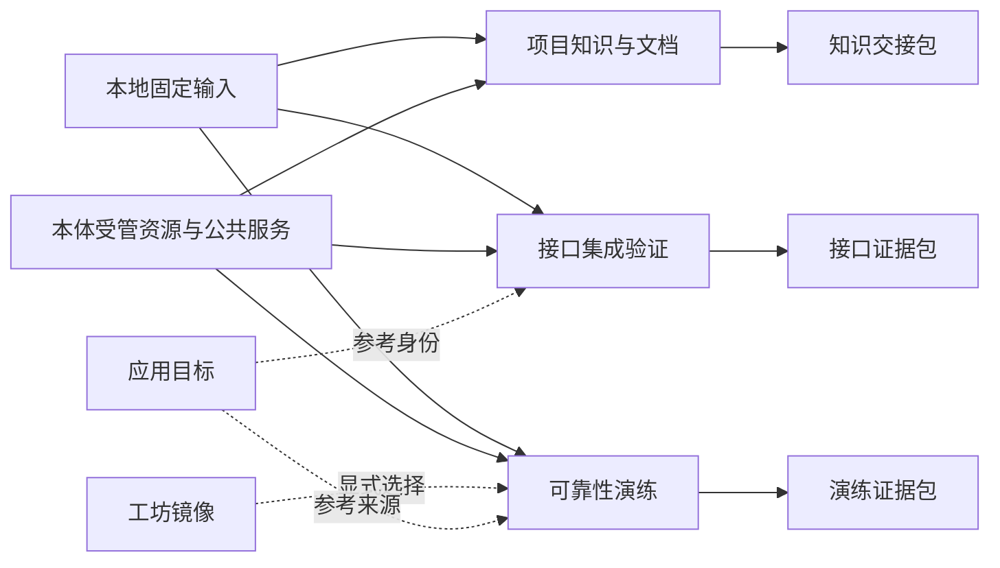

# 第二批三个完整插件包设计

设计版本：**2.0.0**。日期：2026-10-23。核对基线：应用 **2.6.0 / 86f589a**，宿主插件 API 5，既有公共服务 V1 与显式 Notebook V2。

本轮交付产品和实施设计，应用版本保持 **2.6.0 → 2.6.0**。运行实现状态为**待开始**，当前登记数量仍为 69 个插件、13 个整合包。本文中的新插件、页面、接口、命令和格式均为拟议设计，不能直接在当前版本调用。

本文面向确定实施范围的维护者和负责各领域的开发者。第一批设计与已实现功能见[原设计总览](plugin-pack-roadmap.md)、[环境镜像工坊](foundry-workbench.md)、[应用运行与运维](app-runtime-pack.md)和[数据与实验工作台](data-lab.md)。本批保留这些包的职责，增加联调验证、故障演练和知识交接三个流程。

## 1. 三个包完成什么

| 完整包 | 面向用户的问题 | 独立输入 → 最终结果 | 内部插件 | 详情 |
| --- | --- | --- | ---: | --- |
| 接口集成验证 `integration-lab` | 接口改动后，请求场景是否仍能工作，失败在哪一步？ | 本地接口规格、固定样例和场景 → 可复查的请求、断言、兼容差异及受控负载报告 | 11 个 | [接口集成验证设计](integration-lab-pack-design.md) |
| 可靠性演练 `resilience-lab` | 应用遇到受控故障后能否恢复，恢复证据是否成立？ | 固定镜像、合成业务和演练定义 → 隔离副本上的故障、恢复、清理及验收证据 | 10 个 | [可靠性演练设计](resilience-lab-pack-design.md) |
| 项目知识与文档 `knowledge-studio` | 项目说明是否有依据，哪些内容已过期，能否完整交接？ | 本地材料或显式项目快照 → 固定引用、知识条目、审阅文档、本地阅读版本及离线包 | 10 个 | [项目知识与文档设计](knowledge-studio-pack-design.md) |

共设计 **31 个新插件**。数量依据独立对象和生命周期划分：服务插件各自拥有记录和操作，工作台负责引导及聚合，整合包仅声明精确版本成员。现有基础插件随依赖解析补齐，不计入这 31 个新插件。

“完整包”要求用户能走完输入、准备、执行或编写、判断、保存、交接和清理流程。页面、HTTP 和 CLI 必须调用同一领域契约，并具有一致的身份、计划和结果语义。缺依赖时给出具体准备步骤；失败时保留原因与恢复入口。

## 2. 包内组成

### 2.1 接口集成验证：11 个插件

| 插件 | 用户可完成的操作 |
| --- | --- |
| `integration-specs` | 导入并固定接口规格，检查支持范围，比较两个版本的兼容差异 |
| `integration-environments` | 保存目标、变量及秘密引用，审阅每次请求允许访问的范围 |
| `integration-fixtures` | 管理固定请求与响应样例，选择脱敏版本并核对内容摘要 |
| `integration-mocks` | 根据规格与样例定义模拟接口、状态变化和可重复回复 |
| `integration-scenarios` | 编排请求步骤、参数提取和前后条件，固定场景修订 |
| `integration-runners` | 准备专用运行环境，执行场景，管理模拟服务、取消与资源回收 |
| `integration-assertions` | 检查协议与业务断言，逐项解释通过、失败、缺证据和不支持 |
| `integration-load` | 对同一专用实例内的自建模拟服务执行有上限的负载验证 |
| `integration-reports` | 汇总同一次运行的证据，比较固定版本，输出可复核报告 |
| `integration-exchange` | 导出规格、样例、场景和报告，核验并隔离接收外来材料 |
| `integration-workbench` | 从模板进入准备、执行、报告、问题处理和交接流程 |

首次使用以自带规格和合成订单场景完成断网联调。模拟器规则属于 mocks，活动进程属于 runners。功能请求可以显式绑定已授权的测试目标；首版负载测试仅允许自建模拟服务。接口名称、HTTP 方法及可读页面都不能代替目标授权或副作用判断。

### 2.2 可靠性演练：10 个插件

| 插件 | 用户可完成的操作 |
| --- | --- |
| `resilience-targets` | 登记演练目标声明，区分参考来源与实际可操作的隔离实例 |
| `resilience-fixtures` | 从固定镜像与材料准备专用副本，初始化合成业务和恢复基线 |
| `resilience-guard` | 审阅资源预算、故障范围和硬截止，登记独立监管与清理证明 |
| `resilience-faults` | 定义并施加受支持的有界故障，查询、撤回并核对影响范围 |
| `resilience-probes` | 采集基线、故障阶段和恢复后的业务及资源证据 |
| `resilience-recovery` | 定义恢复步骤，核对恢复目标、结果与残留资源 |
| `resilience-scenarios` | 组合基线、故障、停止条件、恢复和通过标准 |
| `resilience-runs` | 按固定计划执行演练，处理并发、取消、中断和原任务核销 |
| `resilience-reports` | 生成演练结论与证据包，完成离线核验和隔离接收 |
| `resilience-workbench` | 提供模板、风险预览、阶段时间线、恢复入口和交接流程 |

首版只操作由本包创建、持有完整归属证明的演练资源。选择现有应用作为来源，不授予停止来源应用、修改其数据或切换生产入口的权限。真实 BMC、物理主机隔离和跨主机接管继续遵守已有领域边界，不能算作本包首版的验证承诺。

### 2.3 项目知识与文档：10 个插件

| 插件 | 用户可完成的操作 |
| --- | --- |
| `knowledge-sources` | 捕获显式选择的本地材料或项目文件，保存来源、版本与权限范围 |
| `knowledge-extract` | 解析支持的文本和结构，记录原始位置、缺项和解析版本 |
| `knowledge-index` | 建立版本化索引，检索授权材料并查看匹配范围 |
| `knowledge-evidence` | 管理固定引用、冲突与过期提示，追溯到确切材料和位置 |
| `knowledge-entries` | 编写知识条目，为陈述关联引用并保留修订历史 |
| `knowledge-documents` | 组织章节、条目和引用，生成可审阅的文档候选 |
| `knowledge-reviews` | 审阅内容、引用及缺项，记录结论和失效条件 |
| `knowledge-publish` | 生成固定阅读版本，管理本机受鉴权的查看和撤下 |
| `knowledge-exchange` | 预览导出范围，离线交接材料与文档，核验和接受导入 |
| `knowledge-workbench` | 从材料导入走到检索、编写、审阅、阅读和交接 |

完整路径采用本地检索和人工编写，不要求模型账户。AI 辅助问答是后续可选扩展，首版不以自动回答代替引用核验。导入文档不运行脚本，阅读版本不加载未审阅的远程资源；撤下本机入口不会撤回已经下载的离线副本。

知识空间首版由宿主所有者管理，审阅明确标为单人审阅。项目材料通过显式捕获成为知识空间自己的固定副本，原项目变化与空间内许可撤销分别处理。多人独立审批和项目成员分享另行设计，不由“审阅”或“发布”名称推导。

## 3. 与现有能力的分工

| 已有能力 | 新包复用的基础 | 新包自己负责的结果 |
| --- | --- | --- |
| `delivery` 构建、报告与晋级 | 不可变制品、受管执行和证据组织模式；按需依赖单个制品服务 | 接口场景、演练结论、文档审阅各自保留独立规则，不冒充已有交付门禁结果 |
| `app-runtime` 部署、入口与恢复 | 可选读取固定应用目标；复用原领域允许的材料或身份 | 测试目标授权与隔离演练实例；不改变应用部署、路由和正式数据 |
| `foundry` 环境制作 | 可选选择已验证镜像，宿主核对不可变引用 | 包内工具准备检查、场景与运行证据；镜像可用不等于场景已通过 |
| `data-lab` 数据实验 | 固定数据和可追溯处理的设计约束 | 请求样例、演练业务数据、知识材料分别使用自己的格式及生命周期 |
| 项目搜索、文件、AI 修复 | 显式项目读取与编辑基础 | 固定材料上的知识引用、内容审阅和阅读版本；不默认修改项目源码 |
| 网络模拟、灾备演练、自动修复 | 已有领域可实现部分及真实验证边界 | 固定场景、专用资源、停止条件、统一证据与恢复核销；不把通用 `action` 门面当作新的归属保证 |

三个新包之间**没有必需依赖**。选择其中任意一个都能完成自己的默认流程。可选适配只出现在调用方声明中，缺席时隐藏或解释对应入口，并保留本地输入路径。

导出的报告可由用户作为本地材料交给知识包，仍须核验格式、权限和内容。这种文件交接不建立运行时依赖，也不自动赋予交付门禁认可。交付工作台以后消费这些结果时，须另行设计证据绑定和失效规则。

## 4. 本体需要提供什么

本体负责资源和权限，插件负责业务定义与判断。三个包不直接访问其它插件实现，也不绕过原领域调用 QEMU、宿主进程、文件系统或网络控制器。

| 公共边界 | 2.6.0 已有基础 | 本批必须补齐或核实的部分 | 负责人 |
| --- | --- | --- | --- |
| 不可变材料与 VM 归属 | [ImageAssetsV1](../server/service-contracts/image-assets.ts)、[共享制品实现](../server/artifact-store.ts) | 为新消费者保留自己的引用、作用域和清理证据；内部类不能被误称为跨插件公共服务 | 存储与 VM 模块 |
| 受管项目执行 | [WorkspacesV1](../server/service-contracts/v1.ts)、[项目执行器](../server/project-task-executor.ts) | 固定工具的受限请求、模拟进程及文本解析任务；运行前检查工具，禁止隐式安装 | 执行模块 |
| 网络与故障监管 | [EgressRulesV1](../server/service-contracts/egress-rules.ts)、[网络运行时](network-runtime.md) | 套接字级请求上限与截止、受限故障适配器、原运行撤回证明和独立监管；原出站服务不能代替这些语义 | 网络、进程与 VM 模块 |
| 文本解析与发布 | [计算运行时](compute-runtime.md)、[文件和项目服务](../server/service-contracts/v1.ts) | 有界解析、内容位置映射、索引授权过滤和固定内容阅读；禁止执行材料内代码及隐式抓取远程内容 | 计算、存储与知识模块 |
| 秘密、授权与审阅 | [插件设计契约](plugin-design-contract.md)、[访问控制](access-control.md) | 计划与凭据版本绑定、每次消费复核、导出材料权限清单、审阅失效；不以导入声明授予本地权限 | 契约与各领域模块 |
| 恢复与停用 | [任务证据](task-evidence.md)、[恢复接口](../server/service-contracts/v1.ts) | 各插件登记自己的恢复提供者，区分安全收尾和重新执行，核对原代资源后才能核销 | 各资源所有者 |

详细拟议服务、方法和操作见三份包设计。新增兼容接口须先完成实现和契约验证；改变既有参数、身份或生命周期语义时新增服务版本。本轮不预建服务声明，不冻结未来应用基线，也不为业务对象增加本体全局管理器。

两项边界须在公共能力阶段明确：现有 `ArtifactStore` 仍要求 VM/项目作用域，接口工作空间和知识空间需要自己的真实授权与存储实例，不能填入虚构 VM ID；`FilesV2` 拟将项目捕获分为固定身份的预览票据与消费票据，读取时不能自动绑定同 ID 的新实例。演练包跨内部插件操作副本时，也必须通过原所有者签发、宿主验证的有限授权，不能仅传递镜像 VM 回执获得控制权。

## 5. 三个包共同遵守的规则

### 5.1 身份、计划与结果

计划绑定内容摘要、对象修订、主体权限、真实消费者、目标身份、工具版本、网络范围和预算。执行前再核对；对象变化或计划过期后必须重新预览。计划一次性消费，重复请求查询原操作，不再产生一份执行。

VM ID、项目名、路径和 PID 都不是充分身份。执行记录保存原 VM 创建回执、运行与 boot 代次、项目身份及具体资源票据。跨适配器保留真实消费者；旧回执不能操作同名的新资源。

持久化先写意图，再执行副作用，再发布回执。任务状态、业务判断和清理状态分别记录。响应丢失、控制进程退出或凭据变化后，不能把未知请求当作未执行，也不能把“取消已受理”当作资源已经退出。恢复首先只读核对原记录，新的业务执行另建计划。

### 5.2 默认行为与关闭

默认插件选择保持空。完整包显式选择并重启服务后生效；启用不联网、不运行场景、不注入故障、不发布阅读版本。每个包都有自己的顶层入口、无 VM 空态和本地模板。

短期运行有持久截止时间，必须验证控制器卡住时的停止机制。可靠性演练还要区分“故障已撤回”“目标已恢复”和“资源已回收”；证据不足时保持未知。关闭插件撤回新操作与访问入口，并完成原资源的受管收尾；保留正式材料、版本、报告和恢复证据。

### 5.3 配额与保留

三份设计中的数值是**首版拟定硬上限，实施前可按资源实测收紧，不是当前性能保证**。单请求、对象、任务与整个包都要有上限，并同时受宿主总额度约束。不能因并行启用三个包而将宿主预算乘以三。

清理必须先列出引用、活动读取、未知任务和恢复保留项，再按原修订执行。被文档、报告、导出包或活动任务引用的材料不能按历史淘汰规则删除。保留到期只表示可以生成清理计划，不表示可以删除来源不明的文件。

### 5.4 交换与信任

三类交接包各有独立格式和版本，按内容类型校验，不能仅凭扩展名分流。导入经过有界读取、路径与条目检查、摘要核验、隔离审阅、显式接受；接受不会启动请求、故障或发布操作。

本地摘要证明字节一致，不证明作者身份，也不证明业务结论正确。包内权限、绝对路径、秘密、活动票据和旧审阅授权不能直接在接收端生效。引用祖先、隐藏材料和原始日志不自动加入导出；脱敏生成新版本，重新核对关联证据。离线副本离开本机后，不承诺远程撤回。

## 6. 实施里程碑

| 阶段 | 优先级、负责人 | 依赖 | 交付与退出条件 | 当前状态 |
| --- | --- | --- | --- | --- |
| D0 设计整合 | P0，统一设计负责人 | 2.6.0 实际代码与目录 | 3 份详情、总览、依赖和边界复核、文档索引与版本记录 | 已完成 |
| M0 公共能力 | P0，执行、网络、存储与契约负责人 | D0；各包最小接口草案 | 用真实资源证明归属、限额、截止、取消和恢复；不能以业务页面代替底层验证 | 待开始 |
| I1 接口集成完整包 | P1，接口验证模块负责人 | 请求执行及材料相关 M0 | 11 个插件；本地模拟联调、失败断言、受限负载、离线接收和清理全链通过 | 待开始 |
| K1 知识文档完整包 | P1，知识模块负责人 | 材料、解析、权限相关 M0 | 10 个插件；离线捕获、固定引用、审阅、阅读、撤权及交接全链通过 | 待开始 |
| R1 可靠性演练完整包 | P1，演练模块负责人 | 监管和故障相关 M0 | 10 个插件；受控故障、独立截止、恢复判定、未知核销及交接全链通过 | 待开始 |
| A1 组合与发行 | P1，统一集成负责人 | 各完整包验收 | 单选、整包、可选依赖缺席、组合额度、纯运行包 CLI 与契约兼容均通过 | 待开始 |

I1 与 K1 可以按文件所有权并行。R1 的故障执行部分必须等独立监管通过，目标与场景编辑可以提前开发。每份详情列出包内分段及具体退出条件；中间阶段可普通提交，但不把缺少最终流程的插件组称为完整包交付。

若在 2.6.0 基线上合并全部兼容功能，可将下一次应用迭代定为 2.7.0；这是实施建议。实际版本须在实施开始时结合基线和兼容审查确定，不预建应用标签，也不凭设计估算工期。

## 7. 设计与实施验收

设计验收核对 31 个 ID 的唯一性、实际与拟议服务的区分、必需依赖无环、可选依赖方向、单包独立路径、文档链接和版本一致性。当前代码与已发布服务基线不变，设计审阅不能记作功能测试通过。

实施必须证明以下结果，并结合各包的具体故障清单验收：

| 场景 | 通过条件 |
| --- | --- |
| 零 VM 与离线首次使用 | 从模板准备到最终结果无隐式下载；缺材料时指出缺项，提供同一流程的准备入口 |
| 单插件与完整包 | 必需依赖正确解析；每个服务可独立查询或操作；工作台覆盖完整流程 |
| 旧修订、旧身份和旧权限 | 执行与输出提交重新检查，拒绝过期计划和跨作用域读取，不覆盖新草稿 |
| 未知副作用与崩溃 | 保留原票据，只核对原资源；不自动重放写请求、故障、恢复或发布 |
| 取消、停用和宿主冻结 | 接受取消与实际退出分别可见；截止机制有真实证据，不用定时器代码推断保证 |
| 报告与引用 | 每个结论关联确切输入、规则、运行或材料；不支持、缺失、截断与失败分别显示 |
| 导入、导出与撤权 | 隔离接受、配额、路径、内容和权限均受检查；导出范围可预览，接收端重新授权 |
| 多包共存与清理 | 宿主总额度仍有效；未知和活动引用阻止删除；一个包停用不误收其它包资源 |
| 发行与交接 | 安装态页面、HTTP、CLI、文档和服务基线一致；离线核验工具不依赖开发源码 |

本轮验证结果、提交与标签见[项目状态](../PROJECT_STATUS.md)。后续实施以三份详情与本总览共同作为验收依据；冲突时先修订设计记录，再改公开契约。
