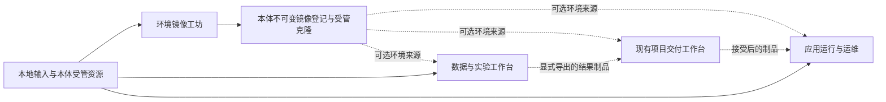

# 三个插件包的产品与实施设计

设计版本：**1.0.0**。日期：2026-10-23。核对基线：应用 `2.5.0 / 6fb9115`，宿主插件 API 5，公共服务 V1。

本文保留 `2.5.0` 时的设计基线；后续实现合并为 `2.6.0` 一个兼容功能迭代。当前目录已登记 3 个新包和 28 个新插件，共 69 个插件、13 个整合包。使用与边界见 [工坊指南](foundry-workbench.md)、[应用指南](app-runtime-pack.md)和[数据指南](data-lab.md)，验收与提交状态见 [项目状态](../PROJECT_STATUS.md)。下文分阶段版本安排属于原设计，不代表分别发布了这些版本。

## 1. 三个包各自完成什么

这三个包分别管理环境、运行中的应用，以及数据与实验。每个包都能从自己的输入走到可保存、可验证、可交接的结果。跨包集成是可选配套，不作为首次使用的前提。

| 包 | 面向的任务 | 独立输入与结果 | 内部插件 | 详细设计 |
| --- | --- | --- | --- | --- |
| 环境镜像工坊 `foundry` | 为断网构建、开发和运行准备可信环境 | 基础镜像、锁定配方和软件包 → 已清理身份、验证并登记的不可变镜像 | 9 个 | [环境镜像工坊](foundry-pack-design.md) |
| 应用运行与运维 `app-runtime` | 将本地制品运行起来，持续维护和恢复 | 已审阅的本地制品、受管目标、配置和数据 → 可访问、可观察、可升级的应用 | 9 个 | [应用运行与运维](app-runtime-pack-design.md) |
| 数据与实验工作台 `data-lab` | 将数据处理过程变成可复核的实验 | 本地数据或显式导入的只读数据 → 数据版本、质量报告、实验结果和离线交接包 | 10 个 | [数据与实验工作台](data-lab-pack-design.md) |

内部插件按持久对象和生命周期划分。每个服务插件提供独立的查询、计划或操作入口；工作台插件负责串联流程。安装整个包才能获得本文约定的完整体验，单独选用插件时由解析器补齐它的必需依赖。

已有 `environment`、`operations` 和 `lab` 包保留原来的含义。它们分别聚合环境工具、运维工具和实验能力，新包围绕完整的业务流程组织状态与操作。新包不替换旧 ID，也不要求用户启用整个旧包来获得一项底层服务。

## 2. 包内插件组成

### 2.1 环境镜像工坊

| 插件 | 用户能完成的操作 |
| --- | --- |
| `foundry-sources` | 登记基础镜像与软件源，固定来源、摘要和信任决策 |
| `foundry-blueprints` | 编写和修订环境配方，预览工具、依赖、网络及资源需求 |
| `foundry-depot` | 预取并核对软件包，检查离线材料是否齐全 |
| `foundry-builders` | 从固定输入创建构建 VM，执行配方，取消或恢复任务记录 |
| `foundry-sanitizers` | 清理构建凭据、机器身份和临时状态，生成首次启动约束 |
| `foundry-checks` | 在新实例中验证工具、断网安装、身份和基础运行能力 |
| `foundry-catalog` | 登记不可变镜像，管理标签、引用、弃用和清理 |
| `foundry-exchange` | 导出环境材料，隔离导入、验证并接受接收端镜像 |
| `foundry-workbench` | 查看配方到镜像的完整进度、失败原因和下一步操作 |

主流程：选择来源 → 固定配方 → 准备离线材料 → 构建 → 清理身份 → 新实例验证 → 登记镜像 → 导出或供调用方选择。缺少来源材料时保留明确的缺项清单；构建失败不登记为可用镜像。

### 2.2 应用运行与运维

| 插件 | 用户能完成的操作 |
| --- | --- |
| `app-targets` | 创建或显式接管部署目标，检查容量、网络和环境 |
| `app-packages` | 登记本地应用制品，核对内容和启动说明，保留版本 |
| `app-config` | 管理配置修订与秘密引用，比较升级所需变更 |
| `app-data` | 管理应用持久数据，生成备份、恢复和迁移计划 |
| `app-deploy` | 审阅安装、升级和停止计划，执行健康验证与切换 |
| `app-routes` | 管理本地访问入口、端口占用和路由切换 |
| `app-observe` | 查看状态、受限日志、健康记录和故障证据 |
| `app-recovery` | 执行有证据的恢复步骤，管理运行手册和演练结果 |
| `app-workbench` | 汇总应用、版本、配置、数据、入口和待处理故障 |

主流程：导入制品 → 选择目标 → 配置和数据计划 → 部署审阅 → 启动与探测 → 切换入口 → 持续观察 → 升级或恢复。应用代码回退与数据恢复分别审阅；旧版本不兼容新数据时，不显示“一键回滚成功”。

### 2.3 数据与实验工作台

| 插件 | 用户能完成的操作 |
| --- | --- |
| `data-runtime` | 准备受管计算环境，检查依赖、限额和隔离条件 |
| `data-sources` | 导入文件或读取已授权的数据源，记录来源与一致性边界 |
| `data-datasets` | 封存数据版本、schema 和脱敏副本，比较版本差异 |
| `data-transforms` | 编辑 SQL 变换，预览计划并保存独立输出版本 |
| `data-quality` | 查看数据画像，执行质量规则并区分样本与全量结论 |
| `data-notebooks` | 启动交互笔记本，执行固定输入的批量任务并保存输出 |
| `data-experiments` | 定义参数矩阵，按配额运行、取消和复核实验 |
| `data-lineage` | 比较结果，追溯输入、环境、变换和执行证据 |
| `data-exchange` | 导出数据与实验材料，在接收端验证和重新运行 |
| `data-workbench` | 从导入到结果比较统一组织流程、状态和失败处理 |

主流程：导入 → 固定数据版本 → 质量检查 → SQL 变换或笔记本 → 参数实验 → 比较与血缘 → 离线交接。第一次导入不执行数据包内代码；接收后运行需要本地环境和新的执行审阅。

## 3. 产品完整性的共同要求

完整包必须交付界面、公共服务、HTTP 契约、CLI、入门模板、错误解释和恢复入口。CLI 与界面使用同一鉴权和操作服务，不引入绕过计划确认的快捷路径。详情文档中的命令和服务名都是拟议接口，实施时按公开契约生成客户端。

首版均以本机所有者操作为范围。共享只读页面只显示对应授权视图，不继承所有者的执行、下载秘密或导入权限。首次启用只注册能力和显示准备检查，不自动安装依赖、连接数据源、启动应用或执行导入内容。

每个包至少提供一个可跑通的入门模板。镜像工坊提供含基础构建工具的环境配方；应用运维提供静态服务和带持久数据的服务说明；数据工作台提供小型表格数据、质量规则和参数实验。模板必须声明实际需要的工具及许可，不依赖隐含联网。

所有页面都应覆盖空状态、准备不足、执行中、取消中、失败、结果未知和只读状态。切换 VM、项目或配置后，旧请求结果不能覆盖新页面。失败时显示原任务、已完成副作用、保留资源和可执行的下一步；查看日志不等于重新运行。

配置变更用修订号检测冲突。执行计划展示输入摘要、目标身份、网络目标、配额、数据影响和有效期。确认必须绑定这份计划；输入或信任变化后生成新计划，不能把旧确认套用到新内容。

## 4. 三个包如何协作

图中的不可变镜像登记接口需要实施，不是 2.5.0 已有 SDK。三个新包之间没有必需依赖。一个包缺席时，调用方保留本地输入流程，并说明可选入口为何不可用。

`foundry-catalog` 拟通过 `FoundryCatalogV1` 提供已验证镜像的查询与选择结果，实际镜像句柄由本体拟议 `ImageAssetsV1` 管理。消费方持有不可变引用，并自行审阅用途、网络和预算。镜像验证通过不代表已授权运行其中的应用或实验。

数据包直接依赖已有 `delivery-artifacts` 保存适合其规模的文件，无需启用整个 `delivery` 包。应用包有独立制品命名空间，可选接收交付制品；它复用宿主提取的分块和校验实现，不跨读交付目录。现有文件上限不能因新领域名称而绕过；大型 VM 磁盘另走受管镜像存储接口。三份详情设计分别规定自己的输入、输出和总量上限。

## 5. 本体与插件的实现边界

本体继续负责鉴权、能力准入、受管执行、VM 身份、网络和资源核销。插件负责领域对象、计划、证据和交互流程。整合包只是带精确版本成员的声明式清单，不持有服务或执行状态。

| 能力 | 2.5.0 可复用部分 | 待补齐的公共边界 | 实施责任 |
| --- | --- | --- | --- |
| 环境与镜像 | 镜像准备、黄金镜像、配方、包缓存及项目运行环境 | 不可变镜像登记、摘要选择、引用、受管克隆，以及清理后再验证的发布流程 | 本体资源模块与 foundry 模块 |
| 固定应用目标 | 项目账号、执行票据、常驻服务、网络入口和 VM 备份 | 固定目标的应用资源命名空间、路由归属与修订检查、数据一致性检查点 | 本体执行/存储/网络模块与 app 模块 |
| 固定实验环境 | 项目执行、笔记本会话、制品传输及留存 | 显式项目作用域的会话句柄、有界数据源读取、批量实验与只读数据装载 | 本体执行/网络模块与 data 模块 |
| 领域记录 | 原子发布元数据文件、任务证据和引用清理 | 各领域的计划、修订、恢复票据和清理提供者 | 对应插件模块 |
| 公共接入 | ServiceRef、操作契约、生成客户端和选择解析器 | 新服务的最小方法集、成员权限与实际请求/响应契约 | 统一集成负责人 |

来源依据为 [插件设计契约](plugin-design-contract.md)、[V1 服务声明](../server/service-contracts/v1.ts)、[交付制品契约](../server/service-contracts/delivery-storage.ts) 和 [交付执行器](../server/delivery-executor.ts)。详细缺口及对应源码见各包设计。

现有 `view/action` 门面不自动满足新领域的固定身份与恢复要求。插件不能导入其他插件实现或直接调用内部 QEMU、网络适配器来补接口。实施前先定义窄服务，再从原领域导出受准入控制的成员。

兼容的新增方法和可选字段可以继续使用 V1；改变旧参数含义、身份、取消或返回语义时，应评估新服务版本与宿主 API 版本。只有实现和验收完成后才冻结新服务基线，本轮不生成空接口或未来版本快照。

## 6. 数据、权限与生命周期

### 6.1 对象身份和状态恢复

所有持久领域对象都有稳定 ID、修订、作用域、创建来源和内容摘要。内容摘要采用版本化的规范载荷，排除自身摘要、签名和可变展示状态；执行定义先固定输入，最终回执再关联输出，避免循环引用。运行对象另保存原 VM 代次、项目身份、启动票据及资源归属。展示名称、路径字符串和当前活动项目都不能替代身份。

跨对象操作使用持久计划和阶段回执。先记录意图，再执行副作用，最后核对原资源并发布结果。现有元数据没有跨文件事务；重启恢复必须处理“执行完成但回执未写入”，保留未知状态并向原领域查询，不能盲目重放。

停止或取消后仍需确认原进程、VM、下载和入口实际退出。无法确认时保留资源账目与故障记录。任务历史清理不会删除被镜像、部署、实验、导出或活动读取引用的文件。

### 6.2 关闭、升级与重新启用

包的选择变化仍按现有机制重启生效。关闭插件撤回其界面与新操作入口，并按各包策略撤回访问入口、停止受管工作或明确阻止关闭。保留配方、制品、数据版本、应用数据和恢复证据；卸载代码不等于授权删数据。

应用的长期运行策略与交付预览的绝对到期策略分别管理。应用只有在用户配置并审阅启动策略后才可按固定版本恢复；故障状态、过期计划及未知迁移不能自动重放。镜像构建和实验恢复只核对原任务，新增执行需要新任务记录。

持久格式采用 schema 版本。迁移前保留可核对的旧记录，逐对象落盘并支持中断续查；旧版本不能读取新格式时以只读故障呈现，不能默认清空。禁用依赖前先核对消费者，禁止留下可调用的失效服务句柄。

### 6.3 信任、秘密与离线交换

VM 备份 `.sakura`、交付候选 `.sakura-delivery.zip`、环境交换包和实验交接包是不同格式。接收方按预期格式核对类型、schema 和内容摘要，不能只凭扩展名选择处理器。支持签名的格式使用独立签名用途；数据交接首版仅做内容核验，明确标为来源未认证。

验证签名只说明内容与发布者关系。导入接受、选择环境和运行代码仍是本地独立决策。包内声明的信任、权限、绝对路径、旧任务票据和秘密引用不在接收端自动生效。

秘密只保存受管引用。导出按对应格式和清理策略核验秘密字节、会话令牌、运行票据与机器身份；必需项无法判断时阻止发布。清理证据只覆盖已声明的规则，不能证明任意磁盘绝无秘密。接收方重新绑定凭据；脱敏产物生成新版本，不覆写原始文件。

联网计划必须列出数据源、下载源或应用出口。私有项目默认策略不被依赖安装、数据库驱动、健康探测或导入内容绕过。依赖没有离线材料时，返回缺项和显式准备入口。

## 7. 实施顺序与责任

优先解决 2.5.0 已记录的“运行镜像缺少工具和依赖”问题，因此先做 foundry。应用与数据设计不依赖它的业务实现；基础接口稳定后，可以按文件边界并行开发。

| 阶段 | 优先级与负责人 | 依赖 | 交付与退出条件 |
| --- | --- | --- | --- |
| 设计 1.0.0 | P0，统一设计负责人 | 2.5.0 实际源码 | 3 份详情、总览、依赖检查和设计复核；运行实现保持待开始 |
| 公共能力 M0 | P0，本体执行/存储/网络与契约负责人 | 已审阅的领域计划 | 最小公共接口、作用域、资源票据和失败恢复可实测；不导出内部管理器 |
| foundry 完整包 | P0，镜像模块负责人 | 镜像相关 M0 | 从缺依赖输入到离线可用镜像，再到接收端验证；9 插件单选与整包均通过 |
| app-runtime 完整包 | P1，应用模块负责人 | 应用相关 M0 | 本地制品部署、带数据升级、故障恢复和关闭/重启演练；9 插件符合依赖声明 |
| data-lab 完整包 | P1，数据模块负责人 | 数据相关 M0 | 本地与只读导入、实验比较、离线接收复核；10 插件符合依赖声明 |
| 跨包验收与发行 | P1，统一集成负责人 | 对应包全部验收通过 | 可选依赖有无均可用，契约兼容、文档和无源码发行包一致 |

建议把三个完整包依次纳入 `2.6.0`、`2.7.0` 和 `2.8.0`，这是实施排期建议。版本以届时基线与兼容审查为准，不预先创建应用标签，也不承诺缺少实测依据的工期。

各阶段按“待开始 → 进行中 → 待验收 → 已完成”记录。出现实施阻塞时保留可复现证据，继续推进不依赖该能力的模块；不能用占位页面或模拟成功满足完整包验收。

## 8. 验收清单

设计验收核对现有接口、插件 ID、依赖方向、本地链接、版本和差异，并执行仓库规定的架构与插件静态门禁。设计验收不等于功能验收。

实施时先按各包详情运行最短真实流程，再验证直接相关的异常边界。以下是三个包共同的发布条件。

| 场景 | 必须证明的结果 |
| --- | --- |
| 默认空选择、单插件、整包 | 默认不启动任务；必需依赖解析完整；缺少可选配套有独立可用路径 |
| 新用户首次使用 | 模板、准备检查、执行、结果查看、保存和清理均可从界面完成；CLI 结果一致 |
| 作用域改变与并发操作 | 原计划失效；旧响应不覆盖新状态；修订冲突不静默覆盖数据 |
| 取消、崩溃、宿主重启 | 核对原资源并保留未知副作用；不自动重放构建、迁移或实验写入 |
| 离线使用与导入 | 缺材料时拒绝；离线成功有实际证据；未接受的导入包不执行内容 |
| 数据保留与清理 | 关闭保留正式数据；活动引用阻止删除；解除最后引用后仍需清理计划复核 |
| 超限、损坏与凭据变化 | 操作在边界内停止；不把截断结果标成完整；秘密不进入日志与导出包 |
| 同机跨作用域与另一接收端 | 分别记录验证范围；同机模拟不能冒充跨物理主机验证 |
| 发行物与版本 | 生成契约、真实实现、文档和包成员一致；实现提交之后冻结契约并标记版本 |

跨包只增加两条组合验收：工坊镜像被交付构建或应用/实验显式选择时，摘要与引用持续一致；数据实验的导出结果被交付工作台接受后，原实验记录保持不变。单包完成不得依赖这两条组合场景。

当前设计状态和实际验证结论见 [项目状态](../PROJECT_STATUS.md)。后续实施分别以三份详细设计的里程碑与验收项作为交付依据。
