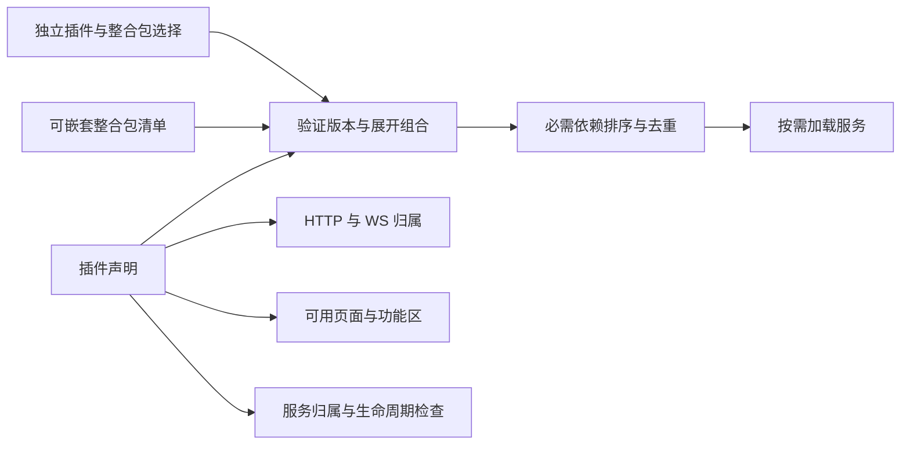

# 插件与整合包协议

本页说明包结构、声明和选择迁移。基于 2.6.0 / API 5 的职责、逐层接口签名、权限、资源归属、退出与恢复要求见 [插件设计契约与统管层接口](plugin-design-contract.md)。

独立下载的第三方计算插件使用 [签名 WebAssembly 执行协议](community-plugins.md)，与官方插件共享管理状态、实例代次与清理责任；其执行适配器不开放可信 Node.js 服务上下文。

Sakura 将可独立启用的运行服务作为插件，将功能组合声明为整合包。当前提供 69 个内置插件、13 个整合包。完整清单见 [架构与分包](plugin-architecture.md)。

## 包结构与版本

```text
plugins/
  commands/
    manifest.ts            纯数据声明，Web 和服务端共用
    server.ts              受信任的服务入口，只在启用时导入
    services.ts            提供者拥有的带类型服务引用
    client.tsx             可选的浏览器入口，按需导入
  packs/
    development.ts         组合清单，无运行代码
shared/
  plugin-protocol.ts        版本、类型与声明辅助函数，不加载校验实现
  plugin-schema.ts          严格 Schema 与 JSON Schema 的生成来源
  plugin-resolver.ts        完整目录校验、组合解析、迁移与来源解释
  plugin-selection.ts       当前目录的选择解析入口，插件中心按需加载
  plugin-catalog.generated.ts 自动生成的声明目录
  plugins.ts                声明目录的公共导出
server/
  plugin-api.ts             生命周期协议与服务访问约束
  plugin-data.ts            私有数据命名空间与版本迁移
  plugin-manager.ts         统一选择、目录、运行与必需服务入口
  plugin-directory.ts       官方/社区/系统实例状态与贡献版本
  plugin-runtime.ts         可信模块的激活、准入与退出
  service-broker.ts         可撤销的版本化公共服务调用
  system-services.ts        必需服务构造、依赖与资源归属
  plugins/loaders.generated.ts 自动生成的可信入口
  plugins/registry.ts       根据声明查找 HTTP/WS 归属
  features.ts              PluginRuntime 的组合入口导出
scripts/
  sync-plugin-catalog.ts   扫描包目录，生成声明和加载器
```

| 字段                 | 当前值  | 含义                             |
| -------------------- | ------- | -------------------------------- |
| 声明 `schemaVersion` | `1`     | 插件和整合包数据结构版本         |
| 插件 `apiVersion`    | `5`     | 宿主提供的生命周期和服务访问协议 |
| 包 `version`         | `2.6.0` | 当前随源码交付的插件/整合包版本  |
| 选择 `schemaVersion` | `3`     | `plugins.json` 的用户选择格式    |

这些版本分别校验。依赖使用完整的 `major.minor.patch` 精确版本；首版不解析范围、不下载包、不同时安装多个版本。声明里的 `version` 只表达当前内置版本，既有选择文件保存标识和用户意图，升级时依据当前发行版的目录重新解析。

API 5 要求可信插件显式声明每个操作的策略及处理器，并为服务引用绑定独立契约；API 4 源码必须完成这两项迁移，不能只修改版本号。用户选择格式与第三方签名 WASM 协议保持原版本。

## 插件声明

完整示例：[收藏命令插件](../plugins/commands/manifest.ts)。下例展示一个只读操作；辅助函数补齐固定协议版本与空集合，生成的数据必须通过 `pluginManifestSchema`，未知字段被拒绝。

```ts
import { definePlugin, pin, http, operation } from '../../shared/plugin-protocol.ts';

export const manifest = definePlugin({
  id: 'commands',
  name: '收藏命令',
  description: '参数化项目命令、执行与日志。',
  category: 'development',
  requires: [pin('projects')],
  services: ['commands'],
  contributes: {
    http: [http('/api/vms/:vmId/commands', ['GET'], true)],
    routes: [{
      id: 'list', method: 'GET', path: '/api/vms/{vmId}/commands',
      handler: 'operation', status: 200,
      policy: {
        access: 'controller', roles: ['owner'], identity: 'fixed-vm',
        projectScoped: true, projectBinding: 'query',
        maintenance: 'allow', transport: 'json', mutating: false,
        session: 'required', vmLock: 'allow-locked',
        approval: 'none', extensionAuth: 'none',
      },
    }],
    operations: [
      operation('list', 'GET', '/api/vms/:vmId/commands'),
    ],
    tabs: ['development'],
    developmentSections: ['commands'],
  },
});
```

| 字段                              | 约束与行为                                               |
| --------------------------------- | -------------------------------------------------------- |
| `kind`                            | 固定为 `plugin`，与整合包区分                            |
| `id`                              | 小写字母开头，最多 64 位，只允许小写字母、数字和连字符   |
| `name` / `description`            | 用户能理解的名称和职责                                   |
| `category` / `experimental`       | 插件中心分类与实验状态                                   |
| `requires`                        | 直接必需依赖及精确版本；自动补齐，依赖失败则跳过消费者   |
| `optional`                        | 直接可选配套及精确版本；不自动启用，不改变必需依赖顺序   |
| `services`                        | 本插件唯一拥有的服务槽位，也是初始化完整性和退出清理清单 |
| `systemDependencies`              | 显式允许访问的必需宿主服务，启动完成时核对完整性         |
| `lifecycle.activateMs/closeMs`    | 激活与单步清理的最长等待时间                             |
| `contributes.http`                | 所属 API 命名空间、允许方法、是否使用项目作用域          |
| `contributes.operations`          | 逐操作声明 ID、方法、精确路径及成功状态                  |
| `contributes.routes`              | 每个可发布操作的精确路由、完整准入策略与处理器种类       |
| `contributes.sockets`             | 已支持的桌面或命名终端 WebSocket 入口                    |
| `contributes.pages` / `tabs`      | 已支持的页面/实例标签入口                                |
| `contributes.developmentSections` | 开发页中独立挂载的功能区                                 |
| `contributes.managed`             | Jobs、重试、调度、事件与拦截器等受管注册种类             |

HTTP 声明拥有完整命名空间及其子路径，例如快照插件的 `/api/vms/:vmId/snapshots` 包括快照恢复子路径。命名空间用于归属，实际发布还必须逐操作匹配精确路径和方法。声明式 `operations` 使用同包 `server.ts` 的 Zod `request`/`response` Schema，宿主输出声明成功状态；legacy route 必须逐项绑定 `httpHandlers`，并接受共同的请求和公开响应契约检查。不允许两个插件共享同一命名空间，也不能覆盖核心入口。

所有可发布 HTTP 方法还必须逐项提供精确 `contributes.routes`，包括完整 `policy` 和处理器种类；仅声明 HTTP 前缀不足以发布操作。策略显式包含访问来源、角色、身份、项目绑定、维护与会话行为、VM 锁、副作用和传输类型。路径更名只能影响路由匹配，不能改变这些准入字段；缺失字段或声明与实现不一致由门禁拒绝。当前 383 个 HTTP 操作均声明请求传输与公开响应契约，另 6 个 WebSocket 操作声明双向类型、参数、身份、错误和关闭语义，并接入同一生成/漂移门禁，详见 [WebSocket 契约](websocket-contracts.md)；动态扩展 JSON 与内部 unknown 参数不因此变成固定领域类型。

`projectScoped: true` 由宿主调用项目上下文包装器，避免每个处理器自行选择项目。它必须用于 VM 命名空间，并声明 `projects` 为必需或可选依赖；如果只是可选配套，未启用项目插件时仍按实例操作。文件历史、网络和私密配置使用这种可选集成。

WebSocket 入口仍是宿主支持的固定通道。页面、标签和开发功能区使用受校验的标识：内置旧入口保持兼容，新入口从同包 `client.tsx` 的导出按需加载；目录检查会拒绝缺少浏览器入口的自定义声明。界面隐藏只是呈现逻辑，HTTP 与 WebSocket 均有服务端启用检查。

## 服务访问与生命周期

内置插件通过同包 `services.ts` 导出绑定独立 V1 接口与契约 ID 的 `ServiceRef`，使用 `host.provide(services.commands, value)` 和 `host.use(services.commands)` 注册与访问服务。`host.optional(ref)` 返回可选服务。宿主检查提供者、声明归属、直接依赖、接口版本与两端原代实例。公共接口由 `server/service-contracts/v1.ts` 维护，运行时描述符从契约生成，不从实现类推导。字符串注册/读取 API 已删除，声明的上下文字段也返回同一 Broker 的公共句柄。详见 [架构与依赖边界](architecture.md)。

`server.ts` 导出同包 `manifest`、`activate(context)` 和当前模块类型要求的 `route`，按声明导出 `operations` 或以操作 ID 为键的 `httpHandlers`，可选导出 `deactivate(context)`。纯声明式操作插件的 `route` 可以返回 false；legacy `route(...)` 作为适配器时必须由 `httpHandlers` 逐项绑定，仅导出通用路由函数不能发布操作。完整签名在 [plugin-api.ts](../server/plugin-api.ts)。新服务声明类型化引用，再通过 `provide(ref, value)` 注册，通过 `use(ref)` 或 `optional(ref)` 读取直接依赖提供的公共接口；消费者不能关闭提供者、取得实现对象或修改服务字段。

1. 初始化前校验完整目录：数据结构、未知依赖、必需/可选版本、重复服务、路由/WS 冲突、核心入口、项目作用域和循环。
2. 按必需依赖顺序导入入口，验证入口声明与目录一致，然后提供 `PluginContext`。
3. 插件只能注册声明的自有服务；重复注册、读取未声明依赖的服务以及遗漏承诺的服务都会使激活失败。`activateMs` 到期会取消激活，已登记的资源按逆序清理，其他插件继续启动。
4. 激活成功后原子发布操作、HTTP、WS 和界面贡献。Jobs、Scheduler、VM 事件及领域拦截器登记实例归属、声明种类与注销回执；业务构造也在原实例权限上下文内执行。插件可用 `onDispose` 登记自己的清理，并用 `registerJobs` 登记重试处理器。
5. 停止准入，撤销后台触发、旧句柄、排队工作和所属连接，再按必需依赖关闭并等待真实清理。`deactivate`、资源清理和服务关闭受 `closeMs` 限制；超时保留 `cleanup-pending` 与原代预算，使用原资源回执恢复后才能注销或重新激活。状态接口统一暴露期望状态、实际阶段、代次、产物摘要和耗时。

必需依赖要声明**实际直接使用的提供者**。例如流水线直接使用项目、文件和传输服务，三个都需要声明，不能借助“文件已经依赖传输”来隐式读取服务。

可选服务应延迟读取并处理不存在的情况。`transfers` 在回调中获取 `files` 和 `snapshots` 的提供者，既不会提前构建它们，也不会把可选配套变成激活依赖。可选关系不提供卸载顺序保证；清理方法只清理自身资源，不能假定可选服务还在运行。

上下文是独立冻结的能力对象。VM 操作使用 `host.vm`；常驻终端使用 `capabilities.sessions`；执行、网络、存储、元数据和 Jobs 固定实例身份，调用时与出队后均复核权限。可选依赖发现不阻挡卸载，在途借用另行观察。可信模块仍与宿主共享 Node.js 进程，第三方代码继续使用签名 WASM 适配器。

## 数据与错误协议

插件通过 `context.capabilities.metadata.reference('name', fallback)` 取得不透明回执，使用 `read()` 和 `replace()` 读写；回执不包含宿主路径。宿主领域构造器可以解析该回执以沿用原持久化实现。元数据排队与原子发布前复核原代权限；业务撤权后，清理只使用保留的原回执。已有数据格式与目录不变，版本化数据继续支持逐版迁移、未来版本拒绝和 `.v0.bak`。

操作请求的 Schema 错误返回 HTTP 400 与 `INVALID_INPUT`；插件声明式响应校验可返回 HTTP 502 与 `INVALID_PLUGIN_RESPONSE`，共同响应边界使用 `INVALID_OPERATION_RESPONSE`。宿主返回机器可读的 `code`、面向用户的 `error` 和 `correlationId`，必要时附带操作结果与审计副诊断。legacy 适配器仍须接受共同边界校验。响应、发送或审计失败不证明业务未执行；先查询原操作结果，再按领域协议决定是否重试。

## 整合包与选择迁移

```ts
import { definePack, member } from '../../shared/plugin-protocol.ts';

export const pack = definePack({
  id: 'developer',
  name: '开发工作台',
  description: '项目、开发工具、环境互通与 Git。',
  members: [member('projects'), member('git'), member('development', 'pack'), member('environment', 'pack')],
});
```

成员始终显式区分 `plugin` 和 `pack`，分别锁定版本。可以嵌套整合包；插件依赖循环和整合包循环分别校验，结果去重。停用一个包不会删除其他根选择仍引用的插件。`reasons` 解释每个插件由哪些用户根选择引入。

原 `development`、`environment`、`monitoring` 插件拆为同名整合包。组合声明的 `replacesPlugins` 明确列出兼容的旧插件标识；选择迁移不会自动启用不属于原选择的整合包，也不会改动插件业务数据。启动时在内存转换版本 1 或 2 选择，首次修改选择时才写入版本 3；旧版独立启用 `automation` 的选择同时补入 `automation-scheduler`，保留计划任务行为。CLI/API 的旧插件标识也映射到相应整合包。



## 检查与 Schema

```powershell
npm run plugins:sync
npm run plugins:contracts
npm run plugins:check
npm run plugins:schema
npm test
npm run build
npm run test:e2e
```

`plugins:contracts` 仅从独立版本化接口生成 Broker 描述符；`plugins:check` 核对契约独立性、描述符、完整插件声明、所有可信入口、JSON Schema 和类型客户端，不激活服务。`plugins:schema` 从同一严格 Schema 生成文档和客户端类型，供编辑器和后续工具使用：

- [插件 JSON Schema](schemas/plugin.schema.json)
- [整合包 JSON Schema](schemas/pack.schema.json)
- [选择 JSON Schema](schemas/selection.schema.json)
- [操作 JSON Schema](schemas/operations.json)

新增插件步骤：创建 `plugins/<id>/manifest.ts` 和 `server.ts`，需要新页面或标签时在同包添加 `client.tsx`；运行 `npm run plugins:sync` 生成目录与可信加载器；声明自身服务和逐操作 Schema；更新需要包含它的整合包；增加独立启用及依赖边界测试，运行上述检查。服务不得在模块顶层启动任务或修改配置。
