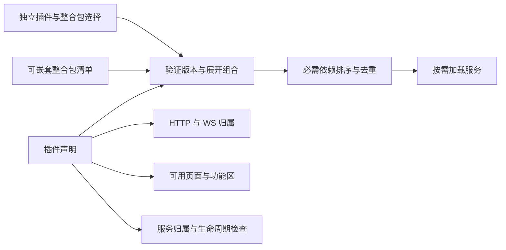

# 插件与整合包协议

独立下载的第三方计算插件使用单独的 [签名 WebAssembly 插件协议](community-plugins.md)，不共享此文中的可信 Node.js 服务上下文。

Sakura 将可独立启用的运行服务作为插件，将功能组合声明为整合包。当前提供 32 个内置插件、9 个整合包。完整清单见 [架构与分包](plugin-architecture.md)。

## 包结构与版本

```text
plugins/
  commands/
    manifest.ts            纯数据声明，Web 和服务端共用
    server.ts              受信任的服务入口，只在启用时导入
    client.tsx             可选的浏览器入口，按需导入
  packs/
    development.ts         组合清单，无运行代码
shared/
  plugin-protocol.ts        版本、类型与声明辅助函数，不加载校验实现
  plugin-schema.ts          严格 Schema 与 JSON Schema 的生成来源
  plugin-resolver.ts        完整目录校验、组合解析、迁移与来源解释
  plugin-selection.ts       当前目录的选择解析入口，插件中心按需加载
  plugin-catalog.generated.ts 自动生成的声明目录
  plugins.ts                声明目录的公共导出
server/
  plugin-api.ts             生命周期协议与服务访问约束
  plugin-data.ts            私有数据命名空间与版本迁移
  plugin-manager.ts         用户选择与 active/planned 状态
  plugins/loaders.generated.ts 自动生成的可信入口
  plugins/registry.ts       根据声明查找 HTTP/WS 归属
  features.ts              激活、请求作用域、退出清理
scripts/
  sync-plugin-catalog.ts   扫描包目录，生成声明和加载器
```

| 字段                 | 当前值  | 含义                             |
| -------------------- | ------- | -------------------------------- |
| 声明 `schemaVersion` | `1`     | 插件和整合包数据结构版本         |
| 插件 `apiVersion`    | `3`     | 宿主提供的生命周期和服务访问协议 |
| 包 `version`         | `0.3.0` | 当前随源码交付的插件/整合包版本  |
| 选择 `schemaVersion` | `3`     | `plugins.json` 的用户选择格式    |

这些版本分别校验。依赖使用完整的 `major.minor.patch` 精确版本；首版不解析范围、不下载包、不同时安装多个版本。声明里的 `version` 只表达当前内置版本，既有选择文件保存标识和用户意图，升级时依据当前发行版的目录重新解析。

## 插件声明

实际示例：[收藏命令插件](../plugins/commands/manifest.ts)。辅助函数补齐固定协议版本与空集合，生成的数据必须通过 `pluginManifestSchema`；未知字段被拒绝。

```ts
import { definePlugin, pin, http, operation } from '../../shared/plugin-protocol.ts';

export const manifest = definePlugin({
  id: 'commands',
  name: '收藏命令',
  description: '参数化项目命令、执行与日志。',
  category: 'development',
  requires: [pin('projects')],
  services: ['commands'],
  contributes: {
    http: [http('/api/vms/:vmId/commands', ['GET', 'PUT', 'DELETE', 'POST'], true)],
    operations: [
      operation('list', 'GET', '/api/vms/:vmId/commands'),
      operation('save', 'PUT', '/api/vms/:vmId/commands'),
      operation('remove', 'DELETE', '/api/vms/:vmId/commands'),
      operation('run', 'POST', '/api/vms/:vmId/commands', 202),
    ],
    tabs: ['development'],
    developmentSections: ['commands'],
  },
});
```

| 字段                              | 约束与行为                                               |
| --------------------------------- | -------------------------------------------------------- |
| `kind`                            | 固定为 `plugin`，与整合包区分                            |
| `id`                              | 小写字母开头，最多 64 位，只允许小写字母、数字和连字符   |
| `name` / `description`            | 用户能理解的名称和职责                                   |
| `category` / `experimental`       | 插件中心分类与实验状态                                   |
| `requires`                        | 直接必需依赖及精确版本；自动补齐，依赖失败则跳过消费者   |
| `optional`                        | 直接可选配套及精确版本；不自动启用，不改变必需依赖顺序   |
| `services`                        | 本插件唯一拥有的服务槽位，也是初始化完整性和退出清理清单 |
| `lifecycle.activateMs/closeMs`   | 激活与单步清理的最长等待时间                             |
| `contributes.http`                | 所属 API 命名空间、允许方法、是否使用项目作用域          |
| `contributes.operations`          | 逐操作声明 ID、方法、精确路径及成功状态                  |
| `contributes.sockets`             | 已支持的桌面或命名终端 WebSocket 入口                    |
| `contributes.pages` / `tabs`      | 已支持的页面/实例标签入口                                |
| `contributes.developmentSections` | 开发页中独立挂载的功能区                                 |

HTTP 声明拥有完整命名空间及其子路径，例如快照插件的 `/api/vms/:vmId/snapshots` 包括快照恢复子路径。宿主先检查插件是否激活和 HTTP 方法。声明了 `operations` 的请求还会按精确路径和方法匹配，使用同包 `server.ts` 的 Zod `request`/`response` Schema 验证载荷与返回值，并由宿主输出声明的成功状态。暂未迁移的路由仍由插件 `route` 验证具体子路径、载荷和状态。不允许两个插件共享同一命名空间，也不能覆盖核心入口。

`projectScoped: true` 由宿主调用项目上下文包装器，避免每个处理器自行选择项目。它必须用于 VM 命名空间，并声明 `projects` 为必需或可选依赖；如果只是可选配套，未启用项目插件时仍按实例操作。文件历史、网络和私密配置使用这种可选集成。

WebSocket 入口仍是宿主支持的固定通道。页面、标签和开发功能区使用受校验的标识：内置旧入口保持兼容，新入口从同包 `client.tsx` 的导出按需加载；目录检查会拒绝缺少浏览器入口的自定义声明。界面隐藏只是呈现逻辑，HTTP 与 WebSocket 均有服务端启用检查。

## 服务访问与生命周期

`server.ts` 导出同包 `manifest`、`activate(context)`、`route(...)`，可选导出 `operations` 和 `deactivate(context)`。完整签名在 [plugin-api.ts](../server/plugin-api.ts)，不从某个业务插件的函数反推接口。新服务通过 `context.provide('name', value)` 注册，通过 `use(provider, 'name')` 或 `optional(provider, 'name')` 读取直接依赖提供的服务；无需给宿主增加新的服务字段。

1. 初始化前校验完整目录：数据结构、未知依赖、必需/可选版本、重复服务、路由/WS 冲突、核心入口、项目作用域和循环。
2. 按必需依赖顺序导入入口，验证入口声明与目录一致，然后提供 `PluginContext`。
3. 插件只能注册声明的自有服务；重复注册、读取未声明依赖的服务以及遗漏承诺的服务都会使激活失败。`activateMs` 到期会取消激活，已登记的资源按逆序清理，其他插件继续启动。
4. `route` 或操作处理器接收同一上下文和取消信号。插件可用 `onDispose` 登记定时器、监听器等非服务资源，并用 `registerJobs` 注册自有任务存储的重试处理器。
5. 停止接收新请求，取消并最多等待 10 秒在途请求，然后逆依赖顺序退出插件。`deactivate`、资源清理和服务关闭分别受 `closeMs` 限制；最后关闭实例与运行时。状态接口暴露每个插件的激活阶段与耗时。

必需依赖要声明**实际直接使用的提供者**。例如流水线直接使用项目、文件和传输服务，三个都需要声明，不能借助“文件已经依赖传输”来隐式读取服务。

可选服务应延迟读取并处理不存在的情况。`transfers` 在回调中获取 `files` 和 `snapshots` 的提供者，既不会提前构建它们，也不会把可选配套变成激活依赖。可选关系不提供卸载顺序保证；清理方法只清理自身资源，不能假定可选服务还在运行。

当前服务上下文检查是受信任模块的协议约束。插件仍与宿主共享 Node.js 进程和实例原语，不构成第三方代码沙箱，也不代表已有权限授权系统。

## 数据与错误协议

插件通过 `context.dataFile('name')` 获取数据目录中 `plugins/<plugin-id>/name.json` 的私有路径。新数据可用 `readVersionedStore`、`writeVersionedStore` 包装为 `{ "schemaVersion": 1, "data": ... }`；读取较旧版本时必须提供逐版迁移，未来版本会明确拒绝。首次覆盖旧格式前保留 `.v0.bak`，写入沿用原子替换。现有 `commands` 数据在首次写入时从未包装的数组迁移。

操作请求的 Schema 错误返回 HTTP 400 与 `INVALID_INPUT`；响应不符合声明返回 HTTP 502 与 `INVALID_PLUGIN_RESPONSE`。宿主统一返回机器可读的 `code` 和面向用户的 `error`。旧路由仍可在迁移期间保留，由插件自己的校验逻辑处理。

## 整合包与选择迁移

```ts
import { definePack, member } from '../../shared/plugin-protocol.ts';

export const pack = definePack({
  id: 'developer',
  name: '开发工作台',
  description: '项目、开发工具、环境互通与 Git。',
  members: [member('projects'), member('git'), member('development', 'pack'), member('environment', 'pack')],
});
```

成员始终显式区分 `plugin` 和 `pack`，分别锁定版本。可以嵌套整合包；插件依赖循环和整合包循环分别校验，结果去重。停用一个包不会删除其他根选择仍引用的插件。`reasons` 解释每个插件由哪些用户根选择引入。

原 `development`、`environment`、`monitoring` 插件拆为同名整合包。组合声明的 `replacesPlugins` 明确列出兼容的旧插件标识；选择迁移不会自动启用不属于原选择的整合包，也不会改动插件业务数据。启动时在内存转换版本 1 或 2 选择，首次修改选择时才写入版本 3；旧版独立启用 `automation` 的选择同时补入 `automation-scheduler`，保留计划任务行为。CLI/API 的旧插件标识也映射到相应整合包。



## 检查与 Schema

```powershell
npm run plugins:sync
npm run plugins:check
npm run plugins:schema
npm test
npm run build
npm run test:e2e
```

`plugins:check` 校验完整目录及所有可信入口，不激活服务，并检查 JSON Schema 是否与源码同步。`plugins:schema` 从同一严格 Schema 生成文档文件，供编辑器和后续工具使用：

- [插件 JSON Schema](schemas/plugin.schema.json)
- [整合包 JSON Schema](schemas/pack.schema.json)
- [选择 JSON Schema](schemas/selection.schema.json)
- [操作 JSON Schema](schemas/operations.json)

新增插件步骤：创建 `plugins/<id>/manifest.ts` 和 `server.ts`，需要新页面或标签时在同包添加 `client.tsx`；运行 `npm run plugins:sync` 生成目录与可信加载器；声明自身服务和逐操作 Schema；更新需要包含它的整合包；增加独立启用及依赖边界测试，运行上述检查。服务不得在模块顶层启动任务或修改配置。
